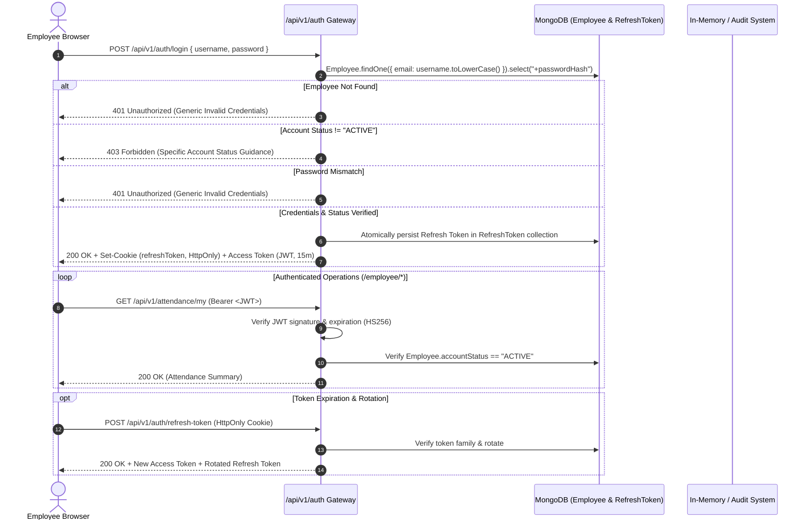
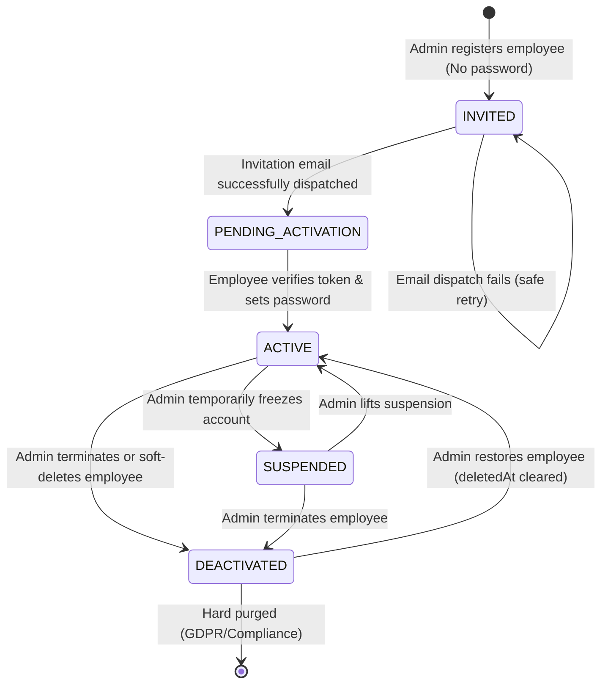

# Unified Authentication & Session Architecture Specification
**Ashivam Technologies Official Platform — Production HRMS & Attendance System**
**Date:** 2026-11-19  
**Security Classification:** Highly Confidential / Internal  

---

## 1. Architectural Philosophy: The Single Source of Truth

A foundational architectural requirement of the Ashivam Technologies HRMS is that **an employee's profile and authentication identity reside in a single canonical MongoDB model (`Employee`)**.

### Why Separate Account Models Were Explicitly Rejected
Earlier proposals considered introducing a separate `User` or `Account` collection referencing `employeeId`. Through comprehensive engineering analysis, this was deemed anti-pattern for this architecture:
1. **Distributed State Synchronization:** Maintaining status flags across two collections (`Employee.isActive` vs `Account.status`) introduces partial-write inconsistencies during network partitions or database timeouts.
2. **Duplicate Identity Indexes:** Multiple collections attempting to enforce uniqueness on `email` or `googleEmail` create synchronization hazards where an email updated in HR records fails to reflect in auth accounts.
3. **Foreign Key Overhead & Transaction Lock Contention:** Requiring multi-document MongoDB transactions for routine operations (e.g. employee creation, status suspension, deactivation) increases latency and lock contention under high concurrency.
4. **Architectural Cohesion:** Unifying corporate credentials and profile attributes into `Employee` ensures that when an employee is suspended or terminated, their authentication access and attendance eligibility are terminated atomically in a single atomic update.

---

## 2. Authentication Flow & Dual-Token Architecture

---

## 3. Account Status State Machine

The authentication state machine is governed by two complementary enums:
1. `accountStatus`: Dictates authentication permissions.
2. `employmentStatus`: Dictates employment eligibility and payroll/attendance standing.

### State Matrix & Access Permissions

| `accountStatus` | `employmentStatus` | Can Log In? | Attendance Eligible? | Refresh Token Valid? | UI Display Badge |
| :--- | :--- | :---: | :---: | :---: | :--- |
| `INVITED` | `ACTIVE` | ❌ No (403) | ❌ No | ❌ None | Yellow (`Invited`) |
| `PENDING_ACTIVATION` | `ACTIVE` | ❌ No (403) | ❌ No | ❌ None | Blue (`Pending Activation`) |
| `ACTIVE` | `ACTIVE` |  Yes (200) |  Yes |  Valid | Green (`Active`) |
| `SUSPENDED` | Any | ❌ No (403) | ❌ No | ❌ Revoked | Orange (`Suspended`) |
| `DEACTIVATED` | Any | ❌ No (403) | ❌ No | ❌ Revoked | Red (`Deactivated`) |

---

## 4. Cryptographic Security Standards

1. **Password Hashing:**
   - Algorithm: `bcryptjs`
   - Work Factor (Cost): 12 salt rounds
   - Projection: `{ select: false }` on Mongoose schema to prevent accidental serialization in API responses or logs.
2. **Activation & Password Reset Tokens:**
   - Entropy: 256 bits (`crypto.randomBytes(32).toString('hex')`)
   - Persistence: Cryptographic SHA-256 hash stored in `activationTokenHash` and `resetPasswordTokenHash`.
   - Expiration:
     - Activation tokens: Strictly 24 hours.
     - Password reset tokens: Strictly 1 hour.
   - Replay Prevention: Token hashes are set to `null` on first successful redemption.
3. **JWT Access Tokens:**
   - Algorithm: Strictly `HS256`.
   - Expiration: 15 minutes.
   - Claims: `id`, `name`, `email`, `role`, `permissions`, `employeeId`, `googleEmail`, `department`, `designation`.
4. **Session Invalidation on Password Change / Status Deactivation:**
   - When an employee changes passwords or is deactivated, all outstanding `RefreshToken` records for their `userId` are marked `isRevoked: true`.
   - Any access tokens issued prior to `passwordChangedAt` are rejected with `401 Unauthorized`.
