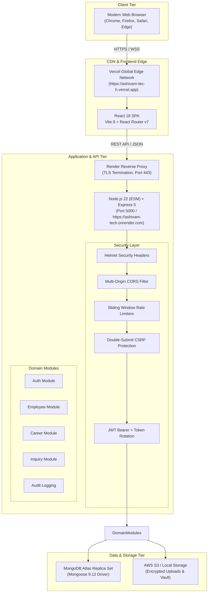

# CURRENT ARCHITECTURE — ASHIVAM TECHNOLOGIES
## Corporate Platform & Distributed Services Architecture

**Document ID:** ASHIVAM-ARCH-CURRENT-001  
**Project:** Ashivam Technologies Corporate Portal & Infrastructure  
**Version:** 1.0 (Production Architecture Baseline)  
**Date:** November 19, 2026  
**Auditor:** Principal Software Architect  

---

## 1. System Topology & Tiering

---

## 2. Component Layer Specifications

### 2.1 Client Presentation Layer
- **Framework:** React 18.3.1 with Vite 8.3.4 bundling.
- **Routing:** React Router DOM v7.18.4 with dynamic route-level code splitting (`React.lazy`).
- **Styling System:** Modular CSS using standardized design tokens (`--clr-primary`, `--clr-gold`, `--clr-navy`, `--clr-surface`).
- **State Management:** React Context API (`AuthContext`) managing user session state, in-memory tokens, and cross-tab synchronization via `BroadcastChannel('ashivam_auth_sync')`.
- **API Communication:** Centralized `api.js` abstraction injecting `X-Request-Id`, `X-CSRF-Token`, and `Authorization: Bearer <token>`.

### 2.2 Security & Gateway Layer
- **Reverse Proxy:** Render PaaS with `trust proxy: 1` enabled, correctly parsing `X-Forwarded-For` without IP spoofing vulnerabilities.
- **HTTP Hardening:** Helmet configured with `HSTS` (31536000s), `X-Content-Type-Options: nosniff`, `frameguard: deny`, and strict `Permissions-Policy`.
- **CORS Defense:** Dynamic origin validator enforcing an allowlist of production domains (`ashivam.com`, `ashivam-tec-h.vercel.app`) with credential support.
- **CSRF Defense:** Cryptographic CSRF tokens paired with custom header inspection (`X-CSRF-Token`) on state-changing requests (`POST`, `PUT`, `PATCH`, `DELETE`).
- **Rate Limiting:** Granular memory-backed limiters for sensitive endpoints (login: 5 req/15min, public forms: 10 req/15min, global: 100 req/15min).

### 2.3 Authentication & Session Management
- **Access Tokens:** Signed with HMAC-SHA256 (`HS256`), 15-minute expiration, containing `sub`, `username`, and `role`.
- **Refresh Tokens:** High-entropy cryptographically random tokens stored as HMAC-SHA256 hashes in MongoDB, delivered via `HttpOnly`, `SameSite=None`, `Secure` cookies with single-use rotation and replay detection.
- **Session Hints:** Non-sensitive flags (`ashivam_auth_hint`) in `localStorage` to eliminate redundant refresh network calls on public pages.

### 2.4 Data Persistence & Concurrency
- **Database:** MongoDB 7+ via Mongoose 9.12.1.
- **Concurrency Control:** Distributed mutex locking via `systemLock.model.js` utilizing MongoDB atomic `findOneAndUpdate` with TTL expiry.
- **Transactional Outbox:** `outbox.model.js` decouples email dispatches and asynchronous tasks from transactional HTTP operations.

---

## 3. Integration Extension Points for Google Meet

The current architecture provides direct, clean extension points:
1. **Routing:** Express mounting under `/api/v1` permits clean addition of `/api/v1/meetings`, `/api/v1/attendance`, and `/api/v1/google`.
2. **Identity:** Extending `Employee` model allows unified authentication through `/api/v1/auth/login` without altering admin tables or creating duplicate user records.
3. **Event Ingestion:** Express webhook parser and rate limiting easily accommodate Google Cloud Pub/Sub push messages.
4. **Scheduled Tasks:** Integration with node-cron or background intervals within the Express process to run periodic reconciliation jobs against Google Meet REST API v2.
