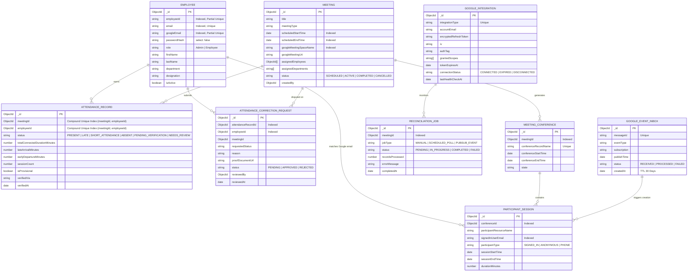

# DATABASE SCHEMA REPORT
## Ashivam Technologies — Google Meet Attendance Management System

**Document Version:** 1.0.0-PROD  
**Database Engine:** MongoDB Atlas (Mongoose ODM)  
**Modules Covered:** Employee Identity Extension & Attendance Domain Models  
**Indexes Audited:** Primary, Compound, Partial Unique, and TTL Indexes  

---

## 1. Schema Architecture Overview

The database design adheres to three core architectural principles:
1. **Zero Collection Duplication:** Rather than creating a disjointed "AttendanceUser" or "EmployeeAccount" collection, the canonical `Employee` collection was extended with non-breaking optional fields (`employeeId`, `googleEmail`, `passwordHash`, `role`), preserving all existing HRMS and recruitment relations.
2. **Normalized High-Frequency Ingestion:** Google Meet participant sessions and raw Pub/Sub events are stored in dedicated event collections (`ParticipantSession`, `GoogleEventInbox`) separate from aggregated attendance evaluations (`AttendanceRecord`), enabling rapid ingestion without document bloat.
3. **Compound & Partial Indexing for Concurrency:** Strict partial unique indexes prevent race conditions during concurrent Pub/Sub event ingestion and guarantee that an employee has exactly one consolidated `AttendanceRecord` per meeting.

---

## 2. Entity-Relationship Diagram (ERD)

---

## 3. Detailed Schema Definitions & Constraints

### 3.1. `Employee` (Extended Core Collection)
- **Path:** `backend/src/modules/employee/employee.model.js`
- **Extensions:**
  - `employeeId` (`String`, `trim: true`, `uppercase: true`): Unique company ID (e.g., `ASH-EMP-1042`).
  - `googleEmail` (`String`, `trim: true`, `lowercase: true`): Verified Google Workspace or personal Gmail used for Google Meet authentication.
  - `passwordHash` (`String`, `select: false`): Bcrypt salted hash (cost 10) for employee portal login. Kept excluded from queries by default to avoid accidental exposure.
  - `role` (`String`, enum: `["Admin", "Superadmin", "Employee"]`, default: `"Employee"`): Enforces identity RBAC.
  - `lastLoginAt` (`Date`): Timestamp of last successful session.
  - `passwordChangedAt` (`Date`): Invalidation marker for JWT revocation.
- **Indexes:**
  - `{ employeeId: 1 }` with `{ unique: true, partialFilterExpression: { employeeId: { $type: "string" } } }`
  - `{ googleEmail: 1 }` with `{ unique: true, partialFilterExpression: { googleEmail: { $type: "string" } } }`
  - `{ email: 1 }` (existing active unique index with soft-delete filter)

### 3.2. `Meeting`
- **Path:** `backend/src/modules/attendance/models/meeting.model.js`
- **Fields:**
  - `title` (`String`, required, max: 200)
  - `meetingType` (`String`, enum: `["Daily Standup", "Department Meeting", "All Hands", "One-on-One", "Training", "Client Meeting", "Ad-hoc"]`, default: `"Daily Standup"`)
  - `scheduledStartTime` (`Date`, required, indexed)
  - `scheduledEndTime` (`Date`, required, indexed)
  - `googleMeetingSpaceName` (`String`, trim: true, indexed): Google Meet space identifier (format: `spaces/{spaceId}`).
  - `googleMeetingUri` (`String`, trim: true): Complete Meet link (e.g., `https://meet.google.com/abc-defg-hij`).
  - `meetingCode` (`String`, trim: true): Formatted code (e.g., `abc-defg-hij`).
  - `assignedEmployees` (`[ObjectId]`, ref: `"Employee"`): Specific assignees.
  - `assignedDepartments` (`[String]`): Target departments for group scheduling.
  - `isRecurring` (`Boolean`, default: `false`)
  - `recurrenceRule` (`String`): RRULE string (e.g., `FREQ=DAILY;BYDAY=MO,TU,WE,TH,FR`).
  - `status` (`String`, enum: `["SCHEDULED", "ACTIVE", "COMPLETED", "CANCELLED"]`, default: `"SCHEDULED"`, indexed)
  - `createdBy` (`ObjectId`, ref: `"Admin"`)
- **Indexes:**
  - `{ scheduledStartTime: 1, status: 1 }` (optimizes daily dashboard filtering)
  - `{ googleMeetingSpaceName: 1 }` (optimizes Pub/Sub conference mapping)

### 3.3. `MeetingConference`
- **Path:** `backend/src/modules/attendance/models/meetingConference.model.js`
- **Fields:**
  - `meetingId` (`ObjectId`, ref: `"Meeting"`, required, indexed)
  - `conferenceRecordName` (`String`, required, unique): Google Meet conference resource identifier (format: `conferenceRecords/{conferenceRecordId}`).
  - `spaceName` (`String`, required)
  - `conferenceStartTime` (`Date`)
  - `conferenceEndTime` (`Date`)
  - `state` (`String`, enum: `["ACTIVE", "COMPLETED"]`, default: `"ACTIVE"`)
- **Indexes:**
  - `{ conferenceRecordName: 1 }` (`unique: true`)
  - `{ meetingId: 1 }`

### 3.4. `ParticipantSession`
- **Path:** `backend/src/modules/attendance/models/participantSession.model.js`
- **Fields:**
  - `conferenceId` (`ObjectId`, ref: `"MeetingConference"`, required, indexed)
  - `participantResourceName` (`String`, required): Google Meet participant resource path.
  - `sessionResourceName` (`String`): Google Meet participant session resource path.
  - `signedInUserEmail` (`String`, lowercase: true, indexed): Extracted from Google participant's `signedinUser` profile.
  - `participantDisplayName` (`String`): Google display name.
  - `participantType` (`String`, enum: `["SIGNED_IN", "ANONYMOUS", "PHONE"]`, default: `"SIGNED_IN"`)
  - `sessionStartTime` (`Date`, required)
  - `sessionEndTime` (`Date`)
  - `durationMinutes` (`Number`, default: 0)
- **Indexes:**
  - `{ conferenceId: 1, signedInUserEmail: 1 }`
  - `{ sessionResourceName: 1 }` (`sparse: true`)

### 3.5. `AttendanceRecord`
- **Path:** `backend/src/modules/attendance/models/attendanceRecord.model.js`
- **Fields:**
  - `meetingId` (`ObjectId`, ref: `"Meeting"`, required)
  - `employeeId` (`ObjectId`, ref: `"Employee"`, required)
  - `status` (`String`, enum: `["PRESENT", "LATE", "SHORT_ATTENDANCE", "ABSENT", "PENDING_VERIFICATION", "NEEDS_REVIEW"]`, default: `"PENDING_VERIFICATION"`, indexed)
  - `totalConnectedDurationMinutes` (`Number`, default: 0)
  - `lateArrivalMinutes` (`Number`, default: 0)
  - `earlyDepartureMinutes` (`Number`, default: 0)
  - `firstJoinTime` (`Date`)
  - `lastLeaveTime` (`Date`)
  - `sessionCount` (`Number`, default: 0)
  - `isProvisional` (`Boolean`, default: true)
  - `verifiedVia` (`String`, enum: `["MEET_REST_API", "PUBSUB_EVENT", "MANUAL_CORRECTION"]`, default: `"MEET_REST_API"`)
  - `manualCorrection` (`Object`): Holds `modifiedBy`, `reason`, `modifiedAt`, `previousStatus`.
  - `verifiedAt` (`Date`)
- **Compound Unique Index:**
  - `{ meetingId: 1, employeeId: 1 }` (`unique: true`): Guarantees absolute uniqueness of attendance calculation per employee per meeting.

### 3.6. `AttendanceCorrectionRequest`
- **Path:** `backend/src/modules/attendance/models/attendanceCorrectionRequest.model.js`
- **Fields:**
  - `attendanceRecordId` (`ObjectId`, ref: `"AttendanceRecord"`, required, indexed)
  - `employeeId` (`ObjectId`, ref: `"Employee"`, required, indexed)
  - `meetingId` (`ObjectId`, ref: `"Meeting"`, required)
  - `requestedStatus` (`String`, enum: `["PRESENT", "LATE", "EXCUSED"]`, required)
  - `reason` (`String`, required, max: 1000)
  - `proofDocumentUrl` (`String`, trim: true)
  - `status` (`String`, enum: `["PENDING", "APPROVED", "REJECTED"]`, default: `"PENDING"`, indexed)
  - `reviewedBy` (`ObjectId`, ref: `"Admin"`)
  - `reviewNotes` (`String`)
  - `reviewedAt` (`Date`)

### 3.7. `GoogleIntegration`
- **Path:** `backend/src/modules/attendance/models/googleIntegration.model.js`
- **Fields:**
  - `integrationType` (`String`, enum: `["GOOGLE_WORKSPACE_MEET"]`, default: `"GOOGLE_WORKSPACE_MEET"`, unique: true)
  - `accountEmail` (`String`)
  - `encryptedRefreshToken` (`String`, required): AES-256-GCM ciphertext.
  - `iv` (`String`, required): 12-byte initialization vector (hex).
  - `authTag` (`String`, required): 16-byte authentication tag (hex).
  - `grantedScopes` (`[String]`): Scopes approved by Google consent screen.
  - `tokenExpiresAt` (`Date`)
  - `connectionStatus` (`String`, enum: `["CONNECTED", "EXPIRED", "DISCONNECTED"]`, default: `"DISCONNECTED"`)
  - `lastHealthCheckAt` (`Date`)

### 3.8. `GoogleEventInbox`
- **Path:** `backend/src/modules/attendance/models/googleEventInbox.model.js`
- **Fields:**
  - `messageId` (`String`, required, unique): Google Cloud Pub/Sub `message.messageId`.
  - `eventType` (`String`, required): CloudEvents `type` header.
  - `subscription` (`String`): Pub/Sub subscription path.
  - `publishTime` (`Date`, required)
  - `status` (`String`, enum: `["RECEIVED", "PROCESSED", "FAILED"]`, default: `"RECEIVED"`)
  - `errorMessage` (`String`)
  - `createdAt` (`Date`, default: `Date.now`, expires: `"30d"`): Automated MongoDB TTL expiry.
- **Indexes:**
  - `{ messageId: 1 }` (`unique: true`)
  - `{ createdAt: 1 }` (`expireAfterSeconds: 2592000` — 30-day auto-purge)

### 3.9. `ReconciliationJob`
- **Path:** `backend/src/modules/attendance/models/reconciliationJob.model.js`
- **Fields:**
  - `meetingId` (`ObjectId`, ref: `"Meeting"`, required, indexed)
  - `jobType` (`String`, enum: `["MANUAL", "SCHEDULED_POLL", "PUBSUB_EVENT"]`, required)
  - `status` (`String`, enum: `["PENDING", "IN_PROGRESS", "COMPLETED", "FAILED"]`, default: `"PENDING"`)
  - `recordsProcessed` (`Number`, default: 0)
  - `errorMessage` (`String`)
  - `startedAt` (`Date`)
  - `completedAt` (`Date`)

---

## 4. Integrity and Query Performance Audits

1. **Race Condition Prevention on Attendance Record Insertion:**
   The compound unique index `{ meetingId: 1, employeeId: 1 }` on `AttendanceRecord` combined with `findOneAndUpdate({ meetingId, employeeId }, { ... }, { upsert: true, returnDocument: 'after' })` guarantees atomic updates during parallel webhook ingestion or concurrent worker reconciliation.
2. **At-Least-Once Delivery Idempotency:**
   Google Cloud Pub/Sub guarantees message delivery at least once. Inserting into `GoogleEventInbox` keyed on `messageId` before initiating downstream conference reconciliation ensures that duplicated messages result in a silent MongoDB duplicate key acknowledgment, preventing duplicated database mutations.
3. **Zero Plaintext Token Exposure:**
   Neither access tokens nor refresh tokens are stored in unencrypted format. `GoogleIntegration` only persists AES-256-GCM ciphertexts, with keys supplied exclusively through runtime environment secrets.
