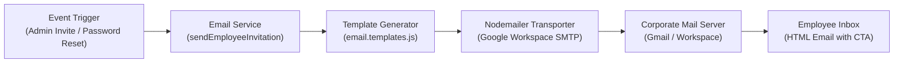

# Email Invitation & Account Activation Architecture Report
**Ashivam Technologies Official Platform — Production HRMS & Attendance System**
**Date:** 2026-11-19  
**Version:** 1.0.0  

---

## 1. Executive Summary

This report provides the technical design, security controls, and responsive HTML email templates created for the Ashivam Technologies employee invitation and account activation workflow.

---

## 2. Email Delivery Architecture

All corporate transactional emails dispatched by the platform flow through `backend/src/modules/notification/email.service.js` utilizing Nodemailer.

### Configuration & SMTP Fallback
- Primary SMTP: `smtp.gmail.com` on port 587 (TLS).
- Authentication: Secure App Password configured via `SMTP_USER` and `SMTP_PASS`.
- From Address: `Ashivam Technologies <no-reply@ashivam.com>` or authenticated system sender.
- Test Environment Behavior: Safe try-catch wrapper captures SMTP delivery exceptions, preventing test or development failures from crashing HTTP request lifecycles.

---

## 3. Responsive HTML Templates

### 1. Employee Account Invitation Template (`employeeInvitationEmail`)
- **Branding:** Ashivam corporate header featuring official brand colors (Deep Navy `#0a192f`, Neon Cyan `#00d2ff`, Slate `#64748b`).
- **Content:**
  - Personalized greeting with full employee name.
  - Assigned Corporate Employee ID (`ASH-EMP-XXXX`).
  - Assigned Department & Designation.
  - Explicit 24-hour expiration notice.
  - Accessible, high-contrast Call-to-Action button pointing to:
    `https://ashivam-tec-h.vercel.app/activate-account?token=${rawToken}`
  - Security footer emphasizing confidentiality.

### 2. Password Reset Request Template (`employeePasswordResetEmail`)
- **Content:**
  - Clear notification that a password reset was requested.
  - 1-hour expiration countdown notice.
  - Prominent "Reset Password" CTA button:
    `https://ashivam-tec-h.vercel.app/reset-password?token=${rawToken}`
  - Explicit warning: *"If you did not request this password reset, please notify security@ashivam.com immediately."*

### 3. Password Reset Confirmation Template (`employeePasswordResetConfirmationEmail`)
- **Content:**
  - Security confirmation that the corporate password was changed successfully.
  - Timestamp of password alteration.
  - Notice that all other active web sessions have been terminated.

---

## 4. Activation Frontend Workflow

1. **Route:** `/activate-account?token=...` (`src/pages/ActivateAccountPage.jsx`).
2. **Dynamic Validation:** As the employee types their chosen password, a real-time policy validator checks:
   -  Minimum 8 characters.
   -  At least 1 uppercase letter (`[A-Z]`).
   -  At least 1 lowercase letter (`[a-z]`).
   -  At least 1 number (`[0-9]`).
   -  At least 1 special character (`[!@#$%^&*...]`).
   -  Password confirmation match.
3. **One-Click Activation:** Upon submission, calls `POST /api/v1/auth/activate`. On success, stores session credentials and redirects straight to `/employee`.
