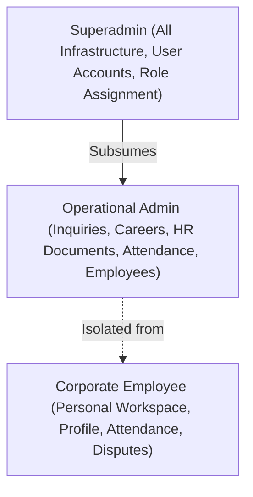

# Role-Based Access Control & Privilege Boundary Report
**Ashivam Technologies Official Platform — Production HRMS & Attendance System**
**Date:** 2026-11-19  
**Security Classification:** Highly Confidential / Infosec  

---

## 1. Executive Summary

This report establishes the role-based access control (RBAC) boundaries, privilege hierarchies, and endpoint gating implemented across the Ashivam Technologies official website and employee portal.

---

## 2. Role Hierarchy & Matrix

The platform strictly segregates administrative capabilities from employee self-service capabilities across three distinct roles:

### RBAC Privilege Matrix

| Module / Resource | Endpoint Pattern | `Superadmin` | `Admin` | `Employee` | Unauthenticated |
| :--- | :--- | :---: | :---: | :---: | :---: |
| **Public Website** | `/`, `/careers`, `/services` |  |  |  |  |
| **Auth Gateway** | `/api/v1/auth/login` |  |  |  |  |
| **Account Activation** | `/api/v1/auth/activate` | ❌ | ❌ |  (Pending) |  |
| **Password Recovery** | `/api/v1/auth/forgot-password` |  |  |  |  |
| **Personal Attendance** | `/api/v1/attendance/my/*` |  |  |  | ❌ |
| **Correction Dispute** | `/api/v1/attendance/corrections` |  |  |  | ❌ |
| **Admin Attendance** | `/api/v1/attendance/admin/*` |  |  | ❌ (403) | ❌ (401) |
| **Employee Directory** | `/api/v1/employees/*` |  |  | ❌ (403) | ❌ (401) |
| **Admin Accounts** | `/api/v1/admin/accounts/*` |  | ❌ (403) | ❌ (403) | ❌ (401) |
| **Audit Logs** | `/api/v1/audit/*` |  |  | ❌ (403) | ❌ (401) |

---

## 3. Enforcement Layers

### Layer 1: Authentication Middleware (`auth.middleware.js`)
- Validates the incoming JWT bearer token or refresh cookie.
- Ensures the user is active (`!user.isActive` triggers `403 Forbidden`).
- For employees, inspects `user.accountStatus`:
  - `INVITED`, `PENDING_ACTIVATION`, `SUSPENDED`, `DEACTIVATED` are strictly rejected with `403 Forbidden`.
- Verifies `iat` against `passwordChangedAt` to prevent token reuse after credential updates.

### Layer 2: Role Authorization Middleware (`authorization.middleware.js`)
- `requireRole("Superadmin", "Admin")`: Blocks employees attempting to invoke administrative CRUD screens with explicit `403 Forbidden`.
- For `Admin`, checks individual granular permissions in `user.permissions` (`employees`, `inquiries`, `careers`, `documents`, `dashboard`, `settings`).

### Layer 3: Frontend Navigation Isolation (`App.jsx` & Navigation)
- Employees are routed to `/employee` (portal).
- Admins are routed to `/admin` (dashboard).
- If an employee tries to open `/admin`, the React routing wrapper redirects them to `/employee` or `/employee-login/admin`.
