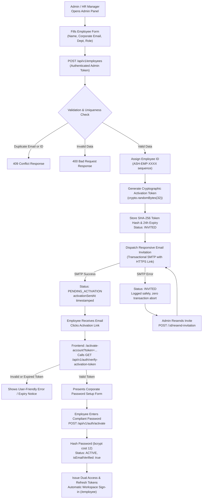

# Employee Onboarding Workflow Specification
**Ashivam Technologies Official Platform — Production HRMS & Attendance System**
**Date:** 2026-11-19  
**Version:** 2.0.0  
**Target Audience:** Engineering Leads, HR Administrators, DevSecOps Engineers  

---

## 1. Overview & Purpose

This document defines the formal, end-to-end Employee Onboarding and Lifecycle Architecture implemented for Ashivam Technologies. It outlines the state machine, security invariants, data structures, and operational steps governing how new corporate employees are registered, invited, verified, activated, and incorporated into corporate attendance and workspace systems.

---

## 2. End-to-End Onboarding Lifecycle Flow

---

## 3. Detailed Step Breakdown

### Step 1: Employee Record Initiation (Admin)
- **Actor:** Authorized Admin / Superadmin with `employees` permission.
- **Action:** Submits `POST /api/v1/employees` via the Admin Portal Employee modal.
- **Required Fields:** `firstName`, `lastName`, `email`, `designation`, `department`, `employmentType`, `joiningDate`.
- **Optional Fields:** `employeeId` (auto-generated if omitted), `googleEmail` (defaults to `email`), `workLocation`, `phone`, `bio`, `skills`, `socialLinks`.
- **Preconditions:** Authenticated admin with active session and CSRF/Bearer token.

### Step 2: Corporate Identifier & Security Token Generation
- **Employee ID Allocation:** If no custom ID is provided, the atomic MongoDB `Counter` sequence generates the standard formatted identifier `ASH-EMP-XXXX` (e.g. `ASH-EMP-1042`).
- **Cryptographic Activation Token:**
  - 32 random bytes generated via `crypto.randomBytes(32).toString('hex')` (256-bit entropy).
  - SHA-256 hash computed and stored in `activationTokenHash` (`select: false`).
  - Plaintext token is never persisted in any database collection.
  - Expiration timestamp set strictly to `now + 24 hours`.
  - Initial `accountStatus` set to `INVITED`.

### Step 3: Transactional Invitation Email Dispatch
- **Service:** `sendEmployeeInvitation` via `backend/src/modules/notification/email.service.js`.
- **Branding:** Ashivam Technologies corporate design system (navy blue `#0a192f`, cyan accents `#00d2ff`, modern typography, clear CTA button).
- **Link Format:** `https://ashivam-tec-h.vercel.app/activate-account?token=${rawActivationToken}`.
- **Fault-Tolerant Resilience:**
  - If SMTP succeeds: `accountStatus` advances to `PENDING_ACTIVATION`, `activationSentAt` is timestamped.
  - If SMTP encounters network or credential failure: Error is logged, `accountStatus` remains `INVITED`, and the employee record is preserved without transaction abortion.
  - Admin receives immediate actionable feedback in the API response (`invitationStatus: "SENT" | "FAILED"`).

### Step 4: Token Verification & Password Setup
- **Route:** `/activate-account?token=${token}`.
- **Pre-flight Check:** On component mount, the frontend calls `GET /api/v1/auth/verify-activation-token?token=${token}`.
- **Validation Rules:**
  - Token must match SHA-256 hash of an existing employee.
  - `activationTokenExpiresAt` must be in the future.
  - `accountStatus` must be `INVITED` or `PENDING_ACTIVATION`.
  - Returns employee's `firstName`, `lastName`, `email`, and `employeeId`.

### Step 5: Password Establishment & Account Promotion
- **Endpoint:** `POST /api/v1/auth/activate`.
- **Password Complexity Policy:**
  - Minimum 8 characters.
  - At least 1 uppercase letter (`[A-Z]`).
  - At least 1 lowercase letter (`[a-z]`).
  - At least 1 number (`[0-9]`).
  - At least 1 special character (`[!@#$%^&*()_+\-=\[\]{};':"\\|,.<>\/?]`).
- **State Mutation:**
  - Password hashed with `bcryptjs` (salt cost 12).
  - `activationTokenHash` set to `null` (single-use enforcement).
  - `activationTokenExpiresAt` set to `null`.
  - `accountStatus` set to `ACTIVE`.
  - `employmentStatus` confirmed as `ACTIVE`.
  - `isEmailVerified` set to `true`.
  - `isActive` synchronized to `true`.
  - Dual tokens generated (Access Token JWT + Refresh Token persisted in `RefreshToken` family).
  - Employee automatically transitioned into `/employee` dashboard.

---

## 4. Exception Handling & Recovery

| Exception Case | System Behavior | User Feedback |
| :--- | :--- | :--- |
| **Email Not Delivered / Bounced** | Admin sees `INVITED` badge; can click "Resend Invitation" (`POST /:id/resend-invitation`). | "Invitation resent successfully" or descriptive delivery error. |
| **Expired Activation Token (>24h)** | `GET /verify-activation-token` returns `400 Bad Request` (`"Activation link has expired"`). | Displays friendly warning directing staff to contact HR for a re-invite. |
| **Replayed Activation Token** | Token hash is cleared upon first activation; subsequent attempts return `400 Bad Request`. | "Activation token is invalid or has already been used." |
| **Suspended / Terminated Staff Attempts Activation** | Blocked with `403 Forbidden` (`"Employee account cannot be activated in its current state"`). | Clear security denial notice. |
| **Brute-Force Attack on Activation** | `authActionLimiter` enforces max 15 requests per 15 minutes per IP. | `429 Too Many Requests` HTTP response. |

---

## 5. Security & Compliance Invariants

1. **Zero Plaintext Token Storage:** Only the cryptographic SHA-256 hash of tokens is persisted.
2. **Strict Single-Use Invariant:** Token hashes are wiped (`null`) immediately upon password configuration.
3. **Immutability of Audit Trails:** All admin invitations, resends, and activations emit immutable `AuditLog` records.
4. **Role Isolation:** Activated employees are strictly assigned role `Employee` and cannot invoke administrative endpoints.
