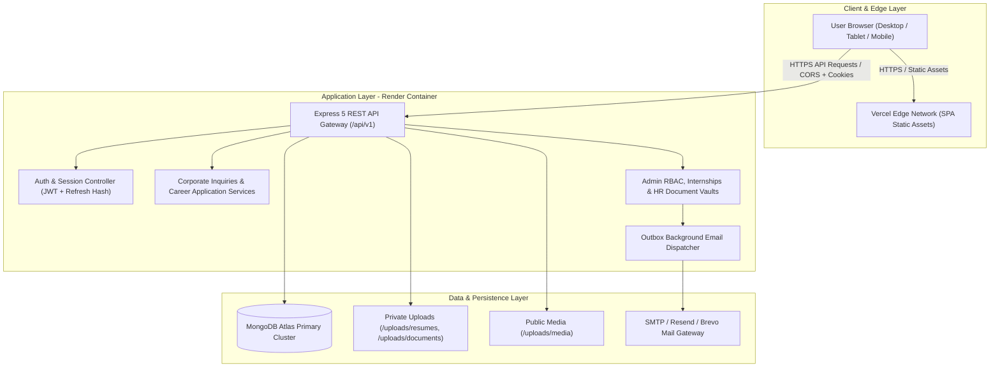

# Ashivam Technologies — Existing Architecture Document

**Document:** `EXISTING_ARCHITECTURE.md`  
**Classification:** Enterprise System Architecture  
**Date:** 2026-11-07  
**Branch:** `feature/ashivam-production-hardening`  
**Workspace:** `C:\Users\DELL\Desktop\Official-Website-main`  
**Repository:** https://github.com/Ritikgupta-tech/ashivam-tecH.git  
**Auditor:** Principal Software Architect & Senior Backend Engineer  

---

## 1. System Topology Overview

The Ashivam Technologies platform currently operates as a decoupled two-tier architecture:
1. **Frontend Tier (Vercel Edge):** Single-page application built with React 18.3.1 and Vite 8.3.4, served globally through Vercel's edge network with Content Security Policy and security headers.
2. **Backend API Tier (Render Cloud Container):** Containerized Node.js 22 + Express 5 service hosted on Render, interfacing with MongoDB Atlas for persistent storage and external SMTP/Transactional APIs for email delivery.



---

## 2. Frontend Architecture Details

### 2.1 Framework & Core Libraries
- **React:** v18.3.1 (React DOM, React Router DOM v7.1.4)
- **Bundler:** Vite v8.3.4 with Rollup optimization
- **Styling Architecture:** Pure CSS design system rooted in CSS custom properties (`src/styles/globals.css`, `src/styles/animations.css`). Zero external CSS frameworks (Tailwind, Bootstrap) or heavyweight component libraries (MUI, Mantine).
- **Iconography:** Centralized SVG vector icon library ([`src/components/icons/index.jsx`](file:///c:/Users/DELL/Desktop/Official-Website-main/src/components/icons/index.jsx)) with zero emojis.

### 2.2 Client-Side Code Splitting & Performance
- **Route-Based Lazy Loading:** The administrative dashboard and authentication interfaces (`AdminLogin`, `AdminDashboard`) are loaded on-demand via `React.lazy()`. Public visitors never download administrative chunks.
- **Bundle Metrics:**
  - Public Client Bundle (`index.js`): ~349 kB raw (~101 kB gzipped)
  - Core Design System (`index.css`): ~124 kB raw (~20.5 kB gzipped)
  - Admin Dashboard Chunk: ~175 kB raw (~32 kB gzipped)
- **Session Coordination (`src/auth/tokenManager.js`):**
  - Web Locks API (`navigator.locks`) + Single-Flight In-Memory Promise Deduplication. Simultaneous API requests encountering an expired 15-minute access token share a single `/auth/refresh` round-trip without duplicate refresh token collisions.
  - Non-sensitive session hint stored in `localStorage` prevents unauthorized refresh calls on anonymous visits.

---

## 3. Backend Architecture Details

### 3.1 Framework & Runtime
- **Runtime:** Node.js v22.x LTS, ES Modules (`"type": "module"`)
- **HTTP Server:** Express 5.1.0 with async error propagation
- **Database ODM:** Mongoose 8.9.5 with strictly defined schemas and indexes

### 3.2 Security Pipeline (`backend/src/app.js`)
1. **Correlation Tracking:** Injects unique `X-Request-Id` UUIDv4 onto every request and response header.
2. **Security Headers (Helmet):** Enforces HSTS (1 year), `X-Frame-Options: DENY`, `X-Content-Type-Options: nosniff`, Referrer-Policy, and strict `Permissions-Policy`.
3. **CORS Defense:** Explicit origin allowlist (matching Vercel frontend and local development), rejecting untrusted origins with HTTP 403.
4. **Rate Limiting:** Multi-tiered rate limiters for global endpoints (100 req/min), authentication logins (10 req/15min), and contact/career submissions (5 req/hour).
5. **Native Cookie Parser:** Zero-dependency cookie extraction supporting `HttpOnly; SameSite=Lax/None; Secure`.
6. **CSRF Guard:** Validates `Sec-Fetch-Site`, `Origin`, `Referer`, and custom `X-Requested-With` headers on all state-changing mutations.
7. **Static Path Isolation:** Only `/uploads/media` is served statically. Confidential folders (`/uploads/resumes`, `/uploads/employee-documents`, `/uploads/hr-documents`) are explicitly mapped to HTTP 404 to block unauthorized static enumeration.

---

## 4. Authentication & Session Architecture

```
User Login -> Validate Bcrypt Password -> Generate 15m JWT Access Token
                                      -> Generate 64-char Refresh Token
                                      -> Store HMAC-SHA256 Hash in DB
                                      -> Set Secure HttpOnly Cookie
```

- **Access Tokens:** Signed with `JWT_SECRET` (HS256), 15-minute expiration, containing `id`, `username`, `email`, `role`, and token lineage version.
- **Refresh Tokens:** High-entropy random bytes, never stored in plaintext. Hashed via HMAC-SHA256 using `JWT_REFRESH_SECRET` before persisting to `RefreshToken` collection.
- **Rotation & Replay Detection:** Every refresh invocation revokes the used token and issues a new pair. If a revoked token is re-submitted (replay attack), the entire lineage family is revoked immediately, terminating all sessions for that account.
- **Session Invalidation:** Password changes or administrator status deactivations immediately purge all refresh token records.

---

## 5. Persistence & Data Domain Inventory

| Collection / Model | Business Domain | Key Attributes | Indexes |
|---|---|---|---|
| `admins` | Platform Access & RBAC | `username`, `email`, `passwordHash`, `role`, `permissions`, `isActive` | `{ username: 1 }`, `{ email: 1 }` |
| `refreshtokens` | Session Management | `userId`, `tokenHash`, `familyId`, `expiresAt`, `isRevoked` | `{ tokenHash: 1 }`, `{ expiresAt: 1 }` (TTL) |
| `inquiries` | Corporate Website | `name`, `email`, `phone`, `projectType`, `budget`, `message`, `status` | `{ email: 1 }`, `{ createdAt: -1 }` |
| `jobs` | Recruitment | `title`, `slug`, `department`, `type`, `location`, `status`, `experience` | `{ slug: 1 }`, `{ status: 1 }` |
| `applications` | Recruitment | `job`, `name`, `email`, `phone`, `resumePath`, `status` | Compound unique `{ job: 1, email: 1 }` |
| `internships` | Internship Management | `applicantName`, `email`, `domain`, `university`, `status` | `{ email: 1 }`, `{ status: 1 }` |
| `interns` | Internship Operations | `internId` (e.g. `ASH-INT-2026-001`), `email`, `domain`, `status`, `mentor` | `{ internId: 1 }` (unique), `{ email: 1 }` |
| `internshipprograms`| Internship Tracks | `title`, `slug`, `domain`, `duration`, `seats`, `isActive` | `{ slug: 1 }` (unique) |
| `employees` | HR Management | `employeeId`, `email`, `name`, `department`, `designation`, `deletedAt` | Partial unique `{ email: 1 }` where `{ deletedAt: null }` |
| `employeedocuments` | HR Management | `employeeId`, `documentType`, `filePath`, `fileSize`, `verified` | `{ employeeId: 1 }` |
| `hrdocuments` | HR Compliance | `title`, `category`, `filePath`, `version`, `isPublished` | `{ category: 1 }` |
| `auditlogs` | Enterprise Security | `adminId`, `action`, `targetModel`, `targetId`, `ip`, `userAgent` | `{ createdAt: -1 }`, `{ action: 1 }` |
| `outbox` | Reliable Email Delivery | `recipient`, `subject`, `template`, `payload`, `attempts`, `status` | `{ status: 1, nextAttemptAt: 1 }` |
| `distributedlocks` | Concurrency Control | `lockKey`, `ownerId`, `fencingToken`, `expiresAt` | `{ lockKey: 1 }` (unique) |

---

## 6. Monolithic Coexistence Analysis

Currently, three distinct business domains reside in this single repository:
1. **Corporate Website & Public Engagement:** Inquiries, job listings, career applications, CMS content.
2. **Internship Operations:** Student applicants, evaluation stages, intern roster, track management.
3. **HR Operations:** Employee records, salary structures, confidential document verification, organizational policies.

While sharing an Express instance and MongoDB Atlas database reduces hosting overhead, future scaling requires establishing clean architectural contracts to enable independent deployment of `ashivam-internship-management` and `ashivam-hr-management`.
