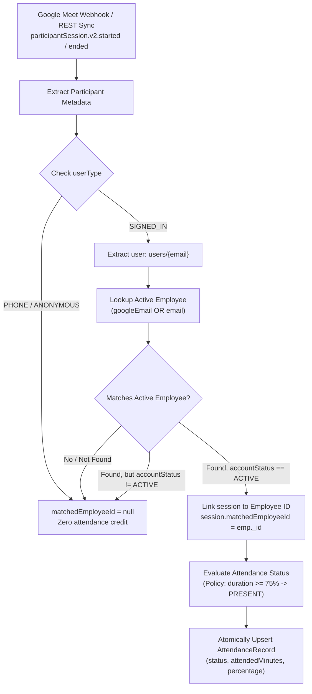

# Google Identity Mapping & Attendance Reconciliation Report
**Ashivam Technologies Official Platform — Production HRMS & Attendance System**
**Date:** 2026-11-19  
**Integration Scope:** Google Workspace Meet REST API v2 & Google Cloud Pub/Sub  

---

## 1. Executive Summary

This report documents how verified Google Workspace identities are correlated with internal Ashivam Technologies corporate employee records during Google Meet sessions, ensuring accurate, spoof-proof attendance records.

---

## 2. Participant Identity Resolution Architecture



---

## 3. Security Rules for Identity Matching

1. **Anonymous Participant Rejection:**
   - Any participant joining without an authenticated Google account or via phone dial-in is classified as `ANONYMOUS` or `PHONE`.
   - Their session is logged in `ParticipantSession` for auditability, but `matchedEmployeeId` remains strictly `null`.
   - No attendance credit is awarded.
2. **Account Status Verification:**
   - Even if a participant's Google email matches an employee record, if that employee's `accountStatus` is `INVITED`, `PENDING_ACTIVATION`, `SUSPENDED`, or `DEACTIVATED`, the match is rejected:
     ```javascript
     matchedEmployee = await Employee.findOne({
       $or: [{ googleEmail }, { email: googleEmail }],
       deletedAt: null,
       isActive: true,
       accountStatus: "ACTIVE",
     });
     ```
3. **Historical Record Retention Invariant:**
   - If an employee is terminated or deactivated in the future, their historical `AttendanceRecord` documents remain permanently intact in MongoDB.
   - Deactivation only halts future meeting eligibility and credential access; it never mutates or purges past records.
