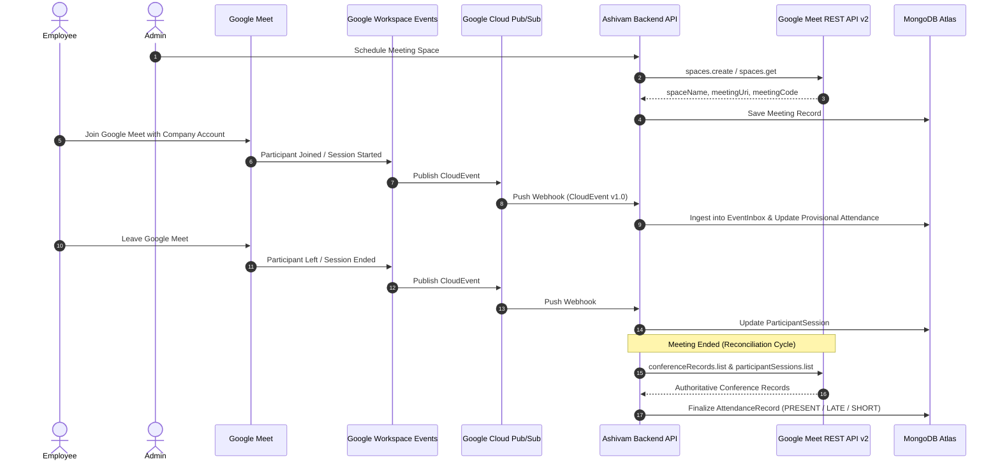

# GOOGLE INTEGRATION AUDIT — ASHIVAM TECHNOLOGIES
## Google Meet REST API v2, Workspace Events & Pub/Sub Integration Audit

**Document ID:** ASHIVAM-GOOGLE-AUDIT-001  
**Project:** Google Meet Attendance Management System  
**Date:** November 19, 2026  
**Auditor:** Google Workspace API Integration Specialist & DevSecOps Lead  

---

## 1. Overview of Google Integration Architecture

The Ashivam Technologies Google Meet Attendance System requires three Google Cloud & Workspace services working in harmony:



---

## 2. Google OAuth 2.0 & Scope Analysis

### 2.1 Scope Comparison: `meetings.space.created` vs `meetings.space.readonly`
| OAuth Scope | Capabilities | Limitations | Recommendation |
| :--- | :--- | :--- | :--- |
| `https://www.googleapis.com/auth/meetings.space.created` | - Create new spaces via API<br>- Read spaces created by the calling app<br>- Read conference records of spaces created by this app | **Cannot read meetings created in Google Calendar** or directly via meet.google.com by employees. | **Insufficient on its own** for existing enterprise meetings. |
| `https://www.googleapis.com/auth/meetings.space.readonly` | - Read any meeting space metadata<br>- Read any conference record and participant sessions across the domain | Cannot create new spaces via API. | **Essential for reading all participant records.** |
| **Combined Least-Privilege Scope Set** | - Create app-managed spaces<br>- Read all company conference records | Requires domain admin consent for Workspace organizational units. | **Configured:** `meetings.space.created` + `meetings.space.readonly` |

### 2.2 Token Lifecycle & Encryption
1. **Authorization Code Flow with PKCE**:
   - `GET /api/v1/google/oauth/authorize`: Generates a high-entropy state token and PKCE code challenge.
   - Redirects to Google consent screen: `https://accounts.google.com/o/oauth2/v2/auth`.
2. **Callback Handling**:
   - `GET /api/v1/google/oauth/callback`: Validates state, exchanges code for Access Token (1-hour expiry) and Refresh Token.
3. **Encrypted Token Storage**:
   - Google Refresh Tokens must **never** be stored in plaintext.
   - Encrypted with AES-256-GCM using `GOOGLE_TOKEN_ENCRYPTION_KEY` before persisting into `GoogleIntegration` model.
   - Stored attributes: `encryptedRefreshToken`, `iv`, `authTag`, `accessTokenExpiry`, `scopeList`.

---

## 3. Google Meet REST API v2 Specifications

The integration connects to `https://meet.googleapis.com/v2`:

### 3.1 Key Endpoints
1. `POST /v2/spaces`: Creates a persistent meeting space for Ashivam recurring standups.
2. `GET /v2/spaces/{spaceId}`: Fetches space configuration and active conference URI.
3. `GET /v2/conferenceRecords`: Lists completed conferences with filter `space.name="{spaceName}"`.
4. `GET /v2/conferenceRecords/{confId}/participants`: Lists all participants that attended.
5. `GET /v2/conferenceRecords/{confId}/participants/{participantId}/participantSessions`: Lists exact start and end times for each connection session.

### 3.2 Participant Identity Mapping
- Google Meet API provides:
  - `signedinUser.user`: Unique Google Workspace user resource name or email.
  - `signedinUser.displayName`: Public display name.
  - `anonymousUser.displayName`: Anonymous or unauthenticated guest.
  - `phoneUser.displayName`: Dial-in phone participant.
- **Strict Verification Rule**:
  - Only participants with a verified `signedinUser` whose email matches an active employee's `googleEmail` or `workEmail` receive automated attendance credit.
  - Anonymous and phone participants are tagged as `NEEDS_REVIEW` and alerted to administrators.

---

## 4. Google Cloud Pub/Sub & Workspace Events Audit

### 4.1 Topic & Subscription
- **Google Cloud Project:** `ashivam-meet-attendance`
- **Topic:** `projects/ashivam-meet-attendance/topics/ashivam-meet-events`
- **Subscription:** `projects/ashivam-meet-attendance/subscriptions/ashivam-meet-events-sub`

### 4.2 Push Webhook Architecture
- Google Cloud Pub/Sub delivers messages to the backend via HTTP POST:
  - **Endpoint:** `POST https://ashivam-tech.onrender.com/api/v1/google/events/pubsub`
  - **Authentication:** Validated using Google OIDC Service Account bearer token or secret URL query token (`?token=<PUBSUB_SECRET>`).
  - **Envelope Format**:
    ```json
    {
      "message": {
        "data": "<BASE64_ENCODED_CLOUDEVENT_JSON>",
        "messageId": "1234567890",
        "publishTime": "2026-11-19T18:00:00Z"
      },
      "subscription": "projects/ashivam-meet-attendance/subscriptions/ashivam-meet-events-sub"
    }
    ```

### 4.3 Deduplication & Idempotency
- Google Pub/Sub guarantees **at-least-once** delivery. Duplicates are inevitable.
- Each event is recorded in the `GoogleEventInbox` collection indexed uniquely on `messageId`.
- Duplicate deliveries are acknowledged (`HTTP 200`) immediately without re-executing business logic.
