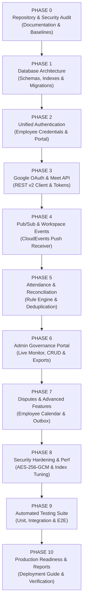

# IMPLEMENTATION PLAN — ASHIVAM TECHNOLOGIES
## Google Meet Employee Attendance Management System

**Document ID:** ASHIVAM-PLAN-PHASE0-001  
**Project:** Ashivam Technologies Corporate Platform Upgrade  
**Execution Lead:** Principal Full-Stack Engineer & DevSecOps Lead  
**Date:** November 19, 2026  

---

## 1. Architectural Phases Overview

---

## 2. Phase-by-Phase Execution Details

### PHASE 0: Repository & Architecture Audit (Completed)
- Inspect existing codebase, models, routes, test suites, and configurations.
- Establish the baseline of 355 passing tests.
- Produce the 5 mandatory Phase 0 engineering audit reports.

### PHASE 1: Database & Backend Architecture
- **Deliverables**:
  - Extend `Employee` schema with `employeeId`, `passwordHash` (select: false), `googleEmail` (indexed), `authStatus`.
  - Create `Meeting` model (space name, code, time range, status, assigned employees/departments).
  - Create `MeetingConference` model (Google conference record identifier, space mapping, start/end).
  - Create `ParticipantSession` model (participant email, session start/end, device info, connection state).
  - Create `AttendanceRecord` model (compound unique `{ meetingId: 1, employeeId: 1 }`, status, connected duration, arrival status).
  - Create `AttendancePolicy` model (default grace period: 5 mins, minimum duration: 30 mins, thresholds).
  - Create `AttendanceCorrectionRequest` model (employee dispute workflow, audit log, admin resolution).
  - Create `GoogleIntegration` model (encrypted tokens, status, expiry, scopes).
  - Create `GoogleEventInbox` model (Pub/Sub event deduplication with idempotency key).
  - Create `ReconciliationJob` model (background verification logs).
- **Verification**: Run unit validation tests for all schemas.

### PHASE 2: Unified Employee Authentication & Portal Integration
- **Deliverables**:
  - Update `auth.service.js` to authenticate both Admins (by username) and Employees (by email/employeeId).
  - Issue JWT tokens embedding role (`Employee`, `Admin`, `Superadmin`) and employee identity.
  - Update `auth.middleware.js` to look up credentials in `Admin` or `Employee` based on token claims.
  - Build frontend Employee Workspace Dashboard under `/employee/*`:
    - Today's Meeting Card with live attendance state.
    - Upcoming Meetings schedule.
    - My Attendance summary and stats.
    - Attendance Calendar with color-coded status badges.
    - Profile information.
  - Update `EmployeeLoginPage.jsx` to direct authenticated employees to their personal dashboard.
- **Verification**: Ensure employee cannot access `/admin/*` and admin cannot be locked out.

### PHASE 3: Google OAuth 2.0 & Meet REST API v2 Integration
- **Deliverables**:
  - Google OAuth 2.0 service with PKCE/State verification.
  - Token encryption service using AES-256-GCM.
  - Google Meet REST API v2 client module:
    - Create/Fetch Meeting Space (`spaces.create`, `spaces.get`).
    - List Conference Records (`conferenceRecords.list`).
    - List Participants & Participant Sessions (`conferenceRecords.participants.list`, `participantSessions.list`).
- **Verification**: Mocked tests for API responses and token refresh cycles.

### PHASE 4: Google Cloud Pub/Sub & Workspace Events Integration
- **Deliverables**:
  - Webhook route: `POST /api/v1/google/events/pubsub`.
  - Webhook security: Validate authorization token / Google JWT signature or secret key.
  - CloudEvents v1.0 parser for Meet events:
    - `conferenceRecord.v2.started`, `ended`
    - `participant.v2.joined`, `left`
    - `participantSession.v2.started`, `ended`
  - Idempotent inbox ingestion preventing duplicate event processing.
  - Real-time provisional attendance state update.
- **Verification**: Replay tests with duplicate Pub/Sub payloads.

### PHASE 5: Automatic Attendance Engine & Reconciliation
- **Deliverables**:
  - Calculation Engine:
    - First join time, last leave time, total connected duration, eligible session duration.
    - Session merging for re-connections.
    - Policy evaluation: PRESENT, LATE, SHORT_ATTENDANCE, ABSENT, PENDING_VERIFICATION, NEEDS_REVIEW.
  - Periodic Reconciliation Worker:
    - Reconciles completed meetings by calling Google Meet REST API v2.
    - Overwrites provisional states with authoritative finalized records.
- **Verification**: Time calculation edge case tests (multiple drops, midnight boundary, Asia/Kolkata timezone).

### PHASE 6: Admin Dashboard & Reporting
- **Deliverables**:
  - Administrative Attendance Tab in `AdminDashboard`:
    - Summary metrics: Present, Absent, Late, Short Attendance, Pending Verification.
    - Meeting Manager: Create meeting, recurring standups, assign departments/employees.
    - Live Meeting Monitor: Real-time participant join/leave timeline.
    - Export engine: Download attendance data as CSV, formatted Excel, or printable PDF.
- **Verification**: Export format sanitization and RBAC isolation tests.

### PHASE 7: Advanced Features & Employee Dispute System
- **Deliverables**:
  - Employee Correction Request interface: Submit dispute with proof note.
  - Admin Resolution workflow: Approve / Reject dispute with immutable audit trail.
  - Notification dispatches via Outbox pattern for meeting reminders and attendance finalization.
- **Verification**: Dispute state transition tests.

### PHASE 8: Security & Performance Hardening
- **Deliverables**:
  - End-to-end audit for IDOR, CSRF, NoSQL injection, and formula injection.
  - Token encryption validation (zero raw secrets in DB).
  - Database indexing for meeting queries and participant email lookups.
- **Verification**: Automated security test suite.

### PHASE 9: Complete Automated Testing
- **Deliverables**:
  - Unit tests for engine calculations and session merging.
  - Integration tests for APIs and webhooks.
  - Mocked end-to-end lifecycle test.
- **Verification**: 100% test pass rate across new and existing tests.

### PHASE 10: Production Readiness & Final Documentation
- **Deliverables**:
  - Full suite of 10 final engineering reports.
  - Staging verification and production deployment guide.
