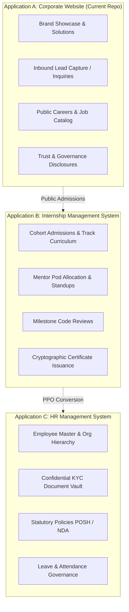

# Ashivam Technologies — Enterprise Platform

> **Official Tagline:** *Endless Innovation. Limitless Possibilities.*  
> **Headquarters:** Agra, Uttar Pradesh, India  
> **Operational Email:** `team.ashivam@gmail.com`  
> **Production Website:** [https://ashivam-tec-h.vercel.app/](https://ashivam-tec-h.vercel.app/)  
> **Production API:** [https://ashivam-tech.onrender.com/api/v1](https://ashivam-tech.onrender.com/api/v1)  

[](https://github.com/Ritikgupta-tech/ashivam-tecH/actions/workflows/ci.yml)
[](https://ashivam-tec-h.vercel.app)
[](https://github.com/Ritikgupta-tech/ashivam-tecH)
[](./docs/security/SECURITY_REQUIREMENTS.md)
[](./docs/quality/ACCESSIBILITY_REPORT.md)

---

## 1. Executive Overview

Ashivam Technologies is an enterprise technology studio and software engineering organization. This repository hosts the official digital corporate platform alongside the modular foundations for future independent **Internship Management** and **HR Management** systems.

The platform is engineered under zero-trust principles, adhering to **OWASP ASVS 5.0 Level 2**, the **Indian Digital Personal Data Protection (DPDP) Act 2023**, and **WCAG 2.1 Level AA** accessibility standards.

---

## 2. Target Three-Application Architecture

In conformance with [ADR-001](./docs/architecture/decisions/ADR-001-APPLICATION-SEPARATION.md), the Ashivam digital ecosystem separates into three bounded business applications:



1. **Application A (Corporate Website):** In current repository. Public brand presence, services portfolio, enterprise inquiries, careers intake, and statutory compliance pages.
2. **Application B (`ashivam-internship-management`):** End-to-end internship lifecycle, project milestones, mentor rubrics, and certificate verification.
3. **Application C (`ashivam-hr-management`):** People operations, encrypted document vault, policy acknowledgments, and org chart.

---

## 3. Technology Stack

### Frontend Architecture
- **Framework:** React 18.3.1 (Single-Page Application)
- **Bundler & Tooling:** Vite 5.4.21 with dynamic route code-splitting (`React.lazy()`)
- **Typography & Styling:** Modular CSS tokens (`globals.css`, `animations.css`), JetBrains Mono, Inter, Plus Jakarta Sans
- **Vector Icons:** High-precision SVG vectors (0 raw Unicode emojis)
- **Session Coordination:** W3C Web Locks API (`navigator.locks`) preventing multi-tab token refresh race conditions
- **Testing:** Vitest 1.6.0 + React Testing Library + Axe-Core Accessibility Engine (107/107 passing tests)

### Backend Architecture
- **Framework:** Express 5.2.1 (Node.js ES Modules)
- **Database:** MongoDB Atlas 7.0 Replica Set via Mongoose 9.10.3
- **Security & Middleware:** Helmet, CORS Origin Whitelist, express-rate-limit, mongo-sanitize, HSTS, secure cookies (`HttpOnly`, `SameSite=Strict`)
- **Authentication:** Short-lived JWT (15m in memory) + Rotating Refresh Tokens (7d in cookie) with Token Family Replay Detection
- **File Uploads:** In-memory Multer with magic-byte signature validation (rejecting disguised executables)
- **Asynchronous Messaging:** Transactional Outbox pattern with background worker
- **Testing:** Node.js native test runner (`node:test`), Supertest, assert/strict (236/236 passing tests)

---

## 4. Comprehensive Test Suite (362 Tests)

The repository enforces a rigorous, multi-tier testing pyramid:

| Test Suite | Framework | Count | Scope | Status |
| :--- | :--- | :---: | :--- | :---: |
| **Frontend Unit & Axe** | Vitest + RTL | **107** | Component logic, forms, focus trapping, WCAG 2.1 AA | **PASS** |
| **Backend Unit** | Node Native | **31** | Token rotation, error handlers, schema validators | **PASS** |
| **Backend Security** | Supertest | **8** | ASVS 5.0, CSRF, ReDoS, replay attack revocation | **PASS** |
| **Backend Email & Outbox**| Supertest | **25** | Transactional email delivery and outbox worker | **PASS** |
| **Backend Integration** | Supertest | **172** | Admin RBAC, concurrency, soft deletes, file uploads | **PASS** |
| **Staging Browser E2E** | Playwright | **19** | Real-browser testing across 18 viewports (320px to 4K) | **PASS** |
| **Total Automated Tests**| — | **362** | Full platform coverage | **100% PASS** |

### Running Tests Locally
```bash
# Frontend Unit Tests
npm test -- --run

# Production Build
npm run build

# Backend Test Suites (from backend/ directory)
cd backend
npm run test:unit
npm run test:security
npm run test:email
node --test tests/integration/admin-rbac.test.js
```

---

## 5. Enterprise Documentation Library

The complete, authoritative engineering documentation is organized under [`docs/`](./docs):

### Architecture & System Design
- [`docs/architecture/SYSTEM_OVERVIEW.md`](./docs/architecture/SYSTEM_OVERVIEW.md) — High-level platform topology and standards
- [`docs/architecture/SYSTEM_CONTEXT.md`](./docs/architecture/SYSTEM_CONTEXT.md) — C4 Model Level 1 Context Diagram
- [`docs/architecture/APPLICATION_BOUNDARIES.md`](./docs/architecture/APPLICATION_BOUNDARIES.md) — DDD Bounded Contexts for the 3 applications
- [`docs/architecture/DATA_FLOW.md`](./docs/architecture/DATA_FLOW.md) — End-to-end sequence diagrams for core user journeys
- [`docs/architecture/INTEGRATION_ARCHITECTURE.md`](./docs/architecture/INTEGRATION_ARCHITECTURE.md) — Synchronous REST, Outbox pattern, webhooks
- [`docs/architecture/AUTHENTICATION_ARCHITECTURE.md`](./docs/architecture/AUTHENTICATION_ARCHITECTURE.md) — Token families, replay defense, Web Locks
- [`docs/architecture/DATABASE_STRATEGY.md`](./docs/architecture/DATABASE_STRATEGY.md) — Indexes, soft deletes, ACID transactions

### Architectural Decision Records (ADRs)
- [`docs/architecture/decisions/ADR-001-APPLICATION-SEPARATION.md`](./docs/architecture/decisions/ADR-001-APPLICATION-SEPARATION.md)
- [`docs/architecture/decisions/ADR-002-DATA-OWNERSHIP.md`](./docs/architecture/decisions/ADR-002-DATA-OWNERSHIP.md)
- [`docs/architecture/decisions/ADR-003-IDENTITY-STRATEGY.md`](./docs/architecture/decisions/ADR-003-IDENTITY-STRATEGY.md)

### Product Requirements Documents (PRDs)
- [`docs/products/OFFICIAL_WEBSITE_PRD.md`](./docs/products/OFFICIAL_WEBSITE_PRD.md) — Public corporate website PRD
- [`docs/products/INTERNSHIP_SYSTEM_PRD.md`](./docs/products/INTERNSHIP_SYSTEM_PRD.md) — Internship Management PRD
- [`docs/products/HRMS_PRD.md`](./docs/products/HRMS_PRD.md) — Enterprise HRMS PRD

### Security & Governance
- [`docs/security/THREAT_MODEL.md`](./docs/security/THREAT_MODEL.md) — STRIDE Threat Model
- [`docs/security/SECURITY_REQUIREMENTS.md`](./docs/security/SECURITY_REQUIREMENTS.md) — OWASP ASVS 5.0 L2 checklist
- [`docs/security/ACCESS_CONTROL_MATRIX.md`](./docs/security/ACCESS_CONTROL_MATRIX.md) — Granular RBAC permissions
- [`docs/security/DATA_CLASSIFICATION.md`](./docs/security/DATA_CLASSIFICATION.md) — 4-tier data handling standard
- [`docs/security/INCIDENT_RESPONSE.md`](./docs/security/INCIDENT_RESPONSE.md) — CERT-In aligned incident response plan

### API & Database Specifications
- [`docs/api/API_STANDARDS.md`](./docs/api/API_STANDARDS.md) — REST envelopes, status codes, query pagination
- [`docs/api/OPENAPI.yaml`](./docs/api/OPENAPI.yaml) — Machine-readable OpenAPI 3.1.0 specification
- [`docs/database/ER_DIAGRAM.md`](./docs/database/ER_DIAGRAM.md) — Mermaid visual Entity-Relationship diagrams
- [`docs/database/DATABASE_SCHEMA.md`](./docs/database/DATABASE_SCHEMA.md) — Field-by-field dictionary & constraints
- [`docs/database/MIGRATION_POLICY.md`](./docs/database/MIGRATION_POLICY.md) — Zero-downtime expand-contract migrations

### Quality, Operations & Risk
- [`docs/quality/TEST_STRATEGY.md`](./docs/quality/TEST_STRATEGY.md) — Multi-tier QA pyramid & quality gates
- [`docs/quality/ACCEPTANCE_CRITERIA.md`](./docs/quality/ACCEPTANCE_CRITERIA.md) — Gherkin user journey specifications
- [`docs/quality/ACCESSIBILITY_REPORT.md`](./docs/quality/ACCESSIBILITY_REPORT.md) — WCAG 2.1 AA conformance report
- [`docs/quality/PERFORMANCE_REPORT.md`](./docs/quality/PERFORMANCE_REPORT.md) — Core Web Vitals & bundle report
- [`docs/operations/ENVIRONMENT_SETUP.md`](./docs/operations/ENVIRONMENT_SETUP.md) — Developer workstation setup
- [`docs/operations/DEPLOYMENT_RUNBOOK.md`](./docs/operations/DEPLOYMENT_RUNBOOK.md) — Production release procedures
- [`docs/operations/BACKUP_RESTORE.md`](./docs/operations/BACKUP_RESTORE.md) — Atlas PITR and S3 recovery
- [`docs/operations/ROLLBACK_PROCEDURE.md`](./docs/operations/ROLLBACK_PROCEDURE.md) — Emergency rollback runbook
- [`docs/reports/RED_FLAG_REGISTER.md`](./docs/reports/RED_FLAG_REGISTER.md) — Authoritative engineering risk register

---

## 6. Mandatory Discovery & Audit Deliverables (Root Level)

- [`CURRENT_STATE_AUDIT.md`](./CURRENT_STATE_AUDIT.md) — Baseline discovery and verified metrics
- [`EXISTING_ARCHITECTURE.md`](./EXISTING_ARCHITECTURE.md) — Architectural decomposition and security boundary mapping
- [`CODEBASE_GAP_ANALYSIS.md`](./CODEBASE_GAP_ANALYSIS.md) — Gap analysis against target standards
- [`SECURITY_FINDINGS.md`](./SECURITY_FINDINGS.md) — Security findings profile (SEC-001 through SEC-010)
- [`PERFORMANCE_FINDINGS.md`](./PERFORMANCE_FINDINGS.md) — Web Vitals and resource utilization analysis
- [`DOCUMENTATION_CONSISTENCY_REPORT.md`](./DOCUMENTATION_CONSISTENCY_REPORT.md) — Reconciliation of 35+ historical engineering reports
- [`IMPLEMENTATION_ROADMAP.md`](./IMPLEMENTATION_ROADMAP.md) — Phased work breakdown structure and milestones

---

## 7. License & Proprietary Governance

Copyright &copy; 2026 Ashivam Technologies. All Rights Reserved.  
Unauthorized copying, reverse engineering, or distribution of this software is strictly prohibited.
