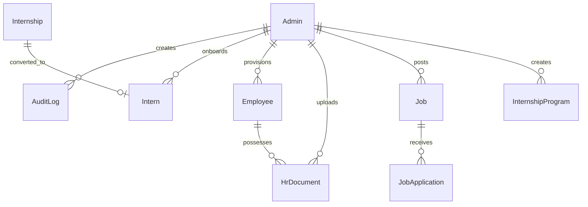

# Ashivam Technologies — Admin Data Model & Schema Specifications

**Document Version:** 1.0.0  
**Database Engine:** MongoDB 6.0+ with Mongoose ODM  
**Target Application:** Ashivam Technologies Official Platform  
**Status:** Canonical Reference Specification  

---

## 1. Entity-Relationship Overview

---

## 2. Schema Definitions & Field Catalogs

### 2.1 Admin Entity (`Admin`)
Collection: `admins`

| Field | Type | Required | Unique | Default | Indexes / Constraints |
| :--- | :--- | :--- | :--- | :--- | :--- |
| `_id` | ObjectId | Yes | Yes | auto | Primary Key |
| `username` | String | Yes | Yes | — | `unique: true`, lowercase, trim |
| `name` | String | Yes | No | — | trim, maxlength: 100 |
| `email` | String | No | Sparse | null | lowercase, trim |
| `passwordHash` | String | Yes | No | — | `select: false` (hidden by default) |
| `role` | String | Yes | No | 'Admin' | Enum: `['Superadmin', 'Admin']` |
| `permissions` | [String] | Yes | No | `[]` | Enum: `['dashboard','inquiries','careers','employees','content','media','audit','settings','users','notifications']` |
| `isActive` | Boolean | Yes | No | true | Index: `{ isActive: 1 }` |
| `lastLoginAt` | Date | No | No | null | — |
| `passwordChangedAt` | Date | No | No | null | — |
| `createdAt` | Date | Yes | No | now | Timestamps |
| `updatedAt` | Date | Yes | No | now | Timestamps |

---

### 2.2 Employee Entity (`Employee`)
Collection: `employees`

| Field | Type | Required | Unique | Default | Indexes / Constraints |
| :--- | :--- | :--- | :--- | :--- | :--- |
| `_id` | ObjectId | Yes | Yes | auto | Primary Key |
| `firstName` | String | Yes | No | — | trim, maxlength: 80 |
| `lastName` | String | Yes | No | — | trim, maxlength: 80 |
| `email` | String | Yes | Partial | — | Partial unique index: `{ email: 1 }` where `{ deletedAt: null }` |
| `phone` | String | No | No | — | trim, maxlength: 30 |
| `profileImage` | String | No | No | null | URL or relative path |
| `designation` | String | Yes | No | — | trim, maxlength: 120 |
| `department` | String | Yes | No | — | trim, maxlength: 120 |
| `employmentType` | String | Yes | No | 'Full-time' | Enum: `['Full-time', 'Part-time', 'Contract', 'Intern', 'Freelance']` |
| `joiningDate` | Date | Yes | No | — | Index: `{ joiningDate: -1 }` |
| `workLocation` | String | Yes | No | 'Office' | Enum: `['Office', 'Remote', 'Hybrid']` |
| `bio` | String | No | No | '' | maxlength: 1000 |
| `skills` | [String] | No | No | `[]` | Array of skill tags |
| `socialLinks` | Object | No | No | `{}` | `linkedin`, `github` |
| `displayOrder` | Number | No | No | 0 | min: 0 |
| `isFeatured` | Boolean | No | No | false | For public team spotlight |
| `isActive` | Boolean | No | No | true | Index: `{ department: 1, isActive: 1 }` |
| `deletedAt` | Date | No | No | null | Soft-deletion timestamp |
| `createdBy` | ObjectId | No | No | null | Ref: `Admin` |
| `updatedBy` | ObjectId | No | No | null | Ref: `Admin` |

Virtuals:
- `fullName`: `${this.firstName} ${this.lastName}`

---

### 2.3 Intern Entity (`Intern`)
Collection: `interns`

| Field | Type | Required | Unique | Default | Indexes / Constraints |
| :--- | :--- | :--- | :--- | :--- | :--- |
| `_id` | ObjectId | Yes | Yes | auto | Primary Key |
| `internId` | String | Yes | Yes | — | Unique sequential ID: `ASH-INT-YYYY-XXX` |
| `applicationId` | ObjectId | No | No | null | Ref: `Internship` (if converted) |
| `name` | String | Yes | No | — | trim, maxlength: 100 |
| `email` | String | Yes | No | — | lowercase, trim, maxlength: 150 |
| `phone` | String | Yes | No | — | trim, maxlength: 30 |
| `college` | String | Yes | No | — | trim, maxlength: 200 |
| `course` | String | No | No | '' | trim, maxlength: 100 |
| `domain` | String | Yes | No | — | Engineering / Product track |
| `department` | String | No | No | 'Software Engineering' | trim |
| `designation` | String | No | No | 'Software Engineering Intern' | trim |
| `mentorName` | String | No | No | '' | Assigned lead engineer |
| `joiningDate` | Date | Yes | No | — | Official start date |
| `expectedEndDate` | Date | No | No | null | Projected completion |
| `actualEndDate` | Date | No | No | null | Recorded on completion / withdrawal |
| `duration` | String | No | No | '3 Months' | e.g. 1 Month, 3 Months, 6 Months |
| `workLocation` | String | No | No | 'Remote' | Enum: `['Office', 'Remote', 'Hybrid']` |
| `stipend` | Number | No | No | 0 | min: 0 |
| `isUnpaid` | Boolean | No | No | false | Academic credit track |
| `onboarding` | Object | Yes | No | — | Subdocument: `status`, `idProofVerified`, `collegeNocVerified`, `agreementSigned`, `ndaSigned`, `completedAt` |
| `status` | String | Yes | No | 'active' | Enum: `['active', 'on_hold', 'completed', 'extended', 'withdrawn', 'terminated']` |
| `performanceNotes`| String | No | No | '' | Evaluation feedback |
| `extensionReason` | String | No | No | '' | Required when status === 'extended' |
| `createdBy` | ObjectId | No | No | null | Ref: `Admin` |
| `deletedAt` | Date | No | No | null | Soft deletion timestamp |

Compound Indexes:
- `{ status: 1, createdAt: -1 }`
- `{ email: 1, domain: 1 }`

---

### 2.4 Internship Candidate Application (`Internship`)
Collection: `internships`

| Field | Type | Required | Unique | Default | Indexes / Constraints |
| :--- | :--- | :--- | :--- | :--- | :--- |
| `_id` | ObjectId | Yes | Yes | auto | Primary Key |
| `name` | String | Yes | No | — | trim, maxlength: 100 |
| `email` | String | Yes | No | — | lowercase, trim, maxlength: 150 |
| `phone` | String | Yes | No | — | trim, maxlength: 20 |
| `college` | String | Yes | No | — | trim, maxlength: 200 |
| `course` | String | No | No | '' | trim, maxlength: 100 |
| `year` | String | No | No | '' | Graduation year |
| `domain` | String | Yes | No | — | Track applied for |
| `duration` | String | No | No | '3 Months' | Requested duration |
| `statement` | String | No | No | '' | Applicant cover letter / objective |
| `status` | String | Yes | No | 'applied' | Enum: `['applied', 'under_review', 'shortlisted', 'selected', 'in_progress', 'completed', 'rejected']` |
| `convertedToIntern`| Boolean | No | No | false | Tracks promotion to enrolled intern |
| `internId` | String | No | No | null | Link to `ASH-INT-YYYY-XXX` |
| `assignedTo` | ObjectId | No | No | null | Ref: `Admin` |

---

### 2.5 Internship Programs / Tracks (`InternshipProgram`)
Collection: `internshipprograms`

| Field | Type | Required | Unique | Default | Indexes / Constraints |
| :--- | :--- | :--- | :--- | :--- | :--- |
| `_id` | ObjectId | Yes | Yes | auto | Primary Key |
| `title` | String | Yes | No | — | trim, maxlength: 150 |
| `slug` | String | Yes | Yes | — | lowercase, slugified URL |
| `domain` | String | Yes | No | — | e.g. Web Engineering |
| `department` | String | No | No | 'Software Engineering' | trim |
| `description` | String | Yes | No | — | maxlength: 5000 |
| `duration` | String | No | No | '3 Months' | — |
| `workLocation` | String | No | No | 'Remote' | Enum: `['Office', 'Remote', 'Hybrid']` |
| `openings` | Number | No | No | 2 | min: 1 |
| `stipend` | Number | No | No | 0 | min: 0 |
| `isUnpaid` | Boolean | No | No | false | — |
| `eligibility` | String | No | No | 'B.Tech / BCA / MCA students' | — |
| `status` | String | Yes | No | 'published' | Enum: `['draft', 'published', 'paused', 'closed', 'archived']` |
| `createdBy` | ObjectId | No | No | null | Ref: `Admin` |

---

### 2.6 Careers & Applications (`Job`, `JobApplication`)

**Job Entity (`Job`):**
- Collection: `jobs`
- Fields: `title`, `slug` (unique), `department`, `employmentType`, `location`, `experience`, `salary`, `description`, `responsibilities`, `skills`, `qualifications`, `applicationDeadline`, `isActive` (boolean).

**Job Application Entity (`JobApplication`):**
- Collection: `jobapplications`
- Fields: `job` (Ref: `Job`), `firstName`, `lastName`, `email`, `phone`, `currentCompany`, `experienceYears`, `noticePeriod`, `resumeUrl`, `resumePath`, `status` (`applied`, `under_review`, `shortlisted`, `interview_scheduled`, `hired`, `rejected`).

---

### 2.7 Inquiries (`Inquiry`)
Collection: `inquiries`
- Fields: `name`, `email`, `phone`, `subject`, `message`, `service`, `status` (`new`, `in_progress`, `resolved`, `spam`, `archived`), `adminNotes`, `assignedTo` (Ref: `Admin`).

---

### 2.8 HR Documents (`HrDocument`)
Collection: `hrdocuments`
- Fields: `employee` (Ref: `Employee`), `documentType` (`Offer Letter`, `ID Proof`, `Education`, `Experience`, `Other`), `title`, `description`, `documentNumber`, `fileUrl`, `filePath`, `fileSize`, `mimeType`, `status` (`pending`, `verified`, `rejected`, `archived`), `expiryDate`, `verifiedBy` (Ref: `Admin`).

---

### 2.9 CMS Content (`Content`)
Collection: `contents`
- Fields: `key` (unique), `section`, `title`, `content` (Mixed: text or JSON object), `status` (`draft`, `published`), `publishedAt`, `updatedBy` (Ref: `Admin`).

---

### 2.10 Media Assets (`Media`)
Collection: `media`
- Fields: `filename`, `originalName`, `url`, `mimeType`, `size`, `category` (`image`, `document`, `other`), `altText`, `uploadedBy` (Ref: `Admin`).

---

### 2.11 Settings (`Settings`)
Collection: `settings`
- Fields: `company` (name, tagline, email, phone, address, gstin), `social` (linkedin, github, twitter, instagram), `features` (careers, internships, blog, maintenanceMode).

---

### 2.12 Security Audit Log (`AuditLog`)
Collection: `auditlogs`
- Fields: `action` (e.g. `LOGIN`, `CREATE_INTERN`), `actor` (username, id, role), `ipAddress`, `userAgent`, `entity` (e.g. `Intern`), `entityId`, `description`, `metadata` (Mixed), `requestId` (`X-Request-Id`).
- Index: `{ createdAt: -1 }`, `{ action: 1 }`, `{ entity: 1 }`.
