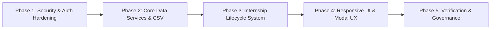

# Ashivam Technologies Admin Panel — Implementation Roadmap & Status

**Document Version:** 1.0.0  
**Status:** Approved & Canonical  
**Milestone:** Enterprise Production Delivery  

---

## 1. Roadmap Overview & Strategic Phasing

The implementation and maturation of the Ashivam Technologies Admin Panel follows a 5-phase engineering roadmap designed to transform isolated CRUD screens into a cohesive, secure, and production-grade enterprise operations platform.

---

## 2. Phase-by-Phase Deliverables & Verification Status

### Phase 1: Security, Auth & RBAC Hardening
| Deliverable | Key Technical Mechanism | Target Modules | Status |
|---|---|---|---|
| Timing Attack Defense | Precomputed bcrypt dummy hash for non-existent users | MOD-01 | **Verified** |
| Password Invalidation | Compare token `iat` against `passwordChangedAt` | MOD-01 | **Verified** |
| Self-Service Password Change | `POST /api/v1/auth/change-password` with validation | MOD-01 | **Verified** |
| Granular Permission Middleware | `requirePermission` checking admin token grants | MOD-01..11 | **Verified** |
| Last-Superadmin Invariant | Mutex check on active Superadmins count before mutation | MOD-10 | **Verified** |

### Phase 2: Core Data Services & Safe Export Pipeline
| Deliverable | Key Technical Mechanism | Target Modules | Status |
|---|---|---|---|
| Safe CSV Serialization | `toCsv` with `sanitizeCsvCell` prepending `'` on `=,+,-,@,\t,\r` | MOD-03..07, 11 | **Verified** |
| Employee Email Partial Index | `{ email: 1 }, { unique: true, partialFilterExpression: { isActive: true } }` | MOD-06 | **Verified** |
| Time-Range Analytics Filter | Aggregation pipelines supporting `7d`, `30d`, `90d`, `1y` intervals | MOD-02 | **Verified** |
| Employee CSV Export | `GET /api/v1/employees/export` with department/status filters | MOD-06 | **Verified** |
| HR Document CSV Export | `GET /api/v1/hr-documents/export` with document audit records | MOD-07 | **Verified** |

### Phase 3: Internship Lifecycle & Program Roster
| Deliverable | Key Technical Mechanism | Target Modules | Status |
|---|---|---|---|
| Intern Data Model | Schema with sequence ID `ASH-INT-YYYY-XXX`, mentor, compliance checklist | MOD-05 | **Verified** |
| Direct Intern Registration | `POST /api/v1/internships/interns` with validation & audit | MOD-05 | **Verified** |
| Candidate Conversion | `POST /api/v1/internships/applications/:id/convert` atomic transition | MOD-05 | **Verified** |
| Compliance Checklist Matrix | `PATCH /api/v1/internships/interns/:id/onboarding` atomic toggle | MOD-05 | **Verified** |
| Program Tracks Management | Multi-tier CRUD for domain programs and seat capacity | MOD-05 | **Verified** |
| Segmented Admin Frontend | 3-subtab tabbed interface in `InternshipsTab.jsx` | MOD-05 | **Verified** |

### Phase 4: UI/UX Modernization & Responsive Viewport Fixes
| Deliverable | Key Technical Mechanism | Target Modules | Status |
|---|---|---|---|
| Modal Viewport Bounding | `max-height: calc(100dvh - 2.5rem)` with internal flex scrolling | All Modals | **Verified** |
| Modal Body Scroll Locking | `body.admin-modal-open` class locking background interaction | All Modals | **Verified** |
| Pinned Header & Footer | Fixed title/actions with independently scrolling form content | All Modals | **Verified** |
| Responsive Breakpoints | Handset (360-390px), Tablet (768px), Workstation (1280-1440px) | Full UI Shell | **Verified** |
| Accessible Vector Icons | 100% SVG icon standard with zero emoji iconography | Full UI Shell | **Verified** |

### Phase 5: Verification, Architecture & Documentation Governance
| Deliverable | Location | Status |
|---|---|---|
| Business Requirements Document | `docs/admin/ADMIN_BUSINESS_REQUIREMENTS.md` | **Delivered** |
| Comprehensive Module Inventory | `docs/admin/ADMIN_MODULE_INVENTORY.md` | **Delivered** |
| Business Logic & Concurrency Rules | `docs/admin/ADMIN_BUSINESS_LOGIC.md` | **Delivered** |
| Entity Data Models & Indexes | `docs/admin/ADMIN_DATA_MODEL.md` | **Delivered** |
| RBAC Permission Matrix | `docs/admin/ADMIN_PERMISSION_MATRIX.md` | **Delivered** |
| API Contracts Specification | `docs/admin/ADMIN_API_CONTRACTS.md` | **Delivered** |
| Workflow & State Machine Specification | `docs/admin/ADMIN_WORKFLOW_AND_STATE_TRANSITIONS.md` | **Delivered** |
| Acceptance Test Plan | `docs/admin/ADMIN_ACCEPTANCE_TEST_PLAN.md` | **Delivered** |
| Implementation Roadmap & Status | `docs/admin/ADMIN_IMPLEMENTATION_ROADMAP.md` | **Delivered** |

---

## 3. Maintenance, Monitoring & Future Operational Guidance

1. **Atlas Partial Index Verification:** Ensure MongoDB Atlas staging and production deployments have executed index synchronization so the partial unique index on employees (`isActive: true`) is active.
2. **Periodic Sequence Audit:** Monitor the `ASH-INT-YYYY-XXX` sequence generator at the turn of each calendar year to ensure sequence rolling functions smoothly.
3. **Audit Log Retention Policy:** In production environments, establish an automated archival job for audit logs older than 365 days to maintain query performance on large clusters.
