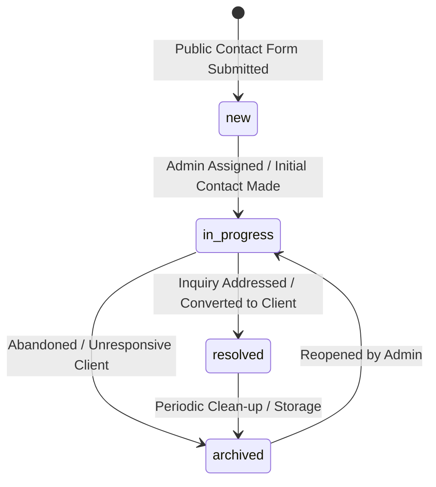
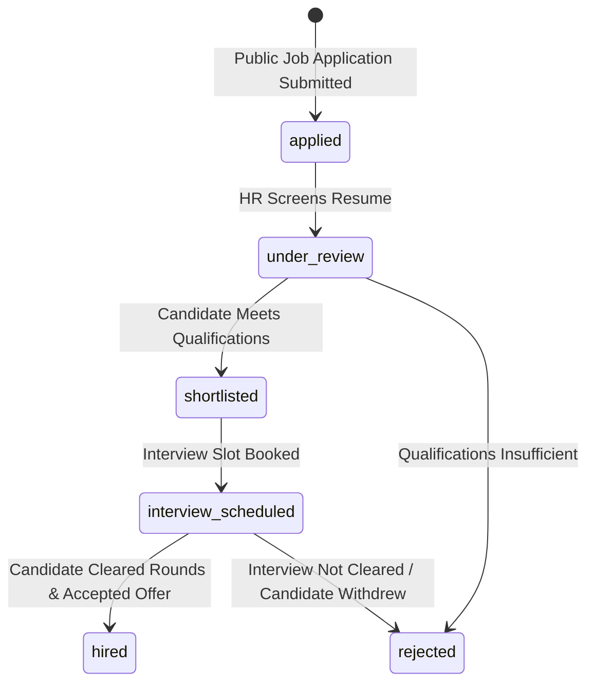
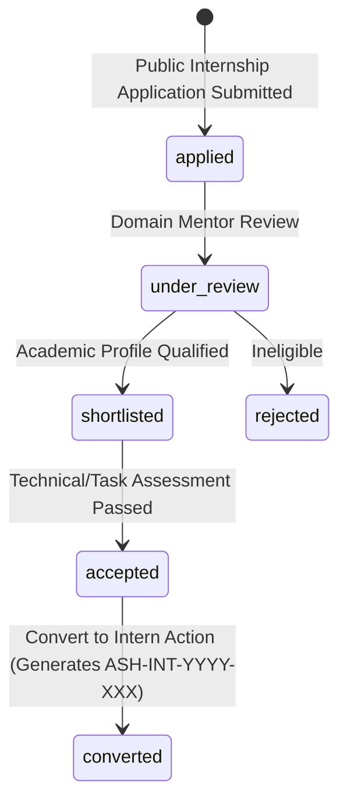
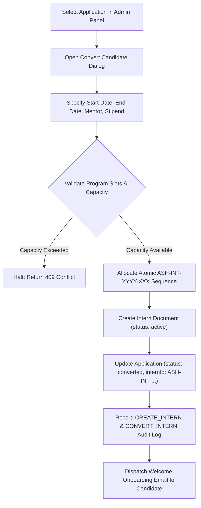
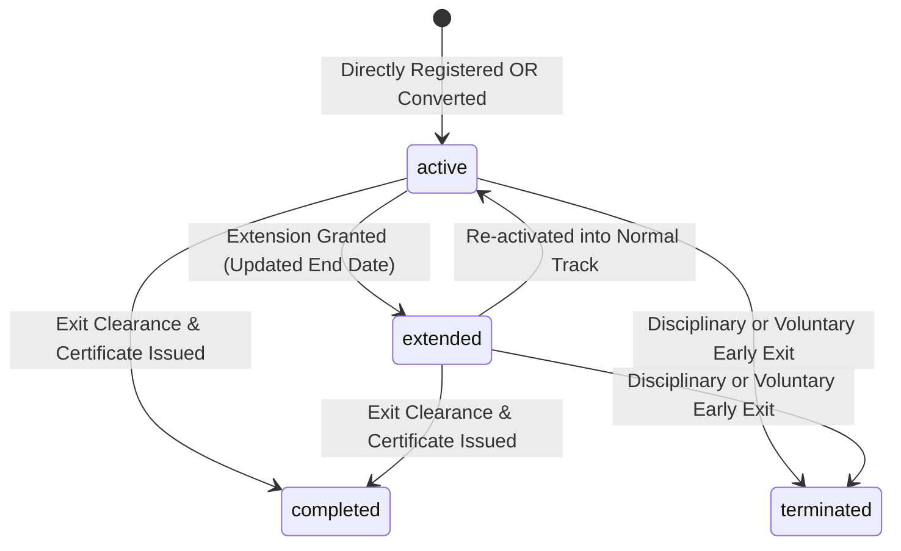
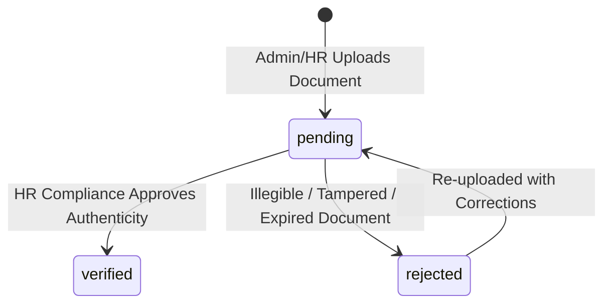
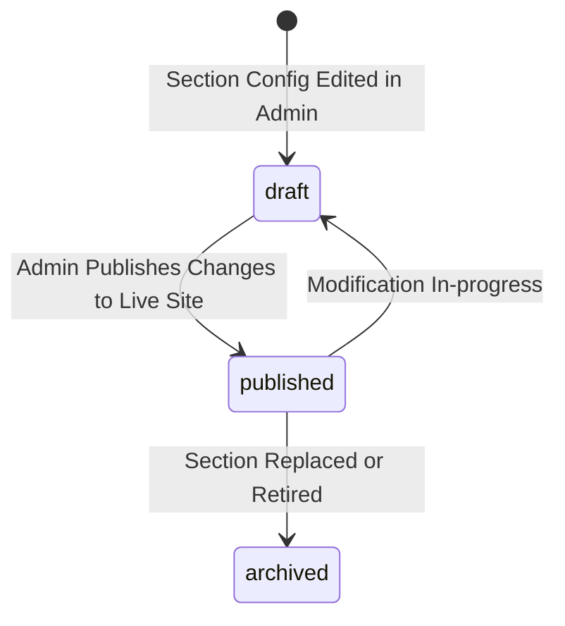
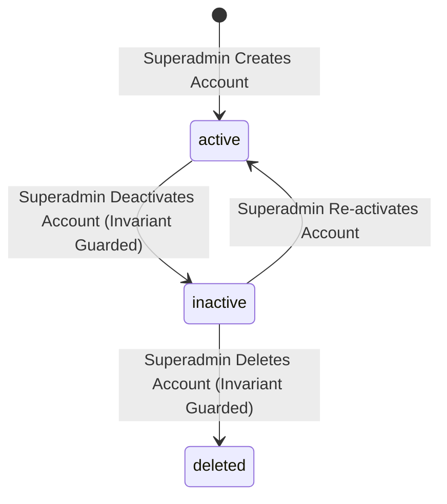

# Ashivam Technologies Admin Panel — Workflow & State Transitions Specification

**Document Version:** 1.0.0  
**Status:** Approved & Canonical  
**Architecture Pattern:** Deterministic Finite State Machines (FSM), Pre/Post-condition Contracts, Side-effect Isolation

---

## 1. Overview of System Finite State Machines

To ensure business data integrity, maintain audit compliance, and prevent illegal operational bypasses, all status transitions in the Ashivam Technologies Admin Panel follow strict Finite State Machine (FSM) specifications.

Every state transition must satisfy:
1. **Valid Source State:** The transition must be explicitly permitted from the current entity state.
2. **Actor Authorization:** The requesting admin must possess the required RBAC role and functional permission.
3. **Payload Pre-conditions:** Required fields (e.g. rejection reason, onboarding dates, mentor assignment) must accompany the transition.
4. **Side Effects & Invariants:** Audit logging, notification dispatch, or dependent entity generation must execute atomically or fail safely.

---

## 2. Inquiries & Leads State Machine (MOD-03)

### 2.1 State Diagram

### 2.2 Transition Rules
| Source State | Target State | Permitted Roles | Required Payload | Side Effects |
|---|---|---|---|---|
| `*` | `new` | System / Public Form | Full contact payload | Auto-reply confirmation sent |
| `new` | `in_progress` | Admin (`contacts`) | Optional note | Status timestamp recorded |
| `in_progress` | `resolved` | Admin (`contacts`) | Resolution note | Inquiry marked completed |
| `in_progress` | `archived` | Admin (`contacts`) | Archival reason | Retained for analytics |
| `archived` | `in_progress` | Superadmin | Reopening rationale | Audit event generated |

---

## 3. Job Candidate Hiring Pipeline (MOD-04)

### 3.1 State Diagram

### 3.2 Transition Pre-conditions & Post-conditions
- **`applied` -> `under_review`**: Triggers notification to candidate that application is being reviewed.
- **`shortlisted` -> `interview_scheduled`**: Requires interview date, interviewer name, and round notes.
- **`interview_scheduled` -> `hired`**:
  - Requires offer issuance date and proposed joining date.
  - Generates audit record: `HIRE_CANDIDATE`.
- **`*` -> `rejected`**: Optional feedback note; candidate receives polite rejection notification.

---

## 4. Internship Application & Candidate Conversion Workflow (MOD-05)

### 4.1 State Diagram

### 4.2 Candidate Conversion to Registered Intern
The transition from candidate application to registered intern is an atomic transaction:

---

## 5. Onboarded Intern Lifecycle & Compliance (MOD-05)

### 5.1 State Diagram

### 5.2 Onboarding Compliance Checklist State Matrix
Every intern document maintains a compliance matrix independent of the primary lifecycle status:
| Compliance Item | Toggle Endpoint | Pre-condition | Post-condition Effect |
|---|---|---|---|
| `offerLetterIssued` | `PATCH /interns/:id/onboarding` | Status `active` | Offer letter document linked |
| `idCardIssued` | `PATCH /interns/:id/onboarding` | Offer letter issued | Physical/Virtual badge active |
| `ndaSigned` | `PATCH /interns/:id/onboarding` | Candidate enrolled | NDA document stored |
| `repoAccessGranted` | `PATCH /interns/:id/onboarding` | NDA signed | GitHub team invited |

---

## 6. HR Document Verification Workflow (MOD-07)

### 6.1 State Diagram

### 6.2 Pre-conditions & Invariants
- A document in `verified` state cannot be deleted without Superadmin override.
- A transition to `rejected` **requires** a non-empty `rejectionReason` string.
- When an employee is soft-deleted, all linked documents are preserved for statutory audit retention.

---

## 7. Content CMS Publishing Workflow (MOD-09)

- Live website consumers (`/api/v1/content/public/:section`) only receive `published` configs.
- Rolling back restores the prior published JSON snapshot from the audit trail.

---

## 8. Admin Account Lifecycle & Last-Superadmin Invariant (MOD-10)

### Invariant Enforcement Rule:
Before executing `isActive: false` or `deleteOne()` on any admin account:
1. Check `admin.role === "Superadmin"`.
2. If true, count `Admin.countDocuments({ role: "Superadmin", isActive: true })`.
3. If count `<= 1`, abort with `409 Conflict: Cannot deactivate or delete the platform's sole remaining Superadmin`.
