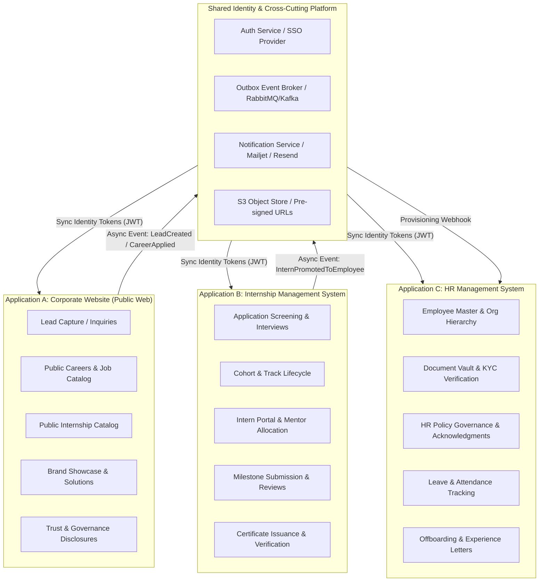
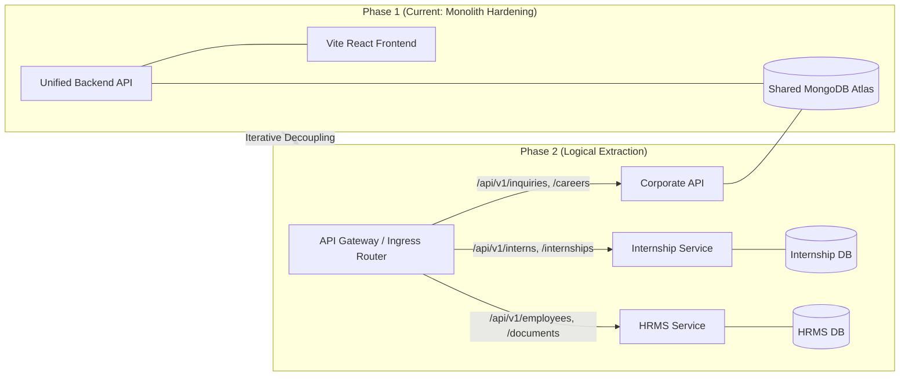

# Ashivam Technologies — Application Boundaries & Domain Decomposition

> **Document Version:** 1.0.0  
> **Classification:** Internal Engineering Standard  
> **Status:** Approved Target Architecture  
> **Authors:** Principal Software Architect, Senior Backend Engineer  

---

## 1. Executive Summary

Ashivam Technologies operates a unified digital ecosystem transitioning from an initial modular monolith to three strictly bounded, independent domain applications:

1. **Official Corporate Website (`ashivam-corporate-web`)** — Public brand presence, services portfolio, solutions showcase, lead generation, career application intake, and trust/compliance disclosures.
2. **Internship Management System (`ashivam-internship-management`)** — End-to-end internship lifecycle: cohort admissions, track curriculum, mentor allocation, weekly milestone submissions, evaluations, and cryptographic certificate issuance.
3. **HR Management System (`ashivam-hr-management`)** — Enterprise human resources: employee master records, cryptographically verified document vaults, organization chart hierarchy, policy governance, attendance, and offboarding.

This document establishes the formal Domain-Driven Design (DDD) bounded contexts, data ownership invariants, communication interfaces, and the extraction migration roadmap without breaking current production monolithic stability.

---

## 2. Domain Decomposition & Context Map



---

## 3. Bounded Context Specifications

### 3.1 Application A: Official Corporate Website

| Attribute | Specification |
| :--- | :--- |
| **Primary Actors** | Prospective clients, enterprise partners, job seekers, internship applicants, general public |
| **Authentication Requirement** | Anonymous by default; Admin role required for content management and inquiry triage |
| **Core Aggregates** | `Inquiry`, `JobPosting`, `PublicApplication`, `CompanyNotice` |
| **Database Collections (Current)** | `inquiries`, `careers` (subset: job listings and inbound resumes) |
| **External Dependencies** | Mailjet/Resend (Transactional Email), Cloudflare (CDN/WAF), Google Analytics / PostHog |
| **SLA & Uptime Tier** | 99.95% Availability; < 1.2s LCP globally; aggressive CDN edge caching |
| **Data Retention** | Inquiries: 180 days after resolution; Public Job Postings: active lifecycle + 30-day archival |

#### Domain Responsibilities
1. **Public Marketing & Lead Generation:** Rendering high-performance, accessible pages highlighting Ashivam Technologies' engineering services, industry solutions, and company vision.
2. **Inquiry Intake & Rate Limiting:** Accepting customer inquiries with strict anti-spam defenses (IP/email sliding window rate limits, honeypot fields, and schema sanitization).
3. **Careers Portal:** Exposing current active job and internship openings with secure resume file uploads (magic-byte validated PDF/DOCX, pre-signed S3 storage).
4. **Legal & Trust Governance:** Presenting Privacy Policy, Terms of Service, Security Architecture, and SLA documentation conforming to Indian IT Act 2000 / DPDP Act 2023.

---

### 3.2 Application B: Internship Management System

| Attribute | Specification |
| :--- | :--- |
| **Primary Actors** | Internship Candidates, Enrolled Interns, Technical Mentors, Track Leads, Internship Directors |
| **Authentication Requirement** | Role-Based Access Control (RBAC): `CANDIDATE`, `INTERN`, `MENTOR`, `TRACK_LEAD`, `INTERNSHIP_ADMIN` |
| **Core Aggregates** | `InternshipCohort`, `CandidateApplication`, `InternProfile`, `MilestoneEvaluation`, `CertificateRecord` |
| **Database Collections (Current)** | `internships`, `interns`, `certificates` |
| **External Dependencies** | S3 (Project Code Submissions), Mailjet (Onboarding & Evaluation Notices), PDF Generation Engine |
| **SLA & Uptime Tier** | 99.9% Availability during business hours (08:00 - 22:00 IST) |
| **Data Retention** | Active cohort duration + 5 years for certificate cryptographic verification lookup |

#### Domain Responsibilities
1. **Admissions & Screening:** Multi-stage applicant vetting (Technical Quiz, Coding Screening, Mentor Interview) with automated status notifications.
2. **Cohort & Track Management:** Structuring cohorts across domains (Full-Stack Engineering, Cloud Architecture, AI/ML, Cyber Security).
3. **Mentor Allocation & Milestone Reviews:** Weekly sprint reviews, pull request assessments, and mentor evaluation rubrics.
4. **Credentialing & Certification:** Automated issuance of tamper-evident digital certificates with unique hash verification (`/verify/cert/:id`).
5. **Pre-Placement Offer (PPO) Handoff:** Triggering `InternPromotedToEmployee` domain event to initiate HR onboarding.

---

### 3.3 Application C: HR Management System (HRMS)

| Attribute | Specification |
| :--- | :--- |
| **Primary Actors** | Employees, People Operations Managers, Department Heads, Finance Officers, Superadmin |
| **Authentication Requirement** | Multi-Factor Authentication (MFA); Strict RBAC: `EMPLOYEE`, `HR_MANAGER`, `DEPT_HEAD`, `SUPERADMIN` |
| **Core Aggregates** | `Employee`, `Department`, `EmployeeDocument`, `HRDocumentPolicy`, `LeaveRecord` |
| **Database Collections (Current)** | `employees`, `employeedocuments`, `hrdocuments` |
| **External Dependencies** | Encrypted S3 Bucket (KYC/Aadhaar/PAN/Degree Documents), Payroll Gateway, SMTP Service |
| **SLA & Uptime Tier** | 99.99% Availability; zero tolerance for data loss; point-in-time recovery (PITR) |
| **Data Retention** | Permanent for active employment + 7 years statutory retention post-resignation/termination |

#### Domain Responsibilities
1. **Employee Master Directory:** Centralized employee profiles, reporting hierarchies, designation mapping, and employment status history.
2. **Cryptographic Document Vault:** Secure KYC document storage with client-side/server-side AES-256-GCM encryption, document verification workflows, and audit trails.
3. **Company Policies & Governance:** Distributing statutory compliance policies (POSH, Code of Conduct, Information Security Policy) with mandatory digital employee acknowledgments.
4. **Attendance & Leave Management:** Leave accrual balances, sick/casual leave requests, multi-tier approval workflows, and holiday calendars.
5. **Offboarding & Separation:** Exit interviews, asset recovery checklists, clearance sign-offs, and automated issuance of Relieving & Experience certificates.

---

## 4. Current Monolithic Co-Location vs. Target Separation

### 4.1 Current Repository Topology (`ashivam-tecH`)
The existing repository co-locates all three domains within a single monolithic Express + Vite React codebase:
```
backend/src/
  ├── controllers/
  │    ├── inquiry.controller.js       --> Domain A (Corporate Website)
  │    ├── career.controller.js        --> Domain A (Corporate Website)
  │    ├── internship.controller.js    --> Domain B (Internship Management)
  │    ├── intern.controller.js        --> Domain B (Internship Management)
  │    ├── employee.controller.js      --> Domain C (HRMS)
  │    ├── employeeDocument.ctrl.js    --> Domain C (HRMS)
  │    └── hrDocument.controller.js    --> Domain C (HRMS)
  └── models/
       ├── Inquiry.js                  --> Domain A
       ├── Career.js                   --> Domain A
       ├── Internship.js               --> Domain B
       ├── Intern.js                   --> Domain B
       ├── Employee.js                 --> Domain C
       ├── EmployeeDocument.js         --> Domain C
       └── HRDocument.js               --> Domain C
```

### 4.2 Migration Strategy: Strangler Fig Pattern
To maintain 100% uptime and avoid catastrophic rewrite risks, Ashivam Technologies uses the **Strangler Fig Pattern**:



---

## 5. Anti-Corruption & Integration Safeguards

1. **Direct Database Joins Prohibited:** No controller or service in one domain may use Mongoose `$lookup` across collections owned by another domain.
2. **Canonical Identifiers:** Domain boundaries reference entities exclusively via immutable UUIDs / ObjectIds (`employeeId`, `internId`, `inquiryId`).
3. **Transactional Outbox for Domain Events:** Cross-boundary notifications (e.g., Intern to Employee conversion) are written to a transactional `Outbox` table within the same ACID transaction before being dispatched asynchronously.
4. **Data Privacy Isolation:** Public corporate website workers have zero database read or write privileges on `employees` or `employeedocuments` collections.

---

## 6. Acceptance & Architectural Sign-Off

- **Architectural Conformance:** Strictly adheres to OWASP ASVS 5.0 Chapter 1 (Architecture) and DDD Boundary Isolations.
- **Backwards Compatibility:** All existing monolithic REST routes remain fully operational during the multi-phase extraction process.
- **Review Cycle:** Semi-annual architectural review prior to any major service extraction sprint.
