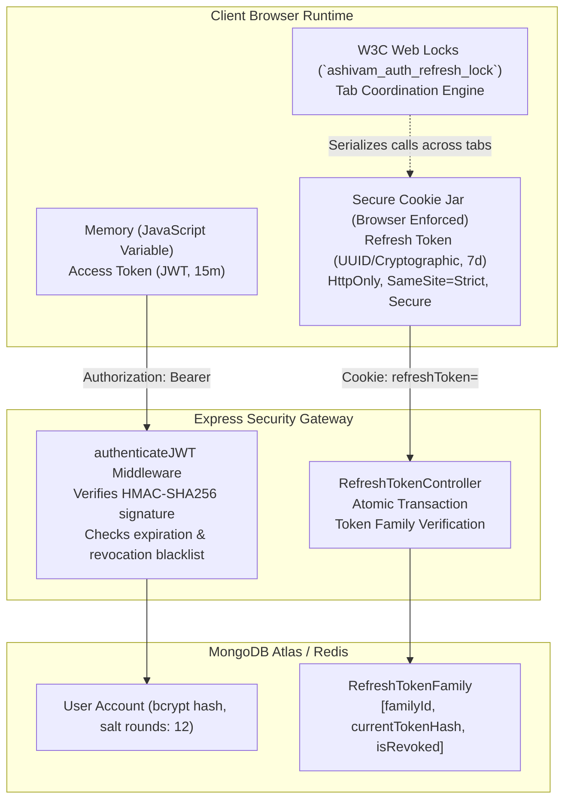
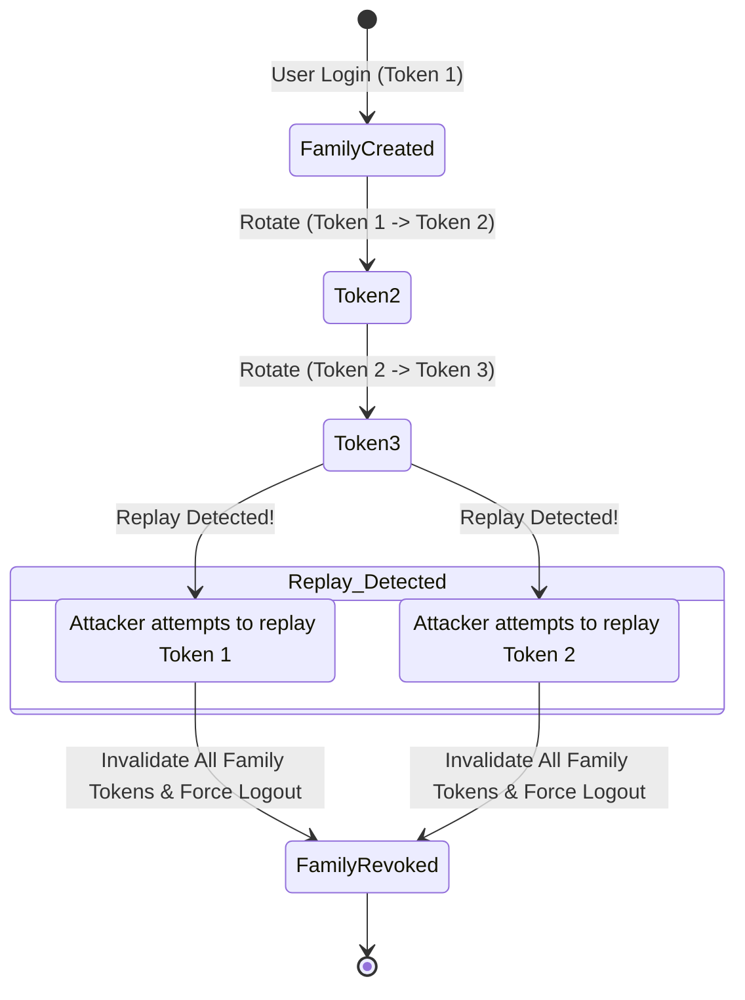

# Ashivam Technologies — Authentication & Session Architecture

> **Document Version:** 2.0.0  
> **Classification:** Security Standard & Engineering Reference  
> **Compliance:** OWASP ASVS 5.0 (V2 Authentication, V3 Session Management)  
> **Target Audience:** Full-Stack Engineers, Security Auditors  

---

## 1. Executive Summary

Ashivam Technologies implements a modern, defense-in-depth authentication and session management architecture designed to mitigate session hijacking, Cross-Site Scripting (XSS) token theft, Cross-Site Request Forgery (CSRF), and distributed token race conditions.

The architecture combines:
1. **Short-Lived JWT Access Tokens (15 Minutes):** Kept strictly in client-side memory (never in `localStorage` or `sessionStorage`).
2. **Rotating Refresh Tokens (7 Days):** Issued inside secure, hardened HTTP cookies with automated token family tracking.
3. **Replay Attack Detection & Family Revocation:** Automatic revocation of all active sessions if an expired or previously consumed token is replayed.
4. **Multi-Tab Web Locks Serialization:** Utilizing the W3C Web Locks API (`navigator.locks`) on the frontend to eliminate concurrent refresh races across multiple browser tabs.
5. **Multi-Factor Authentication (MFA):** RFC 6238 TOTP standard for all privileged administrative and HRMS user accounts.

---

## 2. Token Topology & Cryptographic Specifications



### 2.1 Cryptographic Token Attributes

| Token Type | Lifespan | Storage Location | Payload Contents | Encryption / Signing Algorithm |
| :--- | :--- | :--- | :--- | :--- |
| **Access Token** | 15 Minutes | In-Memory (React state / closure) | `userId`, `role`, `email`, `department`, `iat`, `exp`, `jti` | HMAC-SHA256 (`HS256`) via `JWT_SECRET` (256-bit entropy minimum) |
| **Refresh Token** | 7 Days (Sliding) | `HttpOnly` Cookie | Opaque cryptographic string (32 bytes entropy) | SHA-256 hash stored in DB; signed via `JWT_REFRESH_SECRET` |
| **Password Reset Token** | 30 Minutes | Ephemeral Email Link | HMAC signed token with single-use nonce | SHA-256 hash stored in DB |
| **MFA TOTP Secret** | Permanent until reset | Encrypted in DB | Base32 encoded 160-bit shared secret | AES-256-GCM authenticated encryption |

---

## 3. Refresh Token Rotation & Replay Attack Defense

When an access token expires, the client sends the rotating refresh token stored in the `HttpOnly` cookie to `/api/v1/auth/refresh-token`.

### 3.1 Token Family Algorithm
Every login generates a new **Token Family ID** (`familyId`).
1. **Normal Rotation:**
   - Client presents `Token_N`.
   - Backend verifies `Token_N` is the currently expected active token for `familyId`.
   - Backend marks `Token_N` as consumed, generates `Token_N+1`, stores `Token_N+1` in the database, and returns it to the client via `Set-Cookie`.
2. **Replay Detection (Compromised Session):**
   - If an attacker intercepts and replays `Token_N` *after* the legitimate client has already rotated to `Token_N+1`:
   - Backend detects that `Token_N` has already been consumed.
   - **Immediate Revocation:** Backend immediately flags the *entire* `familyId` as compromised and revokes all active tokens for that user account.
   - Both the attacker and the legitimate user are invalidated, forcing a clean re-authentication and triggering a security alert to `team.ashivam@gmail.com`.



---

## 4. Multi-Tab Race Condition Defense (W3C Web Locks)

### 4.1 The Concurrency Problem
When an authenticated user opens 5 browser tabs simultaneously and their access token expires, all 5 tabs would simultaneously trigger a `/refresh-token` network call. Without synchronization:
- Tab 1 succeeds and rotates to `Token_2`.
- Tab 2 hits the server with `Token_1` 50ms later.
- The server interprets Tab 2's call as a **token replay attack**, revoking the entire session and abruptly logging the user out.

### 4.2 Frontend Web Locks Implementation
Ashivam Technologies eliminates this race condition in `src/api/client.js` using the standard W3C Web Locks API (`navigator.locks.request`):

```javascript
// Production-Hardened Token Refresh with Web Locks
let isRefreshing = false;
let refreshPromise = null;

export async function getValidAccessToken() {
  if (isAccessTokenValid()) {
    return currentAccessToken;
  }

  // Fallback for non-supported browsers
  if (!navigator.locks) {
    return serializedFallbackRefresh();
  }

  // Coordinate across all open tabs in the browser origin
  return navigator.locks.request('ashivam_auth_refresh_lock', async () => {
    // Re-check after obtaining the lock (another tab may have just refreshed it)
    if (isAccessTokenValid()) {
      return currentAccessToken;
    }

    try {
      const response = await fetch('/api/v1/auth/refresh-token', {
        method: 'POST',
        credentials: 'include', // transmits HttpOnly refresh cookie
        headers: { 'Content-Type': 'application/json' }
      });

      if (!response.ok) {
        throw new Error('Refresh token invalid or expired');
      }

      const data = await response.json();
      currentAccessToken = data.data.accessToken;
      return currentAccessToken;
    } catch (err) {
      handleSessionTermination();
      throw err;
    }
  });
}
```

---

## 5. Cookie Security Configuration

The refresh token cookie is set by Express with the following mandatory security flags:

```javascript
res.cookie('refreshToken', newRefreshToken, {
  httpOnly: true,                                       // Prevents JavaScript access (mitigates XSS)
  secure: process.env.NODE_ENV === 'production',        // Enforces HTTPS-only transmission
  sameSite: 'strict',                                  // Strictly prevents CSRF attacks
  path: '/api/v1/auth',                                 // Restricts cookie scope to auth endpoints only
  maxAge: 7 * 24 * 60 * 60 * 1000                      // 7 days
});
```

---

## 6. Role-Based Access Control (RBAC) Matrix

| Endpoint Group | Anonymous | Applicant / Intern | Employee | Department Head / HR | Superadmin |
| :--- | :---: | :---: | :---: | :---: | :---: |
| **Public Website (`/api/v1/inquiries`)** | Create | Create | Create | View / Triage | Full Admin |
| **Careers Intake (`/api/v1/careers/apply`)**| Create | Create | Create | View / Review | Full Admin |
| **Intern Portal (`/api/v1/interns/me`)** | No Access | Read / Submit | Read | Read / Review | Full Admin |
| **HR Document Vault (`/api/v1/employee-documents`)** | No Access | No Access | Read Own / Upload | Verify / Approve | Full Admin |
| **HR Policies (`/api/v1/hr-documents`)** | No Access | Read Public | Read All / Ack | Create / Manage | Full Admin |
| **User & Staff Directory (`/api/v1/employees`)** | No Access | No Access | Read Org Chart | Manage Dept | Full Admin |
| **Audit Logs (`/api/v1/audit-logs`)** | No Access | No Access | No Access | Read Own Dept | Read All / Export |

---

## 7. Password Management & Storage Standards

1. **Hashing Function:** `bcrypt` with salt rounds factor = `12`.
2. **Password Complexity Requirements:**
   - Minimum length: 12 characters.
   - At least 1 uppercase letter (`A-Z`).
   - At least 1 lowercase letter (`a-z`).
   - At least 1 digit (`0-9`).
   - At least 1 special character (`[!@#$%^&*(),.?":{}|<>]`).
3. **Breached Password Checks:** Enforces OWASP ASVS 2.1.7 against known leaked passwords list (HaveIBeenPwned top 100,000 dictionary check).
4. **Account Lockout:** 5 consecutive failed login attempts locks the account for 15 minutes with security alert dispatch to the user's registered email.
