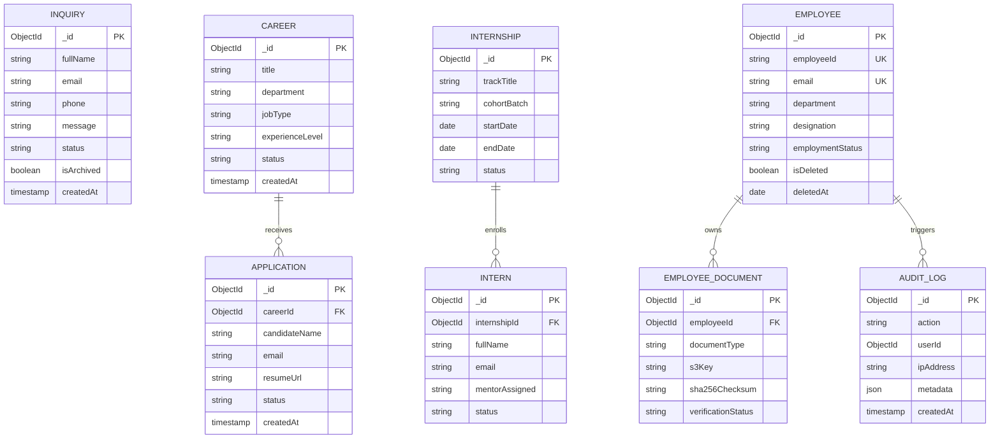

# Ashivam Technologies — Database Architecture & Persistence Strategy

> **Document Version:** 1.0.0  
> **Classification:** Engineering & Operations Standard  
> **Technology:** MongoDB Atlas Replica Set (Engine v7.0) with Mongoose ODM  
> **Target Audience:** Database Administrators, Senior Backend Engineers  

---

## 1. Executive Summary

The Ashivam Technologies platform utilizes **MongoDB Atlas** running as a multi-region replica set on AWS (Primary: `ap-south-1` Mumbai, Disaster Recovery: `ap-southeast-1` Singapore).

This document establishes the persistence standards, partial unique index patterns, soft-delete invariants, transaction boundaries, optimistic concurrency control, and zero-downtime migration protocols.

---

## 2. Collection Topology & Index Inventory



### 2.1 Index Specifications & Partial Constraints

| Collection | Index Fields | Index Type | Purpose / Business Rule |
| :--- | :--- | :--- | :--- |
| `employees` | `{ employeeId: 1 }` | Unique | Enforces immutable employee enterprise identifier. |
| `employees` | `{ email: 1 }` | Partial Unique: `{ isDeleted: false }` | Prevents duplicate active emails while allowing soft-deleted historical records. |
| `employees` | `{ department: 1, employmentStatus: 1 }` | Compound | Fast organization roster queries and department headcount filtering. |
| `inquiries` | `{ email: 1, createdAt: -1 }` | Compound | Rate limit evaluation and historical lead aggregation. |
| `inquiries` | `{ status: 1, createdAt: -1 }` | Compound | Operations triage queue sorting (newest unread leads first). |
| `careers` | `{ status: 1, department: 1 }` | Compound | Public website career portal listing optimization. |
| `employeedocuments` | `{ employeeId: 1, documentType: 1 }` | Compound | Rapid document checklist retrieval per employee. |
| `auditlogs` | `{ createdAt: -1 }` | TTL Index (365 Days) | Automated compliance retention and log rotation. |
| `outbox_events` | `{ status: 1, createdAt: 1 }` | Partial Compound | Efficient polling queue for unhandled asynchronous events. |

---

## 3. Soft-Delete & Tenant Isolation Invariants

To comply with statutory legal requirements and maintain historical relational integrity, entities (such as `Employee`, `Career`, `Internship`) are **never hard-deleted** via `deleteOne` or `deleteMany`.

### 3.1 Soft-Delete Schema Structure
```javascript
const SoftDeleteSchemaExtension = {
  isDeleted: {
    type: Boolean,
    default: false,
    index: true
  },
  deletedAt: {
    type: Date,
    default: null
  },
  deletedBy: {
    type: mongoose.Schema.Types.ObjectId,
    ref: 'User',
    default: null
  }
};
```

### 3.2 Query Middleware Safeguard
To eliminate accidental leakage of soft-deleted documents, Mongoose pre-query middleware automatically applies `{ isDeleted: { $ne: true } }` across all `find`, `findOne`, `findOneAndUpdate`, and `countDocuments` queries:

```javascript
function applySoftDeleteFilter(next) {
  if (this.getQuery().includeDeleted !== true) {
    this.where({ isDeleted: { $ne: true } });
  }
  next();
}

schema.pre('find', applySoftDeleteFilter);
schema.pre('findOne', applySoftDeleteFilter);
schema.pre('findOneAndUpdate', applySoftDeleteFilter);
schema.pre('countDocuments', applySoftDeleteFilter);
```

---

## 4. Multi-Document ACID Transactions

For complex workflows involving multiple dependent collections, operations are wrapped inside **MongoDB Multi-Document ACID Transactions** utilizing client sessions:

### 4.1 Intern-to-Employee Conversion Transaction Flow
```javascript
async function promoteInternToEmployee(internId, employeePayload, session) {
  const transactionSession = session || await mongoose.startSession();
  
  if (!session) {
    transactionSession.startTransaction();
  }

  try {
    // 1. Validate and update intern status
    const intern = await Intern.findByIdAndUpdate(
      internId,
      { status: 'CONVERTED_TO_EMPLOYEE' },
      { session: transactionSession, new: true }
    );
    if (!intern) throw new NotFoundError('Intern record not found');

    // 2. Create Employee Master record
    const employee = await Employee.create([employeePayload], { session: transactionSession });

    // 3. Emit Transactional Outbox Event
    await OutboxEvent.create([{
      aggregateType: 'EMPLOYEE',
      aggregateId: employee[0]._id,
      eventType: 'employee.onboarded.from_internship',
      payload: { internId, employeeId: employee[0].employeeId }
    }], { session: transactionSession });

    // 4. Log Immutable Audit Record
    await AuditLog.create([{
      action: 'INTERN_PROMOTED_TO_EMPLOYEE',
      userId: employeePayload.createdBy,
      targetId: employee[0]._id
    }], { session: transactionSession });

    if (!session) {
      await transactionSession.commitTransaction();
    }
    return employee[0];
  } catch (error) {
    if (!session) {
      await transactionSession.abortTransaction();
    }
    throw error;
  } finally {
    if (!session) {
      transactionSession.endSession();
    }
  }
}
```

---

## 5. Optimistic Concurrency Control (OCC)

To prevent the "Lost Update" problem during simultaneous edits (e.g., two HR managers updating an employee's salary or leave allocation at the same time), all mutable domain documents implement Mongoose's optimistic concurrency control:

```javascript
schema.set('optimisticConcurrency', true);
schema.set('versionKey', '__v');
```
If a conflicting update occurs, Mongoose throws a `VersionError`, returning an HTTP `409 Conflict` to the client, prompting them to refresh the record and review the concurrent change.

---

## 6. Backup, Recovery & Disaster Scenarios

| Tier | Backup Frequency | Retention Period | RPO (Recovery Point Objective) | RTO (Recovery Time Objective) |
| :--- | :--- | :--- | :--- | :--- |
| **Continuous PITR** | Continuous oplog streaming | 35 Days | < 1 Minute | < 15 Minutes |
| **Daily Snapshots** | Daily at 02:00 IST | 90 Days | 24 Hours | < 30 Minutes |
| **Monthly Offsite Archival**| 1st of each month | 7 Years (Statutory) | 30 Days | < 4 Hours |

### 6.1 Disaster Recovery Runbook (Regional Outage)
In the event of an AWS `ap-south-1` complete facility failure:
1. Atlas automatically promotes the secondary replica member in `ap-southeast-1` to Primary within 12 seconds.
2. Express connection string uses standard DNS SRV seed list (`mongodb+srv://...`), allowing clients to transparently reconnect without code modification or service redeployment.
3. Health check probe (`/api/v1/health`) reflects active connection to secondary cluster member.
