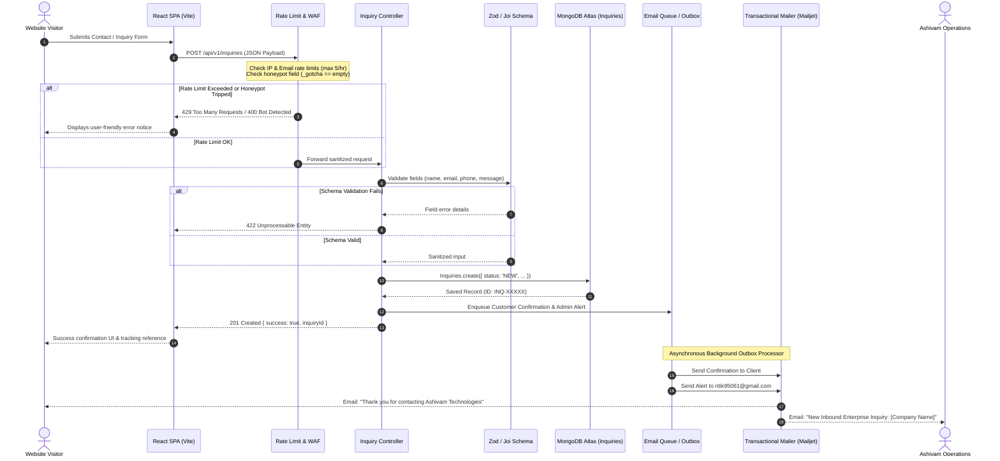
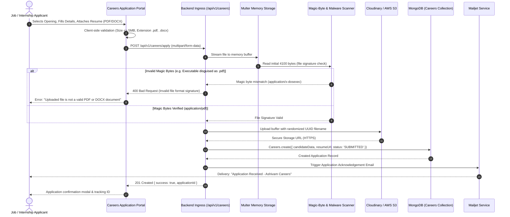
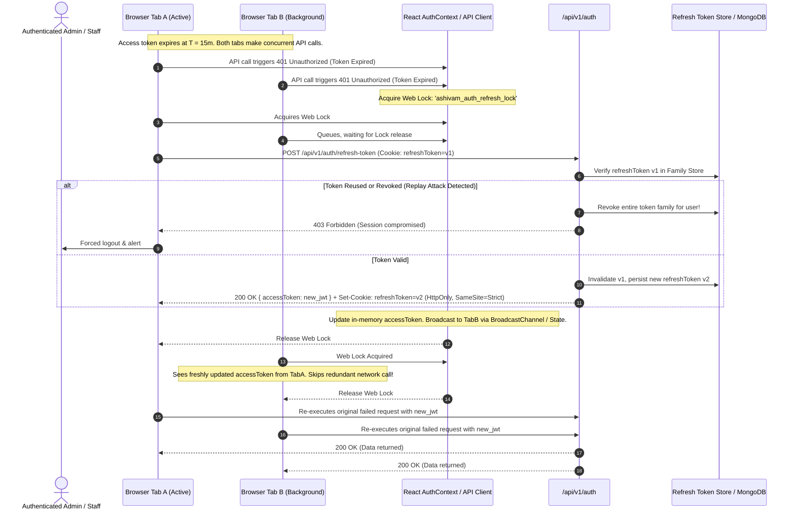
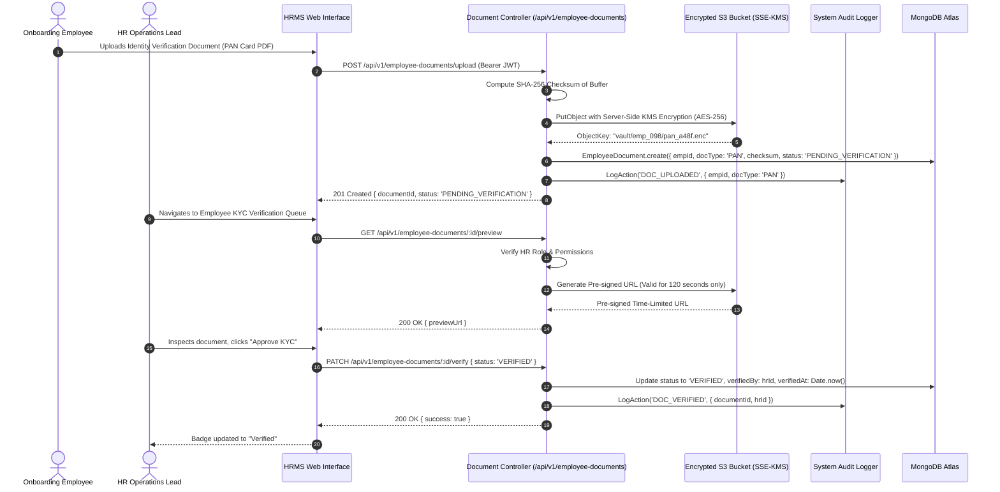

# Ashivam Technologies — System Data Flow & Sequence Specifications

> **Document Version:** 1.0.0  
> **Classification:** Technical Reference Architecture  
> **Status:** Production Standard  
> **Target Audience:** Engineering Leads, Full-Stack Developers, Security Architects  

---

## 1. Overview

This document specifies the end-to-end data flows, sequence interactions, protocol boundaries, and security validation gates across all core business journeys in the Ashivam Technologies platform ecosystem.

---

## 2. Core Business Journeys

### 2.1 Lead Capture & Corporate Inquiry Submission

The inquiry submission pathway handles inbound customer and enterprise leads. It features a defense-in-depth sanitization pipeline, anti-spam honeypot detection, sliding-window rate limiting, and reliable transactional email notification via an asynchronous outbox worker.

---

### 2.2 Careers & Resume Application Workflow

The careers intake workflow securely accepts applicant profiles and CVs/resumes. Uploaded files undergo strict MIME and magic-byte inspection before persistence.

---

### 2.3 Authentication, Token Lifecycle & Silent Web Lock Refresh

Ashivam Technologies implements the OWASP Session Management standard using short-lived JWT Access Tokens (15-minute expiry) in memory and rotation-secured `HttpOnly` Refresh Tokens (7-day sliding expiry). Concurrent tabs coordinate refresh calls via the W3C Web Locks API (`navigator.locks`) to eliminate race conditions and avoid accidental family revocation.

---

### 2.4 HRMS Employee Document Vault & Cryptographic Verification

Employee sensitive identity documents (Aadhaar, PAN, Academic Degrees, Experience Letters) require cryptographic verification, immutable audit logging, and role-restricted viewing.

---

## 3. Data Integrity & Consistency Rules

1. **At-Least-Once Delivery for Email Outbox:** All business events that generate outbound notifications persist an outbox record in MongoDB in the same database session as the domain entity update.
2. **Pre-Signed S3 Access Expiry:** Direct storage links are never publicly exposed. All document URLs are ephemeral pre-signed links expiring within 120 seconds.
3. **Audit Trail Immutability:** Audit log entries (`auditlogs` collection) are strictly append-only; update and delete operations on the audit collection are rejected by database triggers.
