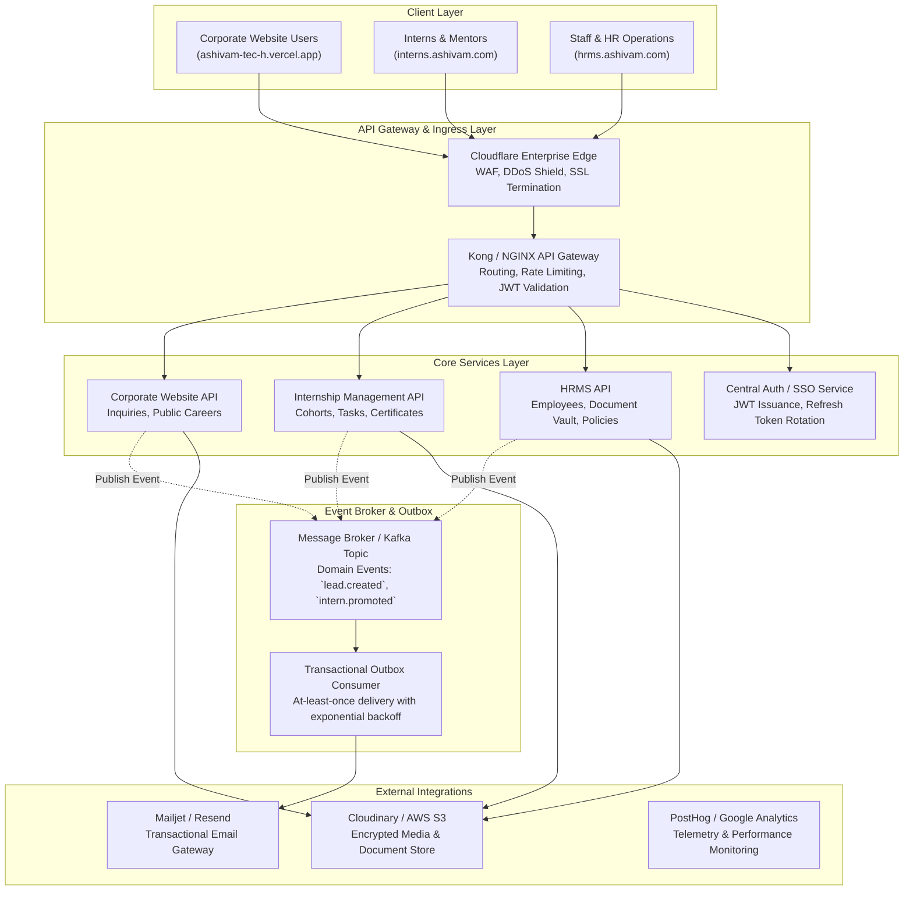

# Ashivam Technologies — Integration Architecture & Inter-Service Specifications

> **Document Version:** 1.0.0  
> **Classification:** Engineering Specification  
> **Status:** Production Target  
> **Authors:** Principal Software Architect, DevSecOps Lead  

---

## 1. Executive Summary

As Ashivam Technologies scales from a modular monolith to a distributed multi-application ecosystem, communication across the **Official Corporate Website**, **Internship Management System**, and **HR Management System** must adhere to clear protocols, strict boundary isolation, and robust failure resilience.

This document specifies the synchronous REST API contracts, asynchronous event architectures, webhook security protocols, and third-party integrations connecting Ashivam Technologies' services.

---

## 2. Inter-Service Communication Topology



---

## 3. Communication Patterns

### 3.1 Synchronous Ingress (REST / JSON)
- **Standard Protocol:** HTTP/2 over TLS 1.3.
- **Payload Format:** JSON conforming to the standardized Ashivam Response Envelope:
  ```json
  {
    "success": true,
    "statusCode": 200,
    "message": "Resource retrieved successfully",
    "data": { ... },
    "meta": {
      "page": 1,
      "limit": 20,
      "totalRecords": 150,
      "totalPages": 8
    },
    "correlationId": "req_8f19b4e0-798c-4f81-a83d-1a8c9b910bcf",
    "timestamp": "2026-11-07T18:15:30.000Z"
  }
  ```
- **Timeouts & Circuit Breakers:** Synchronous upstream calls carry a strict 5,000ms timeout with a circuit breaker tripping after 5 consecutive 5xx errors.

### 3.2 Asynchronous Domain Events (Transactional Outbox Pattern)
To ensure distributed transactional consistency without two-phase commits (2PC), all inter-application events use the **Transactional Outbox Pattern**.

#### Outbox Schema Definition
```sql
CREATE TABLE outbox_events (
    id UUID PRIMARY KEY DEFAULT gen_random_uuid(),
    aggregate_type VARCHAR(64) NOT NULL,
    aggregate_id VARCHAR(64) NOT NULL,
    event_type VARCHAR(128) NOT NULL,
    payload JSONB NOT NULL,
    status VARCHAR(32) NOT NULL DEFAULT 'PENDING', -- PENDING, PUBLISHED, FAILED
    retry_count INT DEFAULT 0,
    max_retries INT DEFAULT 5,
    last_error TEXT,
    created_at TIMESTAMP WITH TIME ZONE DEFAULT NOW(),
    published_at TIMESTAMP WITH TIME ZONE
);
CREATE INDEX idx_outbox_pending ON outbox_events (status, created_at) WHERE status = 'PENDING';
```

#### Event Catalog
| Event Name | Producer | Consumer | Trigger Condition |
| :--- | :--- | :--- | :--- |
| `lead.inquiry.created` | Corporate Website | Notification Service | Visitor submits contact/inquiry form |
| `career.application.submitted` | Corporate Website | Notification Service, ATS | Candidate uploads resume and submits application |
| `internship.application.approved` | Internship System | Notification Service | Track lead marks applicant as accepted |
| `internship.cohort.assigned` | Internship System | Notification Service, LMS | Cohort onboarding packet dispatched |
| `internship.certificate.issued` | Internship System | Public Verification Portal | Completion certificate generated & signed |
| `intern.promoted.to_employee` | Internship System | HRMS | High-performing intern converted to full-time staff |
| `employee.kyc.submitted` | HRMS | HR Review Queue | Employee uploads Aadhaar/PAN in vault |
| `employee.resignation.accepted` | HRMS | IT Clearance, Finance, Admin | Offboarding workflow initiated |

---

## 4. Webhook Security Architecture

External webhooks (e.g. from payment gateways or external Git providers) and internal webhooks dispatched across services must satisfy the following security controls:

### 4.1 Cryptographic Signature Verification
Every inbound webhook payload is signed using **HMAC-SHA256** with an ephemeral shared secret. The receiving endpoint must verify the signature prior to reading or parsing the request body.

```javascript
// Reference Verification Implementation
const crypto = require('crypto');

function verifyWebhookSignature(rawBody, signatureHeader, secret) {
  if (!signatureHeader || !signatureHeader.startsWith('t=')) {
    return false;
  }

  // Format: t=1730998800,v1=9c4a8f...
  const parts = signatureHeader.split(',');
  const timestamp = parts.find(p => p.startsWith('t=')).split('=')[1];
  const signature = parts.find(p => p.startsWith('v1=')).split('=')[1];

  // Prevent replay attacks (reject payloads older than 300 seconds)
  const currentTimestamp = Math.floor(Date.now() / 1000);
  if (Math.abs(currentTimestamp - parseInt(timestamp, 10)) > 300) {
    return false;
  }

  const signedPayload = `${timestamp}.${rawBody}`;
  const expectedSignature = crypto
    .createHmac('sha256', secret)
    .update(signedPayload)
    .digest('hex');

  return crypto.timingSafeEqual(
    Buffer.from(signature, 'hex'),
    Buffer.from(expectedSignature, 'hex')
  );
}
```

### 4.2 Idempotency Invariants
- Inbound webhooks must supply an `X-Idempotency-Key` or unique event identifier (`event.id`).
- Incoming events are checked against the Redis `processed_events` set with a 72-hour TTL. Duplicate requests immediately return `200 OK` without re-processing business logic.

---

## 5. Third-Party Provider Integrations

### 5.1 Transactional Email (Mailjet API v3.1 / Resend)
- **Authentication:** API Key & Secret Bearer Token.
- **Failover Strategy:** Primary provider is Mailjet (`api.mailjet.com`). If 3 consecutive connection timeouts occur, the outbound queue routes through the backup Resend SMTP endpoint.
- **Domain Deliverability:** Enforced SPF (`v=spf1 include:mailjet.com ~all`), DKIM (2048-bit key on `ashivam.com`), and DMARC (`v=DMARC1; p=reject; rua=mailto:ritik95061@gmail.com`).

### 5.2 Encrypted Media & Document Store (AWS S3 / Cloudinary)
- **Upload Protocol:** Browser never receives long-lived AWS IAM credentials. All uploads use server-generated **Pre-signed S3 POST URLs** with strict MIME-type and size constraints (`Content-Length-Range: [1024, 10485760]`).
- **Encryption at Rest:** AWS KMS customer-managed key (CMK) applying AES-256-GCM (`aws:kms`).
- **Access Control:** S3 bucket has public access blocked (`BlockPublicAcls`, `IgnorePublicAcls`, `BlockPublicPolicy`, `RestrictPublicBuckets` set to `TRUE`).

---

## 6. Resilience & Observability

1. **Distributed Tracing:** All incoming HTTP requests receive an `X-Correlation-ID` header. This correlation ID propagates across microservice calls and background queue workers, appearing in all structured JSON log entries.
2. **Graceful Degradation:** If the transactional mailer is completely unavailable, lead submissions continue saving to the database while writing an incident alert to the centralized logger; the end-user receives a standard success confirmation.
