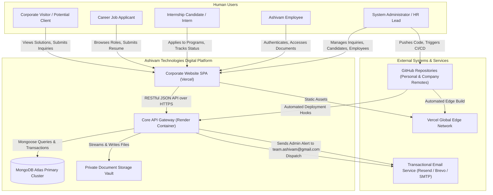

# Ashivam Technologies — System Context (C4 Model Level 1)

**Document:** `SYSTEM_CONTEXT.md`  
**Classification:** Enterprise System Architecture  
**Date:** 2026-11-07  
**Status:** Approved  
**Author:** Principal Software Architect  

---

## 1. System Context Diagram

The C4 Level 1 diagram illustrates how external human actors and external software systems interact with the Ashivam Technologies core platform.

---

## 2. External Actors & Interactions

| Actor | Primary Interaction Goals | Interface Modality | Authentication Requirement |
|---|---|---|---|
| **Corporate Visitor** | Explores company profile, technology services, solutions, and submits project inquiries | Desktop / Mobile Web | Anonymous (Public) |
| **Job Candidate** | Explores job board, reviews technical requirements, and submits PDF resume | Desktop / Mobile Web | Anonymous (Public) with rate limits |
| **Internship Candidate** | Browses published tracks, submits academic details and resume | Desktop / Mobile Web | Anonymous (Public) with rate limits |
| **Enrolled Intern** | Tracks onboarding milestones, reviews mentor allocations | Future Dedicated Portal | Token Authenticated (Intern Role) |
| **Ashivam Employee** | Accesses directory, views verified documents, downloads HR policies | Employee Login Portal | Token Authenticated (Employee Role) |
| **Administrator** | Superadmin & Content Editor roles managing CMS, candidates, and RBAC | Admin Console | Token Authenticated + RBAC Permissions |

---

## 3. External Integration Points

1. **Transactional Email Gateways (Resend / Brevo / SMTP):**
   - Transports admin inquiry alerts, candidate submission acknowledgments, and broadcast notifications.
   - Mandated recipient for all company operational alerts: `team.ashivam@gmail.com`.
2. **MongoDB Atlas Managed Services:**
   - Multi-node replica set with encrypted-at-rest volumes and TLS 1.3 encrypted transit.
3. **Vercel Edge Network:**
   - Provides global DNS resolution, edge SSL termination, and static asset delivery with gzip/brotli compression.
