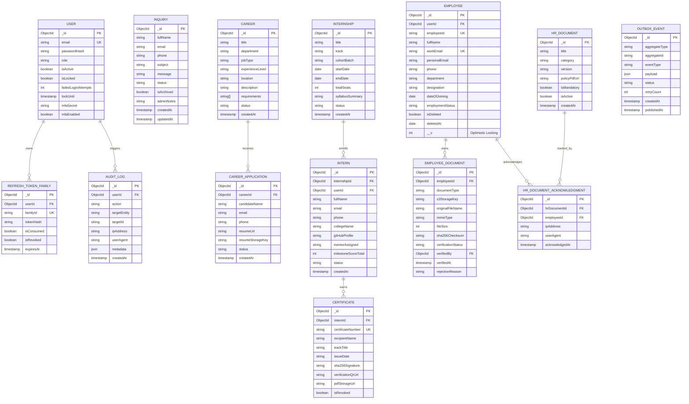

# Ashivam Technologies — Database Entity-Relationship (ER) Architecture

> **Document Version:** 1.0.0  
> **Classification:** Engineering Reference  
> **Database Engine:** MongoDB Atlas 7.0 Replica Set  
> **ODM:** Mongoose 8.x  

---

## 1. Complete Entity-Relationship Diagram

---

## 2. Relational Integrity & Cascade Rules

1. **Soft Delete Cascades:** When an `Employee` is marked `isDeleted: true`, linked `EmployeeDocument` records remain intact for statutory retention (7 years), but are hidden from active operational views.
2. **Career Archival:** When a `Career` posting is archived or closed, linked historical `CareerApplication` records are preserved permanently in the talent pool database.
3. **Internship to Certificate Integrity:** Certificates can only be issued if the linked `Intern` record is in `GRADUATED` or `COMPLETED` status with `milestoneScoreTotal >= 70`.
