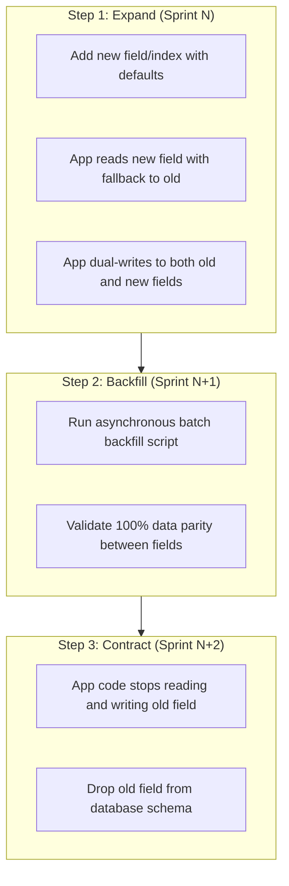

# Ashivam Technologies — Database Migration & Schema Evolution Policy

> **Document Version:** 1.0.0  
> **Classification:** Engineering Operations Standard  
> **Status:** Production Standard  
> **Database:** MongoDB Atlas 7.0  
> **Target Audience:** DevOps Engineers, Database Administrators, Backend Leads  

---

## 1. Executive Summary

To ensure 99.95% availability and prevent data loss, all database schema modifications, index updates, and data migrations in the Ashivam Technologies production cluster must adhere to the **Expand and Contract (Parallel Change)** pattern. Zero-downtime deployments are mandatory.

---

## 2. Core Migration Principles

1. **Non-Breaking Schema Changes:** Application code from version $N$ and version $N+1$ must be able to run simultaneously against the same database cluster during canary and blue-green rollouts.
2. **Never Drop Fields in Step 1:** Deleting a database field or collection requires a minimum two-sprint deprecation period.
3. **No Direct Production Shell Mutations:** Manual ad-hoc queries modifying production data without an approved, tested script and rollback plan are strictly prohibited.
4. **Mandatory Dry-Run in Staging:** All migration scripts must run against staging with full volume data checks prior to production execution.

---

## 3. The Expand-Contract (Parallel Change) Pattern



### 3.1 Field Renaming Example
When renaming `employee.phone` to `employee.primaryContactNumber`:
- **Sprint 1 (Expand):** Add `primaryContactNumber` to Mongoose schema. In `pre('save')`, write to both fields. Read logic checks `primaryContactNumber || phone`.
- **Sprint 2 (Migrate):** Run batch script updating documents where `primaryContactNumber == null`.
- **Sprint 3 (Contract):** Remove `phone` from Mongoose schema and run `$unset: { phone: "" }`.

---

## 4. Production Index Creation Standards

1. **Non-Blocking Index Builds:** In MongoDB 7.0, all index builds are non-blocking by default and do not take exclusive table locks. However, heavy builds on large collections must be scheduled during low-traffic windows (02:00 – 05:00 IST).
2. **Partial Index Safety:** When creating unique indexes on optional fields (e.g., `workEmail` or `phone`), always apply a partial filter expression to prevent duplicate null key violations:
   ```javascript
   schema.index(
     { workEmail: 1 },
     { unique: true, partialFilterExpression: { isDeleted: false } }
   );
   ```
3. **Index Health Telemetry:** Monitor index usage via `$indexStats` before removing any index to ensure no performance regressions occur.

---

## 5. Rollback Protocols & Disaster Safeguards

1. **Pre-Migration Snapshot:** Before executing any migration script, take an immediate on-demand MongoDB Atlas snapshot labeled `pre-migration-<timestamp>`.
2. **Automated Rollback Scripts:** Every migration script `migrate-xyz.js` must have an accompanying, tested `rollback-xyz.js` script in `backend/migrations/`.
3. **Safe Abort Trigger:** If error rate on `/api/v1/health` exceeds $0.5\%$ during migration execution, abort script execution immediately and invoke rollback.
