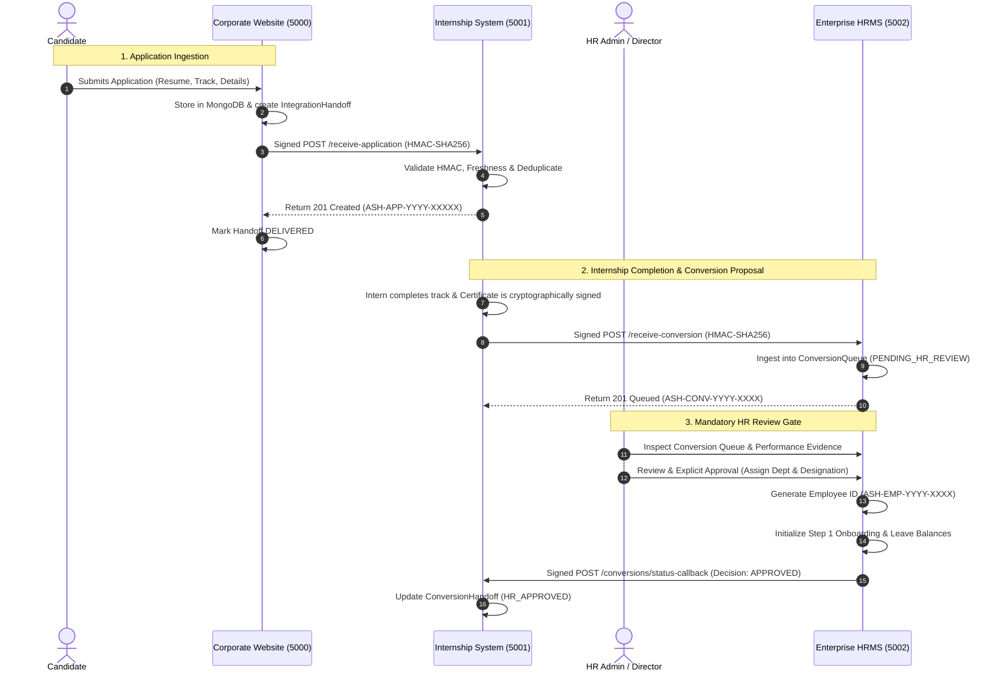

# ASHIVAM TECHNOLOGIES — INTEGRATION ARCHITECTURE SPECIFICATION
## Phase 6: Controlled System Integration

**Organization:** Ashivam Technologies  
**Tagline:** Endless Innovation. Limitless Possibilities.  
**Classification:** Ashivam Engineering Architecture Standard (Confidential)  
**Security Level:** Level 3 — High-Assurance Cross-Service Architecture  

---

## 1. Executive Architecture Summary

Ashivam Technologies operates three decoupled enterprise software platforms designed around strict domain boundaries:

1. **Official Corporate Website** (`ashivam_technologies` on MongoDB, Port `5000` / `5173`):
   - Public face of the organization, service showcase, contact gateway, and career/application intake portal.
2. **Internship Management System** (`ashivam_internship` on MongoDB, Port `5001` / `5174`):
   - Independent application managing candidate screening, committee scoring, technical interviews, offer generation, intern onboarding, task delivery, performance evaluation, and cryptographic HMAC-SHA256 graduation certificate issuance.
3. **Enterprise Human Resource Management System (HRMS)** (`ashivam_hrms` on MongoDB, Port `5002` / `5175`):
   - Independent enterprise platform governing workforce master records, full-time employee onboarding, attendance tracking, biometric corrections, leave accrual/approvals, document verification, compensation/payroll records, and offboarding clearance workflows.

---

## 2. Mandatory Isolation Boundaries

To maintain strict defense-in-depth and avoid monolithic failure cascades, the following architectural boundaries are non-negotiable:

| Dimension | Policy Specification | Security Rationale |
| :--- | :--- | :--- |
| **Git Repositories** | 3 Distinct Repositories | Prevents accidental code bleeding, simplifies RBAC permissions, and maintains separate release lifecycles. |
| **Databases** | 3 Independent MongoDB Databases | Zero cross-database queries or shared connections. Eliminates schema lock-in and multi-tenant data leaks. |
| **Authentication & Tokens** | 3 Independent JWT Session Stores | Each system signs tokens using its own independent 32+ byte cryptographic secret. A compromise in one token store does not grant access to others. |
| **Network & Transport** | Point-to-Point TLS / HTTP HMAC Signing | No direct public access to inter-service ingestion routes. Headers contain cryptographic HMAC signatures and timestamp freshness bounds. |
| **Human Review Gates** | Mandatory HR Approval Gate | Intern graduation does **never** automatically grant employment. Every conversion must be explicitly vetted and approved by an HR Administrator. |

---

## 3. End-to-End Cross-System Data Flow

---

## 4. Key Architectural Guarantees

1. **Idempotency Guarantee:**
   - Every inter-service request carries a globally unique `x-idempotency-key`.
   - Receiving systems maintain an `IntegrationEvent` collection with a 30-day TTL index.
   - Replayed requests return cached HTTP 200 responses with header `x-cache: IDEMPOTENT_HIT` without duplicate database records.

2. **Replay Attack Mitigation:**
   - Every request is tagged with an `x-timestamp` representing Unix epoch milliseconds.
   - Inbound middleware enforces a drift window of $|now - timestamp| \le 300,000\text{ ms}$ (5 minutes). Any stale or future-dated request is rejected with HTTP 401 `AUTH_EXPIRED_TIMESTAMP`.

3. **Cryptographic Payload Integrity:**
   - Inbound middleware constructs the canonical string `${timestamp}.${requestId}.${payloadString}` and hashes it with HMAC-SHA256 using the designated service secret.
   - Verification uses `crypto.timingSafeEqual` to prevent side-channel timing attacks.
