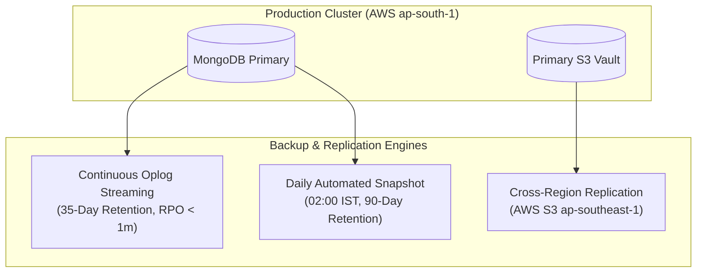

# Ashivam Technologies — Backup & Disaster Recovery Runbook

> **Document Version:** 1.0.0  
> **Classification:** Operations & Business Continuity Standard  
> **Database:** MongoDB Atlas Replica Set (AWS Mumbai `ap-south-1`)  
> **Media Store:** AWS S3 Encrypted Buckets (KMS-Managed)  
> **Target Audience:** DevOps Engineers, Database Administrators  

---

## 1. Backup Strategy & Cadence



---

## 2. Recovery Objectives

- **RPO (Recovery Point Objective):** $\le 1\text{ Minute}$ via continuous MongoDB continuous oplog streaming.
- **RTO (Recovery Time Objective):** $\le 30\text{ Minutes}$ to complete full cluster restoration and traffic cutover.

---

## 3. Step-by-Step Restoration Protocols

### 3.1 Scenario A: Point-in-Time Recovery (PITR) for Accidental Data Mutation
If an erroneous administrative script or transaction corrupts data at `2026-11-07 14:15:00 IST`:
1. Log in to **MongoDB Atlas Management Console**.
2. Navigate to **Database Deployments** $\to$ **Cluster0** $\to$ **Backup**.
3. Select **Point-in-Time Restore**.
4. Set timestamp to `2026-11-07 14:14:00 IST` (1 minute prior to incident).
5. Choose **Restore to a New Cluster** (e.g., `cluster0-restored-temp`) to verify data integrity without disturbing active production traffic.
6. Run data verification query to confirm target records are intact.
7. Either export repaired collections via `mongodump`/`mongorestore` or update application connection string to point to the restored cluster.

### 3.2 Scenario B: Restoring Accidental Deletions in S3 Document Vault
1. S3 bucket enforces **Object Versioning** and **MFA Delete**.
2. If an employee KYC document is deleted via an erroneous API call, S3 creates a *Delete Marker* without destroying underlying byte storage.
3. To restore:
   ```bash
   # Remove the latest delete marker to restore the original document version
   aws s3api delete-object --bucket ashivam-kyc-vault --key vault/emp_012/pan.pdf --version-id <DeleteMarkerVersionId>
   ```

---

## 4. Disaster Recovery Validation & Drills

1. **Semi-Annual DR Simulation:** Every 6 months, the DevSecOps team executes a mock restoration to an isolated sandbox cluster.
2. **Snapshot Verification:** Automated weekly script verifies the integrity and decryptability of the latest Atlas snapshot.
