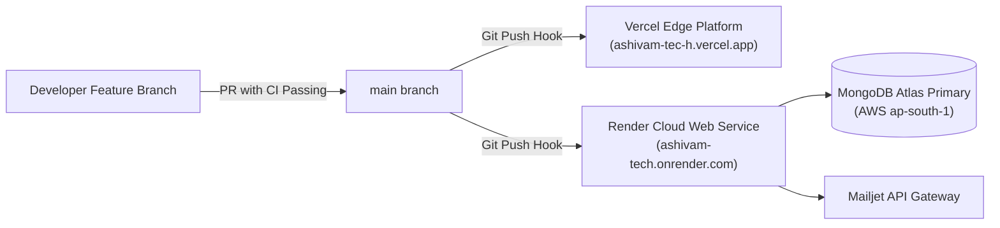

# Ashivam Technologies — Production Deployment Runbook

> **Document Version:** 1.0.0  
> **Classification:** DevSecOps Standard Operating Procedure (SOP)  
> **Production Frontend:** [https://ashivam-tec-h.vercel.app/](https://ashivam-tec-h.vercel.app/)  
> **Production Backend:** [https://ashivam-tech.onrender.com/api/v1](https://ashivam-tech.onrender.com/api/v1)  
> **Lead DevSecOps Engineer:** DevSecOps Lead, Senior Backend Lead  

---

## 1. Production Topology & Deployment Pipeline



---

## 2. Pre-Deployment Gate Checklist

Before merging a release pull request to `main`:

- [ ] All 107 frontend unit/axe tests pass (`npm test -- --run`).
- [ ] Vite production build completes with zero errors (`npm run build`).
- [ ] Backend test suite (236 tests) passes in GitHub Actions CI replica set.
- [ ] Dependency security scan shows zero High/Critical vulnerabilities (`npm audit`).
- [ ] No uncommitted `.env` files or secrets exist in the git tree.
- [ ] Release notes and `CHANGELOG.md` updated with ticket IDs.

---

## 3. Deployment Sequence

### 3.1 Backend Deployment (Render)
1. **Trigger:** Automated webhook on push to `main` (Root Directory: `backend`).
2. **Build Command:** `npm install && npm run build` (if applicable).
3. **Start Command:** `npm start` (`node src/server.js`).
4. **Environment Check:** Ensure Render environment settings contain:
   - `NODE_ENV=production`
   - `MONGODB_URI` (Atlas production connection string)
   - `JWT_SECRET` (256-bit entropy minimum)
   - `JWT_REFRESH_SECRET` (64-char hex key)
   - `FRONTEND_URL=https://ashivam-tec-h.vercel.app`
   - `ALERT_EMAIL=team.ashivam@gmail.com`

### 3.2 Frontend Deployment (Vercel)
1. **Trigger:** Automated webhook on push to `main` (Root Directory: `.`).
2. **Framework Preset:** Vite.
3. **Build Command:** `npm run build`.
4. **Output Directory:** `dist`.
5. **Environment Check:** Ensure Vercel project environment contains:
   - `VITE_API_URL=https://ashivam-tech.onrender.com/api/v1`

---

## 4. Post-Deployment Smoke Verification

Execute the following verification script within 5 minutes of deployment:

```bash
# 1. Verify Backend Health & Database Connectivity
curl -s -i https://ashivam-tech.onrender.com/api/v1/health | grep "HTTP/1.1 200 OK"

# 2. Verify Frontend HTTP Status and Security Headers
curl -s -I https://ashivam-tec-h.vercel.app/ | grep -E "(200 OK|Strict-Transport-Security|x-frame-options)"

# 3. Verify Public Job Catalog Endpoint
curl -s https://ashivam-tech.onrender.com/api/v1/careers | grep '"success":true'

# 4. Verify Live Staging Browser E2E Test Suite
node tests/e2e-browser-staging.js
```

If all 4 smoke tests return `PASS`, sign off on the release in the operations log. If any critical probe fails, immediately trigger the Rollback Procedure (`ROLLBACK_PROCEDURE.md`).
