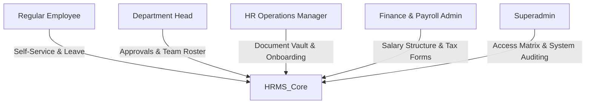

# Product Requirements Document (PRD) — HR Management System (HRMS)

> **Product Name:** Ashivam Enterprise HRMS (`ashivam-hr-management`)  
> **Application Identifier:** Application C  
> **Target Production Subdomain:** `hrms.ashivam.com` / `people.ashivam.com`  
> **Status:** Architecture Blueprint & Phase 2 Extraction Target  
> **Lead Product Director:** UI/UX Director, Principal Software Architect, Application Security Engineer  

---

## 1. Executive Summary & Vision

Ashivam HRMS is an enterprise-grade People Operations platform built to manage employee records, organizational structures, statutory governance documents, confidential KYC identity verification, leave tracking, and offboarding workflows.

Designed under zero-trust principles and Indian DPDP Act 2023 requirements, it replaces error-prone spreadsheets with an encrypted, role-audited digital core.

---

## 2. Target Personas & Access Roles



1. **Regular Employee (`ROLE_EMPLOYEE`):** Views personal profile, uploads onboarding identity documents, reviews/acknowledges company policies, applies for leaves, and downloads payslips.
2. **Department Head (`ROLE_DEPT_HEAD`):** Manages team roster, reviews project allocation, approves or rejects team leave requests, and conducts performance appraisals.
3. **HR Operations Manager (`ROLE_HR_MANAGER`):** Creates employee records, inspects and verifies KYC documents, distributes corporate policies, tracks attendance anomalies, and initiates offboarding.
4. **Finance & Payroll Admin (`ROLE_FINANCE`):** Manages compensation bands, tax declarations (Form 16 / Section 80C), and bank account verification.
5. **Superadmin (`ROLE_SUPERADMIN`):** Manages global system settings, RBAC role mappings, emergency session revocations, and statutory compliance exports.

---

## 3. Core Functional Requirements

### 3.1 Employee Master Directory & Organization Structure
- **FR-HR-01 (Employee Profile Management):** Centralized record maintaining full legal name, enterprise employee ID (`ASH-EMP-XXXX`), work email, personal email, phone, emergency contacts, blood group, department, designation, and reporting manager.
- **FR-HR-02 (Interactive Org Chart):** Dynamic hierarchical tree visualizer rendering reporting structures, departmental headcounts, and vacant positions.
- **FR-HR-03 (Employment Status Tracking):** Lifecycle status management (`PROBATION`, `CONFIRMED`, `NOTICE_PERIOD`, `TERMINATED`, `RESIGNED`, `RETIRED`).

### 3.2 Confidential Document Vault & KYC Verification
- **FR-HR-04 (Document Upload & Categorization):** Secure intake for statutory documents (Aadhaar Card, PAN Card, Educational Degrees, Relieving Letters, Bank Cancelled Cheque).
- **FR-HR-05 (Cryptographic Integrity & KMS Encryption):** Files are encrypted at rest using AES-256-GCM via AWS KMS. SHA-256 checksums are stored to guarantee document tamper-proofing.
- **FR-HR-06 (Ephemeral Pre-Signed Preview):** Direct document links are never exposed. Pre-signed time-limited URLs (120s TTL) are generated dynamically for authorized HR reviewers.
- **FR-HR-07 (KYC Verification Workflow):** HR managers review documents against regulatory standards, setting document state to `VERIFIED` or `REJECTED` (with mandatory rejection reason).

### 3.3 Company Policies & Statutory Governance (POSH / NDA)
- **FR-HR-08 (Policy Publishing & Distribution):** HR publishes mandatory compliance policies (POSH Policy, Information Security Policy, Code of Conduct, Intellectual Property Agreement).
- **FR-HR-09 (Digital Policy Acknowledgment):** Employees must digitally review and sign acknowledgments. The system captures IP address, user agent, and timestamp for legal non-repudiation.
- **FR-HR-10 (Compliance Tracking Dashboard):** HR dashboard tracking acknowledgment completion percentage by department with automated email reminders for unacknowledged staff.

### 3.4 Leave & Attendance Management
- **FR-HR-11 (Leave Balance Accrual):** Configurable leave buckets (Paid Time Off, Sick Leave, Casual Leave, Maternity/Paternity Leave, Bereavement).
- **FR-HR-12 (Multi-Tier Approval Pipeline):** Leave requests route to the immediate reporting manager for 1st-level approval and HR Operations for final approval.
- **FR-HR-13 (Public Holiday Calendar):** Indian statutory and optional company holiday calendar with automated leave deduction adjustments.

### 3.5 Offboarding & Employee Separation
- **FR-HR-14 (Resignation & Notice Period Tracking):** Automated calculation of last working day (LWD) based on contractual notice period requirements.
- **FR-HR-15 (Asset & Departmental Clearance Checklist):** Multi-department sign-offs (IT asset return, Finance expense settlement, HR exit interview).
- **FR-HR-16 (Automated Relieving & Experience Letters):** Automated generation of signed Relieving Certificates and Full & Final (F&F) settlement statements.

---

## 4. Security, Privacy & Statutory Compliance

### 4.1 Indian DPDP Act 2023 Compliance
1. **Purpose Limitation:** Employee data collected strictly for employment, tax, and insurance purposes.
2. **Right to Erasure & Rectification:** Formal workflow allowing employees to request correction of personal information.
3. **Aadhaar Masking Standard:** Display of Aadhaar numbers restricted to the last 4 digits (`XXXX-XXXX-1234`) across all user interfaces and non-superadmin API responses.

### 4.2 Immutable Audit Trail
Every access, view, upload, or status change on an employee record or document generates an immutable audit record:
```json
{
  "timestamp": "2026-11-07T18:22:10.000Z",
  "actorId": "usr_hr_8819a",
  "actorRole": "HR_MANAGER",
  "action": "DOCUMENT_VIEWED",
  "targetEntity": "EmployeeDocument",
  "targetId": "doc_pan_00192",
  "employeeId": "emp_ash_0421",
  "ipAddress": "49.36.120.4",
  "userAgent": "Mozilla/5.0 ... Chrome/130.0.0.0"
}
```

---

## 5. Success Metrics & Performance KPIs

| KPI Metric | Target | Verification Method |
| :--- | :--- | :--- |
| **New Hire Onboarding Completion** | $\le 48\text{ hours}$ from offer acceptance | Onboarding Tracker |
| **Policy Acknowledgment Rate** | $100\%$ within 7 days of release | Compliance Dashboard |
| **KYC Document Verification SLA** | $\le 24\text{ hours}$ | Verification Queue SLA |
| **Document Vault Security** | Zero unauthenticated or unauthorized views | Penetration Test & Audit Logs |
| **Leave Approval Cycle Time** | $\le 12\text{ hours}$ | Approval Event Timestamps |
