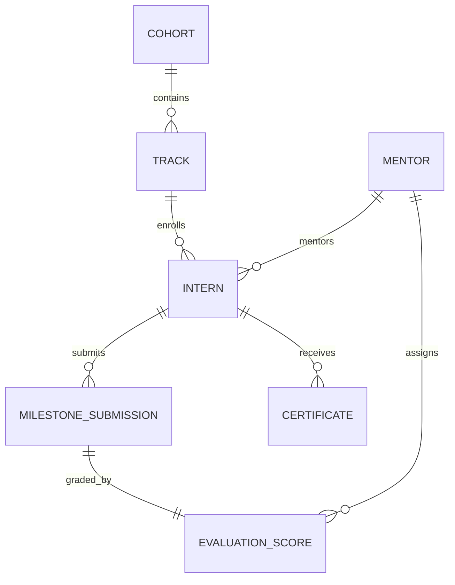

# Product Requirements Document (PRD) — Internship Management System

> **Product Name:** Ashivam Internship Management System (`ashivam-internship-management`)  
> **Application Identifier:** Application B  
> **Target Production Subdomain:** `interns.ashivam.com` / `portal.ashivam.com`  
> **Status:** Architecture Blueprint & Phase 2 Extraction Target  
> **Lead Product Director:** UI/UX Director, Principal Software Architect  

---

## 1. Executive Summary & Vision

The Ashivam Internship Management System is a specialized talent development platform designed to manage the comprehensive lifecycle of Ashivam Technologies' technical internships. It transforms manual internship administration into an automated, meritocratic, and auditable pipeline—from candidate screening and track onboarding to weekly project milestone reviews and cryptographic certificate issuance.

---

## 2. Target Personas & User Roles

1. **Internship Candidate (`ROLE_CANDIDATE`):** College student or early-career engineer applying for domain cohorts (Full-Stack, Cloud & DevOps, AI/ML, Cybersecurity).
2. **Admitted Intern (`ROLE_INTERN`):** Active student enrolled in an active batch. Submits weekly project repositories, views mentor feedback, and tracks attendance.
3. **Technical Mentor (`ROLE_MENTOR`):** Ashivam senior engineer assigned to a 5–8 intern pod. Conducts code reviews, hosts weekly standups, and submits rubric scores.
4. **Cohort Track Lead (`ROLE_TRACK_LEAD`):** Staff engineer overseeing an entire technical track. Defines milestone deadlines, approves extensions, and resolves grading escalations.
5. **Internship Director (`ROLE_INTERNSHIP_ADMIN`):** Executive managing cohort capacity, certificate signing keys, and Pre-Placement Offer (PPO) recommendations.

---

## 3. Core Functional Requirements

### 3.1 Recruitment, Screening & Batch Admissions
- **FR-INT-01 (Cohort Catalog & Publishing):** Admins publish upcoming batches with track descriptions, prerequisite skills, seats available, and application windows.
- **FR-INT-02 (Candidate Screening & Coding Assessment):** Multi-stage screening intake with automated technical qualification quizzes and portfolio link validation.
- **FR-INT-03 (Automated Offer Letter & Acceptance):** Generates digitally signed offer letters with unique acceptance links and candidate signature capture.

### 3.2 Digital Onboarding & Mentor Pod Allocation
- **FR-INT-04 (Intern Profile & Workspace Setup):** Onboarding checklist ensuring interns configure GitHub accounts, join company communication channels, and review the Code of Conduct.
- **FR-INT-05 (Mentor Pod Assignment):** Automated or manual assignment of interns to technical mentors maintaining a maximum 1:8 mentor-to-intern ratio.

### 3.3 Milestone Submissions, Project Tracking & Code Reviews
- **FR-INT-06 (Weekly Milestone Board):** Interactive Kanban/Sprint board outlining deliverables for each week of the 8-to-12 week curriculum.
- **FR-INT-07 (Code Submission Verification):** Interns submit GitHub repository and live deployment URLs. The backend verifies repository existence, branch activity, and commits via GitHub API.
- **FR-INT-08 (Evaluation Rubric Scoring):** Mentors grade submissions across 4 standardized criteria (Code Quality, Architecture, Test Coverage, Timeliness) on a 10-point scale with qualitative comments.

### 3.4 Credentialing, Certification & Verification
- **FR-INT-09 (Cryptographic Certificate Generation):** Upon director approval, system renders a high-resolution PDF certificate with embedded SHA-256 tamper-evident hash, QR code, and unique certificate ID (`ASH-CERT-2026-XXXX`).
- **FR-INT-10 (Public Certificate Verification Portal):** Public route (`/verify/cert/:id`) allowing prospective employers or academic institutions to independently verify credential authenticity.

### 3.5 Pre-Placement Offer (PPO) & HRMS Integration
- **FR-INT-11 (PPO Recommendation Workflow):** Mentors flag top-decile performers for full-time employee conversion.
- **FR-INT-12 (HRMS Data Handoff Event):** Emits `intern.promoted.to_employee` domain event to provision new employee master records directly in the HRMS without re-entering candidate background data.

---

## 4. Technical Architecture & Database Design

### 4.1 Domain Entity Relationships

### 4.2 Security & Integrity Controls
1. **Grade Tampering Defense:** Milestone scores are immutable once finalized by the Track Lead. Any recalculation generates an audit entry.
2. **Private Code Protection:** Intern project submissions are stored in private GitHub repositories or secure S3 buckets with strict access restricted to mentors.
3. **Certificate Anti-Forgery:** Certificate records store the canonical cryptographic hash:
   $$\text{CertHash} = \text{HMAC-SHA256}(\text{certId} \parallel \text{studentEmail} \parallel \text{grade} \parallel \text{issueDate}, \text{CERT\_SIGNING\_SECRET})$$

---

## 5. Success Metrics & KPIs

| Metric | Target | Measurement Method |
| :--- | :--- | :--- |
| **Cohort Completion Rate** | $\ge 85\%$ | System Analytics |
| **On-Time Milestone Submission** | $\ge 90\%$ | Milestone Tracker Logs |
| **Mentor Review Turnaround** | $\le 48\text{ hours}$ | System SLA Alerts |
| **PPO Conversion Rate** | $15\% - 20\%$ | HRMS Promotion Events |
| **Public Certificate Verifications** | 100% hash accuracy | Verification Portal Logs |
