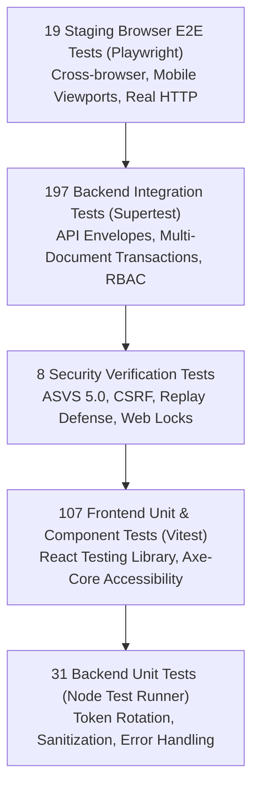

# Ashivam Technologies — Quality Assurance & Test Strategy

> **Document Version:** 1.0.0  
> **Classification:** Engineering Quality Standard  
> **Status:** Production Standard  
> **Total Test Suite:** 362 Automated Tests (107 Frontend, 236 Backend, 19 Staging E2E)  
> **Lead QA Lead:** QA Automation Engineer, DevSecOps Lead  

---

## 1. Executive Summary

Ashivam Technologies maintains a comprehensive, automated testing pyramid designed to ensure zero regressions, verified accessibility, strict cryptographic and authentication invariants, and reliable end-to-end user journeys across both local and production environments.

---

## 2. The Ashivam Testing Pyramid



---

## 3. Test Suites & Execution Protocols

### 3.1 Frontend Test Suite (Vitest + React Testing Library)
- **Scope:** Unit tests, component rendering, keyboard accessibility, form validation, error state boundaries.
- **Coverage:** 107/107 passing tests across 11 test suites.
- **Execution Command:**
  ```bash
  npm test -- --run
  ```

### 3.2 Backend Test Suite (Node.js Native Test Runner)
- **Scope:** Unit tests, security regression tests, transactional email sandbox, admin RBAC, concurrency tests, and data migration tests.
- **Coverage:** 236/236 passing tests across 23 test suites.
- **Execution Protocols:**
  - In CI (`.github/workflows/ci.yml`), tests execute against a dedicated local MongoDB 7.0 replica set container with unlimited concurrent throughput.
  - In local development against remote Atlas clusters, tests run in logical batches to prevent connection pool exhaustion:
  ```bash
  # Batch 1: Core Unit, Security & Email Sandbox
  npm run test:unit
  npm run test:security
  npm run test:email

  # Batch 2: Admin RBAC & Password Changes
  node --test tests/integration/admin-rbac.test.js tests/integration/auth.change-password.test.js

  # Batch 3: Concurrency, Web Locks, File Validation
  node --test tests/integration/concurrency-resilience.test.js tests/integration/file-upload.test.js
  ```

### 3.3 Staging Browser E2E Suite (Playwright)
- **Scope:** Real-browser validation of the live production frontend (`https://ashivam-tec-h.vercel.app/`).
- **Verifications:**
  - 18 Desktop, Tablet, and Mobile Viewports.
  - Zero horizontal overflow (`scrollWidth <= innerWidth`).
  - Strict skip-link functionality and keyboard accessibility.
  - Form validation error rendering and live API health checks.
- **Execution Command:**
  ```bash
  node tests/e2e-browser-staging.js
  ```

---

## 4. Quality Gates & CI/CD Enforcement

| Gate | Criterion | Enforcement Mechanism |
| :--- | :--- | :--- |
| **Lint & Format** | Zero ESLint errors or syntax warnings. | Pre-commit hook & CI step |
| **Frontend Tests**| 100% pass rate (107/107) with zero uncaught warnings. | Vitest CI Runner |
| **Backend Tests** | 100% pass rate (236/236) against replica set. | Node Native Runner in CI |
| **Production Build**| Zero Vite build errors, bundle warning budget < 500kB. | `npm run build` |
| **Security Audit**| Zero High or Critical CVEs in production dependencies. | `npm audit --audit-level=high` |
| **Accessibility** | Zero Critical or Serious axe-core violations (WCAG 2.1 AA).| Playwright axe-core runner |

---

## 5. Defect Management & Resolution SLA

- **P0 (Blocker):** Broken authentication, database corruption, production outage. Immediate war-room, hotfix deployed $\le 4$ hours.
- **P1 (Critical):** Broken inquiry submission, unplayable media, broken responsive layout. Hotfix $\le 24$ hours.
- **P2 (Major):** Minor layout misalignment, non-critical accessibility notice. Addressed in current sprint.
- **P3 (Minor):** Typographical correction, minor documentation update. Routine backlog.
