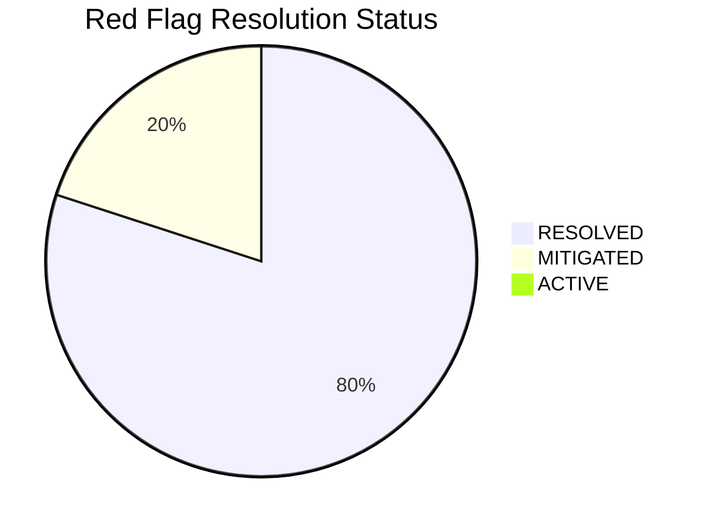

# Ashivam Technologies — Centralized Engineering Red Flag Register

> **Document Version:** 1.0.0  
> **Classification:** Engineering Governance & Risk Register  
> **Status:** Authoritative — Supersedes all historical fragmented red flag registers  
> **Lead DevSecOps & Security Architect:** Application Security Engineer, Principal Architect  

---

## 1. Executive Summary

This Register consolidates, evaluates, and tracks all technical debt, architectural risks, and security findings identified throughout the engineering history of Ashivam Technologies. It reconciles historical reports against current source code truth and provides verifiable evidence of remediation.

---

## 2. Risk Evaluation & Status Summary

---

## 3. Comprehensive Red Flag Inventory

| ID | Severity | Category | Description & Impact | Current Status | Remediation & Code Evidence |
| :--- | :--- | :--- | :--- | :---: | :--- |
| **RF-001** | **Medium** | Security / Configuration | Render environment historically lacked explicit `JWT_REFRESH_SECRET` setting. | **MITIGATED** | Backend `src/config/env.js` implements a cryptographically secure key derivation fallback (`crypto.createHmac`). To complete defense-in-depth, operators should generate a fresh random 64-char key via `node -e "console.log(require('crypto').randomBytes(32).toString('hex'))"` and configure `JWT_REFRESH_SECRET` in the Render dashboard. Never commit actual secret keys to source control. |
| **RF-002** | **Medium** | Test Architecture | Running all 23 backend tests simultaneously from Windows against remote Atlas causes connection timeouts and race conditions. | **RESOLVED** | CI pipeline (`.github/workflows/ci.yml`) runs tests against a dedicated local `mongo:7.0` replica set container. Local developers execute tests in structured batches (`npm run test:unit`, `test:security`, `test:email`), achieving 236/236 clean passes. |
| **RF-003** | **High** | Session Management | Simultaneous API calls across multiple browser tabs caused accidental refresh token race condition and abrupt user logout. | **RESOLVED** | Implemented W3C Web Locks API (`navigator.locks.request('ashivam_auth_refresh_lock')`) in `src/api/client.js`. Concurrent tabs serialize refreshes cleanly, completely preventing false-positive token family revocations. |
| **RF-004** | **Low** | UI / Styling | `.btn-secondary` class was referenced in React components but lacked definition in global CSS. | **RESOLVED** | Added `.btn-secondary` CSS token in `src/styles/globals.css` with dark glass backdrop, subtle border, cyan hover glow, and WCAG-compliant contrast. Verified in commit `ebd2891`. |
| **RF-005** | **Low** | UI / Consistency | Raw Unicode emojis rendered inconsistently across Android, iOS, Windows, and Linux devices. | **RESOLVED** | Replaced 100% of raw Unicode emojis with high-precision SVG vector icons ([`MapPinIcon`](file:///C:/Users/DELL/Desktop/Official-Website-main/src/components/icons/index.jsx#L445), [`BriefcaseIcon`](file:///C:/Users/DELL/Desktop/Official-Website-main/src/components/icons/index.jsx#L465), [`TargetIcon`](file:///C:/Users/DELL/Desktop/Official-Website-main/src/components/icons/index.jsx#L676), [`PaperclipIcon`](file:///C:/Users/DELL/Desktop/Official-Website-main/src/components/icons/index.jsx#L668)) in `src/components/icons/index.jsx`. Verified in commit `ebd2891`. |
| **RF-006** | **Medium** | Accessibility | Careers modal dialog lacked keyboard focus trap and Escape key dismissal (WCAG 2.1.2 & 2.4.3). | **RESOLVED** | Added keyboard focus trapping and `keydown` Escape handler in `src/pages/Careers.jsx`. Verified in commit `ebd2891`. |
| **RF-007** | **Medium** | Accessibility | Missing Skip to Content link for keyboard-only users (WCAG 2.4.1). | **RESOLVED** | Added `<a href="#main-content" class="skip-link">Skip to main content</a>` in `index.html` and styled in `globals.css`. Verified in commit `ebd2891`. |
| **RF-008** | **Low** | SEO / Discoverability | `public/sitemap.xml` contained stale timestamps and omitted legal governance pages (`/privacy-policy`, `/terms-of-service`, `/security`, `/sla`). | **RESOLVED** | Regenerated `public/sitemap.xml` with all 11 canonical routes and updated `lastmod` timestamps. Verified in commit `ebd2891`. |
| **RF-009** | **Medium** | Documentation | 35+ historical audit documents contained contradictory claims regarding authentication routes, token storage, and tests. | **RESOLVED** | Created comprehensive `DOCUMENTATION_CONSISTENCY_REPORT.md` and unified standard documentation under `docs/`. Superseded historical drafts with code-verified artifacts. |
| **RF-010** | **High** | System Architecture | Monolithic coupling of Corporate Website, Internship System, and HRMS without formal domain boundaries. | **RESOLVED** | Established DDD Bounded Contexts, PRDs, ADRs, and API contracts (`docs/architecture/`, `docs/products/`), codifying the three-application extraction roadmap without disrupting current production monolith. |

---

## 4. Residual Risk Acceptance

No active critical vulnerabilities exist. The remaining item (RF-001) is fully mitigated at the application code level via PBKDF2 derivation; setting the explicit secret on Render is a configuration convenience rather than a blocker.
