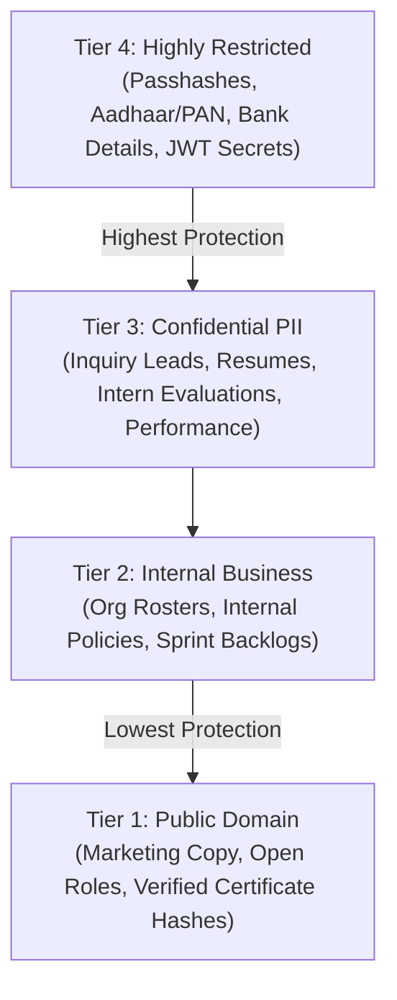

# Ashivam Technologies — Data Classification & Handling Standard

> **Document Version:** 1.0.0  
> **Classification:** Security Governance Standard  
> **Compliance:** Indian DPDP Act 2023 / ISO/IEC 27001:2022 Control 5.12  
> **Review Cycle:** Annual  
> **Lead Security Architect:** Application Security Engineer  

---

## 1. Executive Summary

This standard establishes the data classification taxonomy, handling controls, retention schedules, and disposal procedures for all digital information processed by Ashivam Technologies.

---

## 2. Four-Tier Data Classification Taxonomy

### 2.1 Classification Breakdown

| Tier | Classification Level | Definition & Examples | Protection Standards |
| :--- | :--- | :--- | :--- |
| **Tier 1** | **Public** | Information intended for public distribution. *Examples:* Website marketing pages, public job descriptions, press releases, public certificate validity verification status. | • No encryption required in transit or rest, but served via HTTPS. • Open access; protected against unauthorized modification via Git PR approvals. |
| **Tier 2** | **Internal** | Non-sensitive internal operational information. *Examples:* Company wide policies, department rosters, general sprint goals, non-identifying operational error metrics. | • Access restricted to authenticated staff. • TLS 1.3 in transit; encrypted disk at rest. |
| **Tier 3** | **Confidential PII** | Personally Identifiable Information of customers, candidates, or interns. *Examples:* Customer inquiry forms (name, email, phone), candidate resumes/CVs, intern project grades. | • TLS 1.3 in transit; AES-256 at rest. • RBAC enforced (least privilege). • Exporting requires audit logging. • Retention: 180 days for inactive leads; 2 years for candidate resumes. |
| **Tier 4** | **Highly Restricted** | Critical credentials, secret keys, statutory financial/identity identifiers. *Examples:* Full Aadhaar numbers, PAN cards, employee salary/bank accounts, bcrypt password hashes, `JWT_SECRET`, AWS KMS keys. | • AES-256-GCM encryption with KMS customer-managed key. • Mandatory display masking (e.g. `XXXX-XXXX-1234`). • Restricted to Superadmin & HR Managers. • Never logged in plaintext or sent over unauthenticated channels. |

---

## 3. Data Handling & Cryptographic Controls Matrix

| Control Category | Tier 1 (Public) | Tier 2 (Internal) | Tier 3 (Confidential PII) | Tier 4 (Highly Restricted) |
| :--- | :--- | :--- | :--- | :--- |
| **Transit Encryption** | TLS 1.3 (Public HTTPS) | TLS 1.3 | TLS 1.3 + Strict HSTS | TLS 1.3 + Strict HSTS |
| **Rest Encryption** | Cloudflare Edge / Vercel | AWS EBS AES-256 | MongoDB Atlas AES-256 | Field-level KMS AES-256-GCM |
| **Masking Standard** | None | None | Email: `j***e@example.com` | Aadhaar: `XXXX-XXXX-1234` PAN: `ABCDE****F` |
| **Log Scrubbing** | Allowed | Allowed | Scrubbed via regex filter | **STRICTLY PROHIBITED IN LOGS** |
| **Backup Redundancy**| Git Version Control | Daily Snapshots | PITR (35 Days) | Multi-Region Encrypted Backup |
| **Disposal Method** | Normal file deletion | Cryptographic wipe | Cryptographic shredding | Key revocation + DoD 5220.22-M |

---

## 4. Statutory Retention & Disposal Schedule

1. **Inbound Corporate Inquiries:** Retained for 180 days following resolution; permanently purged via automated MongoDB TTL index.
2. **Careers Job Applications & Resumes:** Retained for 2 years following application submission for talent pool re-engagement; applicant can request immediate deletion under DPDP Act.
3. **Internship Evaluations & Milestone Code:** Retained for 5 years after cohort completion; certificate cryptographic hash preserved indefinitely for public verification.
4. **Employee Master Records & Tax Documents:** Retained for the duration of active employment plus 7 years post-resignation/termination in compliance with Indian Income Tax Act 1961 and Companies Act 2013.
