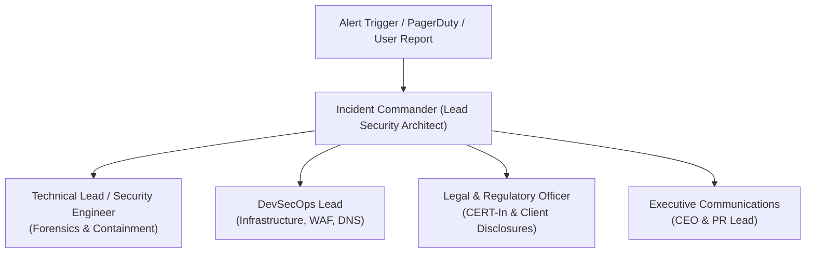
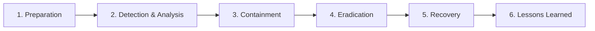

# Ashivam Technologies — Security Incident Response Plan (IRP)

> **Document Version:** 1.0.0  
> **Classification:** Confidential — Security Operations  
> **Framework Standard:** NIST SP 800-61 Rev 2 (Computer Security Incident Handling Guide)  
> **Statutory Compliance:** Indian CERT-In Directives (6-Hour Notification Mandate)  
> **Emergency Incident Hot:** `team.ashivam@gmail.com`  
> **Lead Security Architect:** Application Security Engineer, DevSecOps Lead  

---

## 1. Executive Summary

This Incident Response Plan defines the mandatory procedures, escalation paths, containment protocols, and regulatory notifications for cyber security incidents affecting Ashivam Technologies' infrastructure, client data, employee records, or corporate reputation.

---

## 2. Incident Response Team (IRT) & Escalation Hierarchy



| Role | Primary Responsibility | Contact Channel |
| :--- | :--- | :--- |
| **Incident Commander (IC)** | Directs technical containment, assigns investigative tasks, declares severity. | Dedicated Slack `#incident-war-room` |
| **Lead Security Engineer** | Performs log forensics, packet analysis, token invalidation, malware containment. | Voice / Signal Hotline |
| **DevSecOps Lead** | Isolates compromised servers, rotates cloud secrets, deploys emergency WAF rules. | Render / AWS Root Console |
| **Legal / Compliance Officer**| Assesses regulatory breach notification requirements (CERT-In / DPDP Act). | Legal Counsel Hotline |

---

## 3. Incident Lifecycle Phases (NIST SP 800-61)



### Phase 1: Preparation
- Continuous logging of authentication events, audit logs, and rate limit spikes.
- Daily automated offsite database backups and validated point-in-time recovery runbooks.
- Pre-configured emergency secret rotation scripts.

### Phase 2: Detection & Analysis
- Severity Triage:
  - **SEV-1 (Critical):** Confirmed exfiltration of Tier 4 (PII/KYC) data, administrative account hijacking, or complete production outage.
  - **SEV-2 (High):** Targeted DDoS attack, repeated token replay attempts, or severe vulnerability exploit in production.
  - **SEV-3 (Medium):** Spammed inquiry queues, non-exploited SSRF/XSS attempts caught by WAF, isolated single-user account lockout.

### Phase 3: Containment
- Immediate execution of the containment playbook corresponding to the incident type (see Section 4).
- Preservation of forensic volatile memory and audit log snapshots prior to shutting down or rebooting services.

### Phase 4: Eradication
- Identifying and eliminating the root cause (patching vulnerable dependency, revoking leaked API key, deploying code fix).
- Rotating all potentially exposed cryptographic secrets (`JWT_SECRET`, `MONGODB_URI`, `MAILJET_SECRET`).

### Phase 5: Recovery
- Restoring systems from verified clean backups or deploying hardened code containers.
- Enhanced 24/7 telemetry monitoring for 72 hours post-recovery to detect re-entry attempts.

### Phase 6: Post-Incident Review & Lessons Learned
- Holding a blameless post-mortem within 48 hours of resolution.
- Filing statutory CERT-In report and publishing internal remediations.

---

## 4. Specific Incident Playbooks

### 4.1 Playbook A: Compromised Administrative Account
1. **Immediate Revocation:** Invoke administrative session kill-switch:
   `POST /api/v1/auth/revoke-user-sessions/:id` to purge all active token families.
2. **Account Lock:** Update `isLocked = true` in MongoDB Atlas directly or via admin CLI.
3. **Password & MFA Reset:** Invalidate existing bcrypt hash and revoke existing TOTP secret.
4. **Audit Log Inspection:** Query `AuditLog` for all actions performed by `userId` within the last 72 hours:
   ```javascript
   db.auditlogs.find({ userId: ObjectId("..."), createdAt: { $gte: ISODate("...") } });
   ```
5. **Impact Evaluation:** Determine if any confidential employee or applicant records were viewed or exported.

### 4.2 Playbook B: Data Leak / Mass PII Exfiltration
1. **Perimeter Cutoff:** Add immediate Cloudflare Edge blocking rule to drop all traffic to affected endpoints (`/api/v1/employee-documents/*`).
2. **Rotate S3 KMS Keys:** Revoke pre-signed URL signing key and rotate AWS IAM credentials.
3. **Identify Scope:** Query egress logs and MongoDB read metrics to determine exact record IDs accessed.
4. **Regulatory Notification (CERT-In):**
   - Under the Indian Information Technology (The Indian Computer Emergency Response Team and Manner of Performing Functions and Duties) Rules, notice must be filed at `incident@cert-in.org.in` **within 6 hours** of notice of a cyber security incident.
   - Disclose nature of leak, estimated count of affected data principals, and containment actions underway.

---

## 5. Communications Matrix & Emergency Contacts

- **Central Security Reporting:** `team.ashivam@gmail.com`
- **Indian Computer Emergency Response Team (CERT-In):**
  - Website: [https://www.cert-in.org.in](https://www.cert-in.org.in)
  - Emergency Incident Reporting: `incident@cert-in.org.in`
  - Toll-Free Phone: `1800-11-4949`
