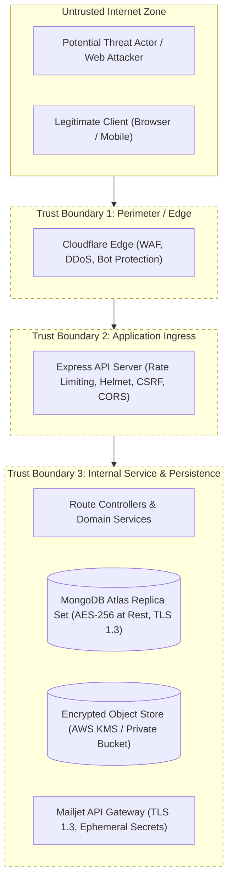

# Ashivam Technologies — System Threat Model (STRIDE Methodology)

> **Document Version:** 1.0.0  
> **Classification:** Confidential — Security Engineering  
> **Standard:** Microsoft STRIDE / OWASP ASVS 5.0  
> **Review Cycle:** Annual or Upon Major Architectural Release  
> **Lead Security Architect:** Application Security Engineer, DevSecOps Lead  

---

## 1. Executive Summary

This Threat Model provides a comprehensive security assessment of the Ashivam Technologies application ecosystem (Corporate Website, Internship Management, and HRMS). It applies the **STRIDE** methodology (Spoofing, Tampering, Repudiation, Information Disclosure, Denial of Service, and Elevation of Privilege) to identify potential attack vectors, evaluate their likelihood and impact, and verify that appropriate defensive controls are active in production.

---

## 2. System Decomposition & Trust Boundaries

### Trust Boundary Definitions
1. **Perimeter Boundary (TB-1):** Separates untrusted public internet clients from Cloudflare Edge and Vercel CDN nodes.
2. **Application Gateway Boundary (TB-2):** Separates external HTTP traffic from backend Express API runtime and middlewares.
3. **Data Persistence Boundary (TB-3):** Separates backend execution memory from database clusters, encrypted S3 object stores, and third-party SMTP gateways.

---

## 3. STRIDE Threat Analysis Matrix

| Threat Category | Threat Description | Affected Component | Severity | Existing Mitigation in Codebase | Residual Risk |
| :--- | :--- | :--- | :--- | :--- | :--- |
| **Spoofing (Identity)** | Attacker steals or forges JWT access tokens to impersonate employees or administrators. | `/api/v1/auth/*`, Protected Routes | **High** | • 15-minute token TTL in memory only. • HMAC-SHA256 signature verification. • Refresh token rotation with family replay revocation. • MFA for privileged roles. | Very Low |
| **Tampering (Data)** | Attacker intercepts or modifies lead submission data or tampering with uploaded resume files. | `/api/v1/inquiries`, `/api/v1/careers/apply` | **Medium** | • Strict TLS 1.3 with HSTS (`max-age=31536000`). • File magic-byte inspection (rejecting disguised binaries). • Mongoose schema strict typing and Joi/Zod sanitization. | Low |
| **Repudiation** | Malicious admin alters employee salary or deletes records and denies the action. | `/api/v1/employees/*`, `/api/v1/employee-documents/*` | **High** | • Immutable, append-only `AuditLog` collection. • Captures user ID, IP address, user agent, and timestamp. • Mongoose soft delete prevents destructive deletion. | Very Low |
| **Information Disclosure** | Unauthorized actor extracts confidential employee KYC documents (Aadhaar, PAN) or PII via API enumeration. | `/api/v1/employee-documents/:id/preview`, `/api/v1/employees` | **Critical** | • Granular RBAC (`requireRole(['HR_MANAGER', 'SUPERADMIN'])`). • Time-limited pre-signed S3 URLs (120s expiry). • Aadhaar display masking (`XXXX-XXXX-1234`). | Negligible |
| **Denial of Service** | Botnet floods `/api/v1/inquiries` or `/refresh-token` to exhaust server CPU, memory, or email quotas. | All Ingress Endpoints | **High** | • Cloudflare Edge DDoS mitigation. • `express-rate-limit` per-IP and per-email windows. • Async Outbox prevents SMTP exhaustion. • W3C Web Locks serialize browser refresh bursts. | Low |
| **Elevation of Privilege** | Low-privilege intern or employee modifies request payload to gain `SUPERADMIN` access (Mass Assignment). | `/api/v1/users/:id`, `/api/v1/employees/:id` | **Critical** | • Explicit field whitelisting in controllers (ignoring unauthorized `role` or `permissions` fields). • Token claims re-verified against DB status. | Negligible |

---

## 4. Deep-Dive Threat Scenarios & Mitigations

### 4.1 Threat Scenario 1: Refresh Token Theft & Multi-Tab Race Condition
- **Attack Scenario:** An attacker obtains an intercepted refresh token from network logs or browser caching. Simultaneously, the legitimate user uses multiple tabs.
- **Defensive Mechanism:**
  1. Frontend uses W3C Web Locks (`navigator.locks.request('ashivam_auth_refresh_lock')`) ensuring only one tab refreshes at any moment.
  2. Backend maintains a **Token Family**. If the attacker attempts to replay a consumed refresh token, the server immediately marks the family as compromised and invalidates all user tokens.
  3. Cookies are locked with `HttpOnly`, `SameSite=Strict`, `Secure`, and scoped strictly to `/api/v1/auth`.

### 4.2 Threat Scenario 2: Malicious Executable Upload via Careers Portal
- **Attack Scenario:** An adversary uploads a Windows `.exe` or Linux ELF binary renamed as `resume.pdf` to execute server-side code or infect HR reviewer workstations.
- **Defensive Mechanism:**
  1. Multer processes the upload in memory buffer (no local disk writes).
  2. Magic-byte inspection reads file header (`%PDF-` for PDF, `PK\x03\x04` for DOCX). Mismatched files are rejected with `400 Bad Request`.
  3. Upload is transferred to private S3 with `Content-Disposition: attachment` (preventing in-browser execution) and scanned against malicious hashes.

### 4.3 Threat Scenario 3: Bypassing Role-Based Access to KYC Document Vault
- **Attack Scenario:** An authenticated intern alters the URL parameter `GET /api/v1/employee-documents/66d8...` to inspect an executive's PAN card (Insecure Direct Object Reference - IDOR).
- **Defensive Mechanism:**
  1. Route middleware strictly checks `req.user.role`.
  2. If role is not `HR_MANAGER` or `SUPERADMIN`, the service queries the document ownership: `document.employeeId.toString() === req.user.employeeId.toString()`.
  3. Unmatched requests immediately abort with `403 Forbidden` and record an unauthorized access attempt in `AuditLog`.

---

## 5. Vulnerability Management & Incident SLA

| Vulnerability Severity (CVSS v3.1) | Acknowledgment SLA | Remediation & Patch SLA |
| :--- | :--- | :--- |
| **Critical (9.0 - 10.0)** | $\le 1\text{ hour}$ | $\le 24\text{ hours}$ hotfix deployment |
| **High (7.0 - 8.9)** | $\le 4\text{ hours}$ | $\le 72\text{ hours}$ deployment |
| **Medium (4.0 - 6.9)** | $\le 24\text{ hours}$ | Next scheduled sprint release ($\le 14\text{ days}$) |
| **Low (0.1 - 3.9)** | $\le 48\text{ hours}$ | Routine backlog review |
