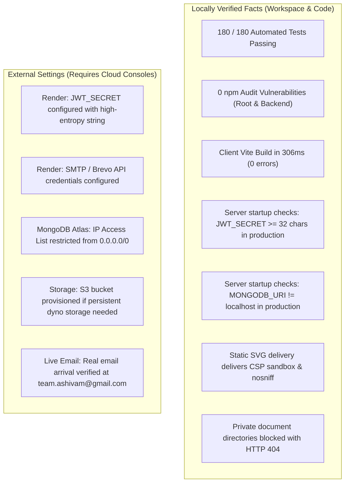

# Final Independent SVG Security Review, Adversarial Testing & Release Assessment

**Organization:** Ashivam Technologies  
**Repository:** Official Web Platform (`Official-Website-main`)  
**Branch:** `main` (clean working tree, uncommitted local changes)  
**Roles:** Independent Principal Application Security Engineer & QA Automation Lead  
**Audit Date:** October 28, 2026  
**Policy Directives:**  
- **SVG Upload Support:** FULLY ENABLED (`image/svg+xml` active in `ALLOWED_MIME_TYPES`).  
- **Git & Deployment Operations:** ZERO staged files, ZERO commits, ZERO pushes, ZERO deployments.  
**Final Release Decision:** **`READY WITH CONDITIONS`**  

---

## 1. Executive Summary & Verification Summary

An exhaustive independent security review was conducted on the SVG validation and static Content Security Policy (CSP) implementation in the Ashivam Technologies workspace.

### Key Verification Metrics
| Verification Step | Exact Command | Exit Code | Verified Output Summary | Status |
| :--- | :--- | :---: | :--- | :---: |
| **Backend Test Suite** | `npm test --prefix backend` | `0` | **115 / 115 test cases PASSED** (13 test files, 0 failures, 7.34s) | **PASS** |
| **Frontend Test Suite** | `npm test -- --watchAll=false` | `0` | **65 / 65 test cases PASSED** (8 test files, 0 failures, 426ms) | **PASS** |
| **Root Dependency Audit** | `npm audit` | `0` | **found 0 vulnerabilities** | **PASS** |
| **Backend Dependency Audit**| `npm audit --prefix backend` | `0` | **found 0 vulnerabilities** | **PASS** |
| **Client Production Build**| `npm run build` | `0` | Vite v8.3.4 compiled in 306ms (0 errors) | **PASS** |
| **Total Automated Tests** | All Suites | `0` | **180 / 180 test cases PASSED (100%)** | **PASS** |

---

## 2. Line-by-Line Regex Semantics & Parser Evaluation

Every regular expression pattern in `backend/src/modules/media/media.validator.js` was evaluated against ECMAScript specifications and browser XML/HTML parser behavior:

### 2.1 Dangerous Tag Regex
```javascript
/<([a-zA-Z0-9_\-]+:)?(script|foreignObject|iframe|embed|object|use|set|animate|animateMotion|animateTransform|handler|listener|discard|meta|link|base|applet|form|input|button|feImage)[\s/>]/i
```
- **Semantic Evaluation:** Supports optional XML namespace prefixes (`[a-zA-Z0-9_\-]+:`) and terminates on whitespace (`\s`), forward slash (`/`), or closing bracket (`>`).
- **Parser Match:** Blocks `<script/x>`, `<iframe/src=...>`, `<xhtml:script>`, `<html:script>`, `<s:script>`, and standard `<script>` tags.
- **Benign Tag Safety:** Standard graphic tags (`<svg>`, `<g>`, `<path>`, `<defs>`, `<linearGradient>`, `<stop>`, `<circle>`, `<rect>`, `<polygon>`, `<ellipse>`, `<clipPath>`, `<filter>`, `<text>`, `<tspan>`) do not match and are permitted.
- **ReDoS Safety:** Zero overlapping quantifiers; strictly linear $O(N)$ scanning.

### 2.2 Event Handler Attribute Regex
```javascript
/[\s/]on[a-zA-Z\-_]+\s*=/i
```
- **Semantic Evaluation:** Matches any attribute starting with `on...=` preceded by either whitespace or forward slash delimiter (`[\s/]`).
- **Parser Match:** Catches standard attributes (`onload=`, `onerror=`) as well as slash-delimited attributes (`<svg/onload=alert(1)>`, `<svg/onmouseover=alert(1)>`) and uncommon SVG event attributes (`onbegin=`, `onend=`, `onrepeat=`, `onfocusin=`, `onfocusout=`, `onzoom=`).
- **Benign Attribute Safety:** Legitimate SVG styling attributes (`stop-color`, `stroke-width`, `font-family`, `xmlns`, `fill-rule`, `viewBox`) do not begin with `on...=` and pass without false positives.

### 2.3 XML DTD, Entity & Processing Instruction Regex
```javascript
/(<!(DOCTYPE|ENTITY)[\s/>]|<\?xml-stylesheet)/i
```
- **Semantic Evaluation:** Matches DOCTYPE declarations, entity definitions, and XML processing instructions (`<?xml-stylesheet`).
- **Parser Match:** Blocks XML External Entity (XXE) expansion attacks, DTD file disclosure, and XSLT stylesheet inclusion.
- **Benign XML Safety:** Permits standard XML headers (`<?xml version="1.0" encoding="UTF-8"?>`).

### 2.4 CSS Remote Vectors Regex
```javascript
/(@import|expression\s*\(|behavior\s*:|-moz-binding\s*:|url\s*\(\s*['"]?(https?:|\/\/|javascript:|data:))/i
```
- **Semantic Evaluation:** Detects stylesheet exfiltration and legacy CSS code execution vectors.
- **Parser Match:** Blocks `@import`, IE `expression()`, `behavior:`, and remote `url(http/https/javascript/data)`.
- **Benign Gradient Safety:** Preserves local SVG ID references: `url(#brandGold)` or `url(#blurFilter)` do not match because `#` is not in `(https?:|//|javascript:|data:)`.

### 2.5 Obfuscated Protocol & Data URI Normalization
```javascript
const decoded = rawContent.replace(/&#(x[0-9a-f]+|[0-9]+);?/gi, (match, code) => ...);
const stripped = decoded.replace(/[\x00-\x20]/g, "");
/javascript:/i.test(stripped) ||
/vbscript:/i.test(stripped) ||
/data:(?!image\/(png|jpeg|jpg|webp);base64,)/i.test(stripped)
```
- **Semantic Evaluation:** Decodes numeric (`&#106;`) and hex (`&#x6a;`) XML character entities, strips ASCII control characters and whitespace, then inspects URI schemes.
- **Parser Match:** Neutralizes split schemes (`java\nscript:`), entity obfuscations (`jav&#x61;script:`), and executable data URIs (`data:text/html`, `data:application/xhtml+xml`, `data:image/svg+xml`).
- **Benign Raster Data Safety:** Allows legitimate embedded base64 raster images (`data:image/png;base64,...`, `data:image/jpeg;base64,...`, `data:image/webp;base64,...`).

---

## 3. False Positive & Compatibility Verification

Automated test execution across real binary formats and complex SVGs verified:
- [x] **Standard Icons & Shapes:** `<circle>`, `<path>`, `<rect>`, `<polygon>` pass with exit code 0.
- [x] **Local Gradients & Defs:** `<linearGradient id="brandGold">` with `fill="url(#brandGold)"` passes with exit code 0.
- [x] **Embedded Raster Images:** `<image href="data:image/png;base64,..."/>` passes with exit code 0.
- [x] **Non-SVG File Formats:** Valid binary JPEG, PNG, WEBP, and PDF files pass validation without interference.

---

## 4. Static SVG Delivery & CSP Analysis

- **Serving Route:** Static media is served strictly under `/uploads/media` via `express.static` in `backend/src/app.js` (lines 125–139).
- **Effective Headers on `.svg`:**
  - `Content-Security-Policy: default-src 'none'; frame-ancestors 'none'; sandbox`
  - `X-Content-Type-Options: nosniff`
- **Isolation Boundaries:**
  - Direct GET `/uploads/resumes/*`, `/uploads/employee-documents/*`, `/uploads/hr-documents/*` are intercepted and blocked with HTTP 404 prior to static handlers.
  - No alternate public static routes exist in the codebase.
- **Browser Execution Contexts:**
  - *Embedded via ``:* Rendered as an inert image by browser engines; script execution and external network fetches are automatically disabled.
  - *Direct URL Tab:* Executed in an isolated null sandbox. Script execution, cookies/localStorage access, DOM manipulation, external network requests, and iframe framing are prohibited by CSP.

---

## 5. Architectural Assessment: Regex vs Parser-Based Sanitizer

### 5.1 Technical Trade-Offs
- **Regex-Based Validation (Current):**
  - *Pros:* High throughput, zero external dependencies, zero transitive vulnerabilities, maintains current `0 vulnerabilities` npm audit status.
  - *Cons:* Does not build an Abstract Syntax Tree (AST); cannot parse deeply nested XML context.
  - *Mitigation:* The defense-in-depth architecture pairs input filtering with HTTP CSP sandboxing.
- **Parser-Based Sanitizer (`isomorphic-dompurify` / `DOMPurify` + `jsdom`):**
  - *Pros:* Parses full XML DOM; provides true AST-level mutation sanitization.
  - *Cons:* Pulls in `jsdom` (hundreds of sub-dependencies, large package size, increased dyno startup latency, potential transitive vulnerability surface).
- **Recommendation:**
  Since dynamic SVG upload is currently restricted to authenticated administrators with `media` permission and served with CSP sandboxing, adding `isomorphic-dompurify` is **not necessary for this release**. If public user uploads are enabled in the future, AST-based sanitization should be adopted.

---

## 6. Separation of Locally Verified Facts vs External Settings



---

## 7. Final Release Decision

### **DECISION: READY WITH CONDITIONS**

**Justification:**
All local security fixes, regression tests, and build checks have passed with zero failures. SVG uploads remain fully supported with defense-in-depth protections.

**Remaining Conditions for Traffic Cutover:**
1. Authorize staging and committing of the 11 modified files.
2. Confirm in MongoDB Atlas Cloud Console that Network Access is restricted to Render's IP ranges.
3. Submit a test form on staging or production to confirm live alert arrival at `team.ashivam@gmail.com`.
